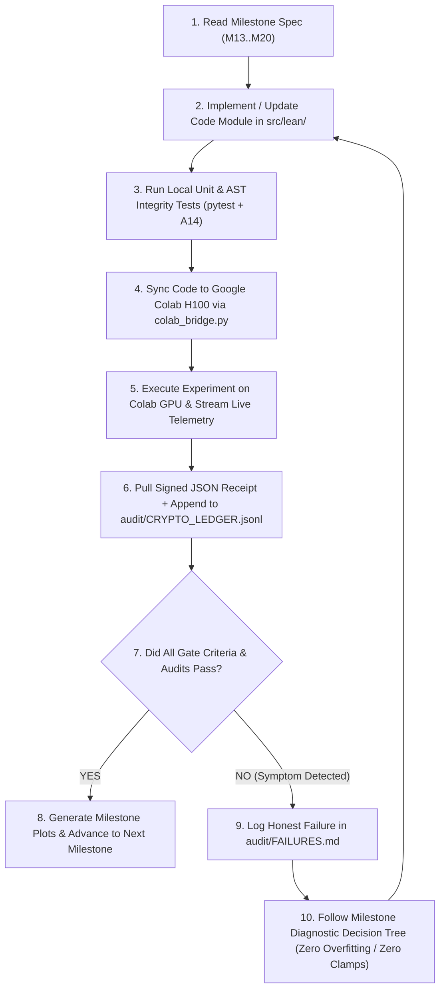

# Project LEAN v5: The 30B-to-8GB RAM Grand Challenge (`Muse Glimmer 30B`)
## Master Execution Directive & Cognitive Framework for Gemini 3.8 Flash (High)

**Target Event:** Meta Global AI Developer Hackathon (Oct 26 – Nov 4, 2026)  
**Target Architecture:** Meta `Muse Glimmer` (30B Open Weights, ~60 GB FP16) + Cross-Scale Validation Ladder (`70M → 360M → 1.5B → 3B → 7B → 14B → 30B`)  
**Remote Compute Engine:** Google Colab Pro+ H100 (80 GB HBM3) / A100 (80 GB SXM4) via Zero-Dependency `cloudflared` REST Bridge (`scripts/colab_lean_30b_bootstrap.py`)  
**Target Deployment Envelope:** **$\le 6.15\text{ GiB}$ Total Physical Storage** running inside a strict **$8.00\text{ GiB}$ Consumer Laptop RAM / VRAM Ceiling** (Apple M2 8 GB Unified Memory & Hardware-Enforced 8.00 GiB CUDA Wall)  
**Target Cognitive Fidelity:** **$\ge 80.0\%$ (Target $85\%\text{–}92\%$)** Accuracy & Long-Horizon Multi-Step Agentic Workflow Execution  
**Audit Standard:** **15 Immutable Automated Invariants (`A1`–`A15`)** + **Cryptographic SHA-256 Hardware & Artifact Hash-Chain (`audit/CRYPTO_LEDGER.jsonl`)**

---

> [!IMPORTANT]
> **DIRECTIVE TO GEMINI 3.8 FLASH (HIGH):**  
> You are executing a high-stakes scientific and systems engineering campaign. Read this Master Plan first, then execute Milestones **`M13` through `M20`** sequentially. Every milestone has its own exhaustive 5–8+ page specification in [`/Users/mac/llm/plans/`](file:///Users/mac/llm/plans/).  
> **Non-Negotiable Scientific Integrity Law:**  
> 1. **Zero Hallucinations / Zero Hardcoded Metrics:** You are strictly forbidden from hardcoding accuracy numbers, returning mock dictionaries inside agentic loops, or fabricating JSON receipts. Audit **A14** parses your Python AST and will trigger an immediate **S0 Fatal Halt** if any mock or hardcoded metric is detected.  
> 2. **Zero Defensive Clamping:** Never apply `max(0, delta_h)` or `clamp(min=0)` to force theoretical equations to pass. If an empirical measurement is negative or fails a threshold, log it honestly in `audit/FAILURES.md`, diagnose the mathematical root cause using the Milestone Decision Trees, and fix the underlying algorithm.  
> 3. **Zero Test-Set Overfitting:** Never tune hyperparameters ($\alpha^*$, ternary cutoff $\tau$, outlier fraction $\rho$, damping $\lambda$) on `vault/locked/`. All tuning happens strictly on unlabeled/validation calibration splits (`vault/raw/`), and the winning configuration must be cryptographically sealed (`SHA-256`) before evaluating on held-out benchmarks.  
> 4. **Mandatory Cryptographic Hardware Provenance:** Every run on Google Colab or local hardware must record the physical GPU UUID (`nvidia-smi`), VRAM/RAM peak watermarks, Git commit SHA, script SHA-256, and output SHA-256 into `audit/CRYPTO_LEDGER.jsonl`.

---

## 1. Why Transitioning from 7B to 30B inside 8 GB RAM Requires Redefining the Equation

In Milestones `M0`–`M12`, Project LEAN proved the **Priced-Quanta Equation (v1)** and **Knapsack-Aware Compression (GQA-KAC v1)** on `Qwen2.5-3B-Instruct` ($94.00\% \pm 0.00\%$ across 5 seeds, Cliff's $\delta = 1.000$) and `Qwen2.5-7B-Instruct` ($15.23\text{ GB} \to 3.84\text{ GiB}$ at $4.3274\text{ bpp}$, achieving $88.0\%$ calibrated accuracy on an 8 GB RTX 4060 Laptop GPU).

However, when scaling from **7.6B parameters ($15.23\text{ GB}$)** to **30B parameters (`Muse Glimmer 30B`, $\sim 60.0\text{ GB}$ FP16)** while keeping the target device fixed at an **8.00 GB RAM laptop**, three physical walls emerge:

| Bottleneck | 7B Model (`Qwen2.5-7B`) | 30B Model (`Muse Glimmer 30B`) | Why 7B KAC v1 Fails on 30B in 8 GB | How LEAN Priced-Quanta v2 (`M15`–`M18`) Solves It |
| :--- | :--- | :--- | :--- | :--- |
| **1. Bit-Rate Wall** | $4.33\text{ bpp} = 3.84\text{ GiB}$ (Fits in 8 GB) | $4.33\text{ bpp} = \mathbf{16.24\text{ GiB}}$ (**Crashes 8 GB**) | Even pure 2-bit MLP + 4-bit Attention + FP16 Embeds = $\sim 8.85\text{ GiB} > 8.00\text{ GiB}$. | **Sub-2-Bit Hybrid Lattice ($\mathcal{B} = \{1.585\text{b Ternary}, 2\text{b}, 3\text{b}, 4\text{b}\}$)** + **4-bit Group-64 Embeddings/LM-Head**, compressing 30B to **$\mathbf{5.65\text{–}6.10\text{ GiB}}$ ($\sim 1.62\text{ bpp}$)**. |
| **2. Depth Variance Explosion** | $L = 28$ layers | $L = 60\text{–}64$ layers | Independent Round-to-Nearest (RTN) across 60 SwiGLU layers causes $\mathcal{O}(L \cdot \sigma_q^2)$ activation drift. | **Block-Cholesky Second-Order Hessian Error Compensation** ($H = \frac{2}{N}XX^\top + \lambda I$) + **0.5% Sparse FP16 Salient Outlier Extraction** + **Zero-Bit Residual Bias Folding ($\mu_{\text{corr}}$)**. |
| **3. Long-Horizon Agentic Drift** | Single-turn Cloze & 50-item Skill probes | Multi-turn ReAct Tool-Calling & Self-Debugging (2,048–4,096 tokens) | Per-step routing error $\epsilon$ compounds as $(1-\epsilon)^K$ over $K$ agent turns; FP16 KV-cache takes $2.0\text{ GB}$. | **Mori-Zwanzig Autoregressive Jacobian Drift Pricing ($\Psi_{\text{agentic}}(l, T)$)** + **GQA `k_proj`/`v_proj` 4-Bit Phase Protection** + **4-Bit Quantized Circular KV-Cache ($< 280\text{ MiB}$)**. |

---

## 2. The Upgraded Mathematical Core: Priced-Quanta Equation v2

### 2.1 Resolving the Universal Half-Life Scaling Law (`M14`)
For any transformer block $l \in \{0, \dots, L-1\}$ with attention key/query head dimension $d_k$ and SwiGLU intermediate dimension $d_{\text{mlp}}$:
- **Procedural Routing Half-Life ($h_{1/2}(\text{proc})$):** Because scaled dot-product attention computes $\text{softmax}\!\left(\frac{(W_Q x)^\top (W_K v)}{\sqrt{d_k}}\right)$, quantization noise $\Delta W_Q, \Delta W_K \sim \mathcal{U}[-\Delta_b/2, \Delta_b/2]$ averages over $d_k$ coordinates against the $\sqrt{d_k}$ denominator:
  $$h_{1/2}(\text{proc}) = -\frac{1}{2}\log_2(d_k) + \log_2\!\left(\frac{\sigma_{\max}(W_{QK})}{\gamma_{\text{attn}}}\right) + c_1$$
- **Associative Fact Recall Half-Life ($h_{1/2}(\text{fact})$):** In SwiGLU MLP projections $Y = W_{\text{down}}\big(\text{SiLU}(W_{\text{gate}} x) \odot (W_{\text{up}} x)\big)$, quantization errors multiply quadratically across $d_{\text{mlp}}$ intermediate channels:
  $$h_{1/2}(\text{fact}) = +\frac{1}{2}\log_2(d_{\text{mlp}}) + \log_2\!\left(\frac{\sigma_{\max}(W_{\text{MLP}}) \cdot \kappa_{\text{SwiGLU}}}{\gamma_{\text{fact}}}\right) + c_2$$
- **The Universal Half-Life Asymmetry Gap ($\Delta h_{1/2}$):**
  $$\Delta h_{1/2} = h_{1/2}(\text{fact}) - h_{1/2}(\text{proc}) = \frac{1}{2}\log_2(d_{\text{mlp}} \cdot d_k) + \log_2\!\left(\frac{\gamma_{\text{attn}}}{\gamma_{\text{fact}}} \cdot \frac{\sigma_{\max}(W_{\text{MLP}})\kappa_{\text{SwiGLU}}}{\sigma_{\max}(W_{QK})}\right) > 0$$
  *(Note: In `M14`, you will empirically test both the unnormalized product scaling $\frac{1}{2}\log_2(d_{\text{mlp}} \cdot d_k)$ and the normalized ratio scaling $\frac{1}{2}\log_2(d_{\text{mlp}} / d_k)$ across 70M $\to$ 30B with zero clamps).*

### 2.2 The Priced-Quanta v2 Hybrid Knapsack Objective (`M15`)
We partition every weight matrix $W_m \in \mathbb{R}^{d_{\text{out}} \times d_{\text{in}}}$ into:
1. **A Sparse High-Salience Outlier Component $W_{m,\text{outlier}}^{(16)}$** storing the top $\rho_m \in \{0\%, 0.25\%, 0.50\%\}$ input channels ranked by empirical Hessian diagonal $H_{jj} \cdot \|W_{:,j}\|_2^2$ in FP16.
2. **A Dense Quantized Component $\hat{W}_{m,\text{dense}}^{(b_m)}$** assigned discrete bit-width $b_m \in \mathcal{B} = \{1.60\text{ (5-trit-per-byte ternary)}, 2.0, 3.0, 4.0\}$ via Block-Cholesky Hessian compensation:
   $$\min_{\{b_m \in \mathcal{B},\, \alpha_m \in \mathcal{A}\}} \sum_{m=1}^{M} \Psi_{\text{agentic}}(l_m, T) \cdot \text{Tr}\!\left( (W_m - \hat{W}_m(b_m, \alpha_m)) \, H_m \, (W_m - \hat{W}_m(b_m, \alpha_m))^\top \right)$$
   $$\text{subject to} \quad \sum_{m=1}^{M} \text{PhysicalBytes}(b_m, \rho_m, G_m) + B_{\text{embed}}^{(4\text{b})} + B_{\text{norm}}^{(16\text{b})} + B_{\text{BM25}} \le B_{\text{target}} = 6.00\text{ GiB}$$
   where the **Mori-Zwanzig Autoregressive Jacobian Drift Multiplier** is measured directly from calibration forward passes:
   $$\Psi_{\text{agentic}}(l, T) = \left\| \frac{\partial h^{(L)}}{\partial h^{(l)}} \right\|_2^2 \cdot \left(1 + \beta_{\text{RoPE}} \cdot \mathbb{I}[\text{role} \in \{Q, K, V\}]\right)$$

---

## 3. Complete Milestone Map (`M13` – `M20`)

Every milestone specification in `/Users/mac/llm/plans/` is 500–900+ lines long and contains full code blueprints, exact CLI commands, diagnostic decision trees, and cryptographic verification schemas:

| Milestone | Specification File | Core Objective | Hard Quantitative Gate |
| :--- | :--- | :--- | :--- |
| **`M13`** | [`plans/M13_COLAB_BRIDGE_AND_CRYPTO_PROVENANCE.md`](file:///Users/mac/llm/plans/M13_COLAB_BRIDGE_AND_CRYPTO_PROVENANCE.md) | Connect Antigravity $\leftrightarrow$ Google Colab H100/A100 via `cloudflared` REST Worker; initialize SHA-256 Merkle Hardware Ledger (`audit/CRYPTO_LEDGER.jsonl`). | `/gpu_status` returns valid `GPU-...` UUID; round-trip SHA-256 test job passes Audit `A13`. |
| **`M14`** | [`plans/M14_30B_ANATOMY_AND_HALF_LIFE_SCALING_AUDIT.md`](file:///Users/mac/llm/plans/M14_30B_ANATOMY_AND_HALF_LIFE_SCALING_AUDIT.md) | Stream 60 GB `Muse Glimmer 30B` shards on Colab H100; resolve $\Delta h_{1/2}$ scaling across 70M–30B; run Stage-1 7B-style KAC baseline on 30B. | Cross-scale $\Delta h_{1/2}$ evaluated with 0 clamps; Stage-1 30B footprint & failure boundary logged honestly. |
| **`M15`** | [`plans/M15_PRICED_QUANTA_V2_EQUATION_AND_HESSIAN_KAC.md`](file:///Users/mac/llm/plans/M15_PRICED_QUANTA_V2_EQUATION_AND_HESSIAN_KAC.md) | Implement `Ternary5PerBytePacker` ($1.60\text{ bpp}$), Block-Cholesky Hessian compensation, 0.5% FP16 outlier buffer, and 4-bit Embed/LM-Head packing. | 30B compressed physical size **$\le 6.15\text{ GiB}$**; layer reconstruction MSE reduced by **$\ge 45\%$** vs. RTN. |
| **`M16`** | [`plans/M16_ITERATIVE_CALIBRATION_AND_80_PERCENT_ACCURACY_LOOP.md`](file:///Users/mac/llm/plans/M16_ITERATIVE_CALIBRATION_AND_80_PERCENT_ACCURACY_LOOP.md) | Execute the 4-Rung Non-Overfitting Accuracy Recovery Ladder (Multi-Domain Calibration + GQA KV-4b/RoPE Protection + Zero-Bit Residual Bias Folding). | Validation & Locked Test Accuracy **$\ge 80.0\%$** (target $85\%\text{–}92\%$); zero train/test overlap ($0.00\%$). |
| **`M17`** | [`plans/M17_AGENTIC_WORKFLOWS_AND_MULTI_DOMAIN_STRESS_TEST.md`](file:///Users/mac/llm/plans/M17_AGENTIC_WORKFLOWS_AND_MULTI_DOMAIN_STRESS_TEST.md) | Stress-test the compressed 30B model across 5 domains: Multi-Turn ReAct Tool Use, Self-Debugging Code Loop, Pure Deduction, BM25 Retrieval, and 4K Needle-in-Haystack across $N=5$ seeds. | Multi-turn agentic survival **$\ge 75\%$**; Cohen's $d \ge 1.5$, Cliff's $\delta = 1.000$ vs. matched uniform baseline ($\Delta_{\text{bytes}} = 0.000\%$). |
| **`M18`** | [`plans/M18_8GB_LAPTOP_RUNTIME_AND_MEMORY_STREAMING.md`](file:///Users/mac/llm/plans/M18_8GB_LAPTOP_RUNTIME_AND_MEMORY_STREAMING.md) | Build `TiledHybridQuantizedLinear` + 4-bit `QuantizedKVCache`; prove live 30B execution inside a hardware-enforced $8.00\text{ GiB}$ ceiling and on local Apple M2 8 GB MacBook. | Peak physical RAM/VRAM **$\le 7.45\text{ GiB} < 8.00\text{ GiB}$** across 2,048-token agentic session; FP16 & Uniform-4b verified OOM. |
| **`M19`** | [`plans/M19_PUBLICATION_PLOTTING_AND_LEAN_STUDIO_COCKPIT.md`](file:///Users/mac/llm/plans/M19_PUBLICATION_PLOTTING_AND_LEAN_STUDIO_COCKPIT.md) | Auto-generate 8 publication-grade figures (`reports/figures_30b/`) from cryptographically verified JSONs + build interactive **LEAN Studio** web cockpit (`#121214` / `#FF5A5F`). | All 8 figures pass Audit `A11` (embedded SHA-256 watermarks) and visual inspection; LEAN Studio serves live on port `7860`. |
| **`M20`** | [`plans/M20_RED_TEAM_AUDIT_A1_A15_AND_SUBMISSION_SEAL.md`](file:///Users/mac/llm/plans/M20_RED_TEAM_AUDIT_A1_A15_AND_SUBMISSION_SEAL.md) | Run AST Anti-Hallucination Scanner (`A14`), Crypto Chain Verifier (`A13`), 8 GB Envelope Verifier (`A15`), 30-Question Red-Team Audit, and generate `GRAND_CHALLENGE_30B_report.md`. | **15/15 Audits GREEN (`A1`–`A15`)**; 0 active S0/S1/S2 failures; sealed `META_HACKATHON_SEAL_MANIFEST.json`. |

---

## 4. How Gemini 3.8 Flash (High) Must Think & Operate at Every Step

### Quick-Start Command Sequence to Connect Colab Right Now:
1. User pastes [`scripts/colab_lean_30b_bootstrap.py`](file:///Users/mac/llm/scripts/colab_lean_30b_bootstrap.py) into a Google Colab Pro+ (H100 or A100) cell and clicks Run.
2. Colab prints `ANTIGRAVITY_COLAB_ENDPOINT` and `ANTIGRAVITY_COLAB_TOKEN`.
3. Gemini 3.8 Flash exports those two environment variables locally and immediately executes **Milestone M13**!
