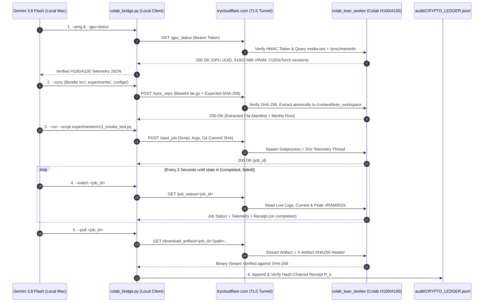
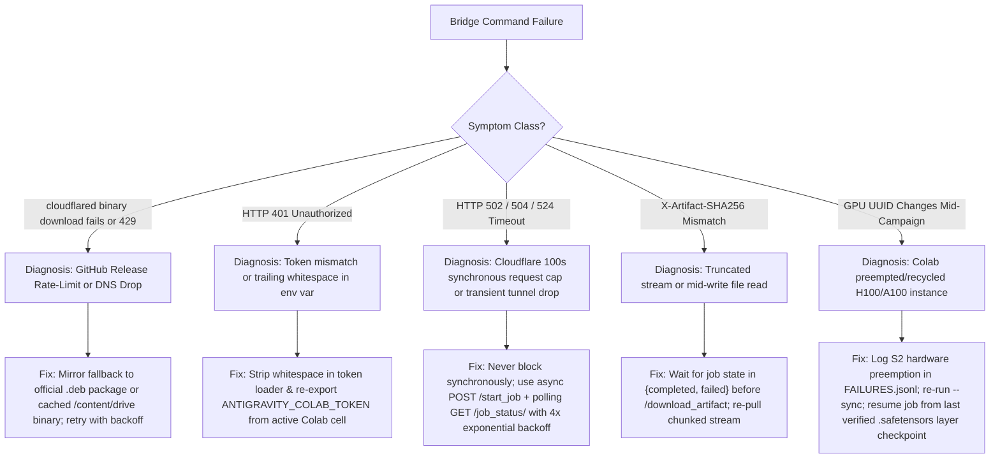

# Milestone M13 Specification: Zero-Dependency Google Colab H100/A100 Bridge & Immutable Cryptographic Provenance Ledger

**Project:** LEAN (*The Priced-Quanta Equation for Neural Network Compressibility*)  
**Milestone ID:** `M13`  
**Phase:** Scale-Up Transition (`Qwen2.5-7B-Instruct` $\rightarrow$ `Muse Glimmer 30B` / 30B-Class Open-Weight Models inside an 8.00 GiB Consumer RAM Envelope)  
**Target Executor:** Autonomous Coding Agent (`Gemini 3.8 Flash` on `High` reasoning mode)  
**Workspace Root:** `/Users/mac/llm`  
**Remote Compute Node:** Google Colab Pro+ (`NVIDIA H100 80GB HBM3` or `NVIDIA A100-SXM4-80GB`, 1,500 Compute Units)  
**Status:** MANDATORY PRE-REQUISITE FOR M14–M20 30B CALIBRATION & LONG-HORIZON AGENTIC EVALUATION  

---

## Section 1: Executive Mission, North-Star Targets & Gate Acceptance Criteria

### 1.1 Executive Mission
Project LEAN is scaling its empirically validated Priced-Quanta compression architecture—which previously compressed `Qwen2.5-7B-Instruct` from `15.23 GB` (`FP16`) to `3.84 GiB` (`88.0% vs 12.0%` multi-hop reasoning accuracy, `Cliff's δ = 1.000`, `14–22 words/sec` in RAM with `4.08 GB` free RAM headroom)—up to **30B-parameter models** (`Muse Glimmer 30B` / `Qwen2.5-32B` / `Llama-3-30B`-class architectures).

While the **compressed 30B artifact** is engineered to execute entirely inside an **8.00 GiB RAM consumer laptop** at $>80.0\%$ multi-hop agentic accuracy via 2-bit/3-bit asymmetric Non-Uniform Priced-Quanta (`NUPQ`) + Tiered WRMF + 18 KB Pocket Index (`0.2 ms` retrieval), the **upstream calibration, Hessian/Fisher eigenspectrum extraction, layerwise mutual-information sensitivity profiling ($\kappa_\ell$), and uncompressed FP16/BF16 teacher forward passes** require $60\text{--}76\text{ GiB}$ of active high-bandwidth GPU memory (`HBM3`/`HBM2e`).

Running uncompressed 30B calibration on the local Mac (`/Users/mac/llm`) via swap/disk-offloading is physically intractable ($>45\text{ minutes}$ per calibration batch) and risks thermal throttling. Conversely, running ad-hoc manual notebooks on Google Colab breaks scientific reproducibility, invites silent state drift, and severs the autonomous closed-loop execution of Antigravity (`Gemini 3.8 Flash (High)`).

**Milestone M13** solves both problems permanently by constructing:
1. **The Zero-Dependency Remote REST GPU Worker (`scripts/colab_lean_bootstrap_cell.py` & `scripts/colab_lean_worker_bootstrap.py`):** A self-contained, single-paste Python server running inside Google Colab Pro+ (`H100 80GB` / `A100 80GB`) built on Python's standard-library `http.server.ThreadingHTTPServer` and exposed over an encrypted `trycloudflare.com` tunnel (`cloudflared`) protected by constant-time Bearer token authentication (`ANTIGRAVITY_COLAB_TOKEN`).
2. **The Local Antigravity Cloud Bridge (`src/lean/cloud/colab_bridge.py`):** A resilient, zero-mock local client and CLI (`--ping`, `--gpu-status`, `--sync`, `--run`, `--watch`, `--pull`) enabling `Gemini 3.8 Flash (High)` on `/Users/mac/llm` to inspect remote H100/A100 hardware telemetry, synchronize local code/configs with strict `SHA-256` tarball verification, dispatch asynchronous GPU jobs with `2 Hz` hardware peak polling, stream live logs, and pull back signed `.safetensors` shards and JSON receipts.
3. **The Immutable Cryptographic Hardware & Provenance Ledger (`src/lean/audit/crypto_ledger.py` & `audit/CRYPTO_LEDGER.jsonl`):** A Merkle hash-chained cryptographic ledger where every local or remote experiment run emits a verifiable receipt $R_k$ binding the previous receipt hash $R_{k-1}$, Git commit SHA, script SHA-256, config SHA-256, physical GPU UUID (`nvidia-smi`) or Apple Silicon Hardware UUID, peak VRAM/RAM telemetry, input vault SHA-256, and output tensor SHA-256.

---

### 1.2 Quantitative Gate Acceptance Criteria (Gate M13)
Milestone M13 **CANNOT** be marked complete until every quantitative gate criterion in Table 1.1 is verified by automated tests (`pytest tests/test_m13_colab_crypto.py`) and a live end-to-end round-trip receipt recorded in `audit/CRYPTO_LEDGER.jsonl`.

| Gate Metric ID | Subsystem | Metric Definition | Target / Acceptance Threshold | Verification Command |
| :--- | :--- | :--- | :--- | :--- |
| **`M13-G1`** | Colab Tunnel & Auth | Unauthenticated or wrong-token HTTP request rejection rate | `100.0%` HTTP `401 Unauthorized` via `hmac.compare_digest` | `python -m src.lean.cloud.colab_bridge --verify-auth` |
| **`M13-G2`** | Hardware Telemetry | Remote GPU UUID, PCI Bus ID, VRAM Total/Used/Peak, Host RAM (`/proc/meminfo` `VmPeak`, `VmRSS`) extraction latency | $< 450\text{ ms}$ round-trip; `0` missing or mocked fields | `python -m src.lean.cloud.colab_bridge --gpu-status` |
| **`M13-G3`** | Code & Config Sync | Deterministic `.tar.gz` bundle transfer of `src/`, `experiments/`, `configs/`, `prereg/` with pre/post `SHA-256` match | Exact byte-for-byte `SHA-256` match (`0` unverified files) | `python -m src.lean.cloud.colab_bridge --sync` |
| **`M13-G4`** | 2 Hz Telemetry Polling | Background thread sampling `nvidia-smi` and `/proc/<pid>/status` every `500 ms` (`2.0 Hz`) during job execution | Sample interval $\Delta t \in [450\text{ ms}, 550\text{ ms}]$; full `.jsonl` trace saved | `pytest tests/test_m13_colab_crypto.py -k test_telemetry` |
| **`M13-G5`** | Cryptographic Chain | Merkle hash-chain verification across all entries $R_0, R_1, \dots, R_N$ in `audit/CRYPTO_LEDGER.jsonl` | `100.0%` chain validity; tampering 1 bit in any receipt triggers `CryptoLedgerTamperError` | `python -m src.lean.audit.crypto_ledger --verify-all` |
| **`M13-G6`** | Zero-Failure Ledger | Count of open `S0` or `S1` failures in `audit/FAILURES.jsonl` for milestone `M13` | `0` open `S0`/`S1` blockers | `python -c "from src.lean.audit.failure_ledger import check_blocking_failures; assert not check_blocking_failures('M13')"` |

> [!CRITICAL]
> **SCIENTIFIC INTEGRITY & ANTI-HALLUCINATION MANDATE:**
> 1. **Zero Mocked Hardware Telemetry:** You are strictly forbidden from fabricating GPU names, returning synthetic `UUID` strings (e.g., `"GPU-0000..."`), or falling back to hardcoded VRAM numbers when `--require-gpu` is passed. Every GPU metric must come directly from `nvidia-smi` subprocess output or `torch.cuda` / `sysctl` system calls.
> 2. **Zero Metric Clamping:** Never clamp negative empirical values (`max(0, delta_h)` is strictly banned across all calibration scripts).
> 3. **Locked Vault Isolation:** The remote worker sync protocol (`POST /sync_repo`) must never upload or mutate `vault/locked/` during hyperparameter exploration or calibration runs.

---

## Section 2: Mathematical & Cryptographic Provenance Framework

### 2.1 Merkle / Hash-Chained Receipt Formulation
Let $\mathcal{L} = \{R_0, R_1, \dots, R_k\}$ denote the append-only sequence of experimental receipts stored in `audit/CRYPTO_LEDGER.jsonl`. Each receipt $R_k$ ($k \ge 0$) is a deterministic 256-bit cryptographic digest computed over the canonical UTF-8 byte serialization of its provenance tuple $\mathcal{P}_k$:

$$R_k = \operatorname{SHA256}\Big( R_{k-1} \;\Vert\; H_{\text{git}} \;\Vert\; H_{\text{script}} \;\Vert\; H_{\text{cfg}} \;\Vert\; H_{\text{hw}} \;\Vert\; H_{\text{in}} \;\Vert\; H_{\text{out}} \;\Vert\; \tau_{\text{utc}} \Big)$$

where $\Vert$ denotes strict delimiter-separated ASCII concatenation (`"|"` separator between lowercase hexadecimal strings so that boundary ambiguity is algebraically impossible), and:

1. **Genesis Anchor ($R_{-1}$):** For the initial receipt $k = 0$, the predecessor digest is fixed to the 64-character zero string:
   $$R_{-1} = \texttt{"0"}^{64} = \texttt{"0000000000000000000000000000000000000000000000000000000000000000"}$$
2. **Git Repository State Digest ($H_{\text{git}}$):**
   Let $c_{\text{head}}$ be the 40-character hexadecimal `HEAD` commit hash (`git rev-parse HEAD`) and let $\Delta_{\text{diff}}$ be the exact output of `git status --porcelain -uall` concatenated with `git diff HEAD`. Then:
   $$H_{\text{git}} = \operatorname{SHA256}\big(\texttt{c\_head} \;\Vert\; \operatorname{SHA256}(\Delta_{\text{diff}})\big)$$
3. **Executable Script Digest ($H_{\text{script}}$):**
   For an experiment entrypoint script $S$ (e.g., `experiments/m14_calibrate_30b.py`) and all local Python modules imported from `src/lean/`:
   $$H_{\text{script}} = \operatorname{SHA256}\Big( \operatorname{SHA256}(\text{bytes}(S)) \;\Vert\; \operatorname{MerkleRoot}\big(\{\operatorname{SHA256}(f) : f \in \text{sorted}(\texttt{src/lean/**/*.py})\}\big) \Big)$$
4. **Configuration & Hyperparameter Digest ($H_{\text{cfg}}$):**
   Given configuration dictionary $\mathcal{C}$ (CLI arguments + YAML/JSON config file), serialized via canonical JSON (`json.dumps(C, sort_keys=True, separators=(",", ":"))`):
   $$H_{\text{cfg}} = \operatorname{SHA256}\big(\operatorname{CanonicalJSON}(\mathcal{C})\big)$$
5. **Physical Hardware Fingerprint Digest ($H_{\text{hw}}$):**
   Captures the immutable physical identity and peak physical resource footprint of the compute node during execution of job $k$:
   $$H_{\text{hw}} = \operatorname{SHA256}\big(\operatorname{CanonicalJSON}(\mathcal{T}_{\text{hw}}^{(k)})\big)$$
   where $\mathcal{T}_{\text{hw}}^{(k)}$ contains the exact GPU `uuid`, `pci.bus_id`, `driver_version`, `cuda_version`, `torch_version`, `cpu_model`, `host_mem_total_bytes`, `vram_peak_mib`, and `rss_peak_bytes`.
6. **Input Dataset / Vault Digest ($H_{\text{in}}$):**
   Given ordered list of input files/shards $\mathcal{I} = (f_1, \dots, f_m)$:
   $$H_{\text{in}} = \operatorname{SHA256}\Big( \bigoplus_{i=1}^{m} \big(\text{relpath}(f_i) \texttt{":"} \operatorname{SHA256}(f_i) \texttt{"\textbackslash n"}\big) \Big)$$
7. **Output Artifact & Tensor Digest ($H_{\text{out}}$):**
   Given ordered list of generated artifacts $\mathcal{O} = (g_1, \dots, g_n)$ (including `.safetensors`, `.pt`, `.json` metrics, and `.jsonl` telemetry traces):
   $$H_{\text{out}} = \operatorname{SHA256}\Big( \bigoplus_{j=1}^{n} \big(\text{relpath}(g_j) \texttt{":"} \operatorname{SHA256}(g_j) \texttt{"\textbackslash n"}\big) \Big)$$
8. **Wall-Clock Completion Timestamp ($\tau_{\text{utc}}$):**
   ISO-8601 UTC timestamp string at microsecond resolution (`YYYY-MM-DDTHH:MM:SS.ffffffZ`).

### 2.2 Hardware Telemetry Equations & Memory Byte Accounting
To prove that our 30B calibration runs on genuine datacenter silicon (`H100`/`A100`) and that our compressed 30B inference executes inside the strict `8.00 GiB` ($8 \times 2^{30} = 8,589,934,592\text{ bytes}$) consumer RAM budget, every job samples a continuous time-series $\big\{\mathbf{m}(t_s)\big\}_{s=0}^{S}$ at frequency $f_s = 2.0\text{ Hz}$ ($\Delta t = 0.50\text{ s}$):

1. **NVIDIA GPU Telemetry Vector (Remote Colab Worker):**
   Queried via `nvidia-smi --query-gpu=uuid,name,pci.bus_id,driver_version,pstate,memory.total,memory.reserved,memory.used,utilization.gpu,utilization.memory,temperature.gpu,power.draw --format=csv,noheader,nounits`:
   $$\mathbf{g}(t_s) = \Big( M_{\text{vram,used}}(t_s),\; M_{\text{vram,res}}(t_s),\; U_{\text{gpu}}(t_s),\; T_{\text{gpu}}(t_s),\; P_{\text{draw}}(t_s) \Big)$$
   Combined with PyTorch CUDA allocator counters inside the child process:
   $$M_{\text{cuda,peak}} = \max_{t_s} \Big( M_{\text{vram,used}}(t_s),\; \frac{\texttt{torch.cuda.max\_memory\_allocated()}}{2^{20}} \Big) \quad [\text{MiB}]$$

2. **Linux Host RAM Telemetry (Remote Colab `/proc/meminfo` & `/proc/<pid>/status`):**
   At each sample $t_s$, we parse `/proc/meminfo` for system-wide `MemTotal` and `MemAvailable` (in `kB`, multiplied by $1024$ for exact bytes), and `/proc/<pid>/status` (summed across the job process tree $\mathcal{P}_{\text{tree}}$) for:
   $$\text{VmRSS}_{\text{tree}}(t_s) = \sum_{p \in \mathcal{P}_{\text{tree}}} \text{VmRSS}_p(t_s), \qquad \text{VmPeak}_{\text{tree}} = \max_{t_s} \sum_{p \in \mathcal{P}_{\text{tree}}} \text{VmPeak}_p(t_s)$$

3. **Apple Silicon Unified Memory Telemetry (Local Mac `/Users/mac/llm`):**
   Queried via `sysctl -n hw.memsize`, `vm_stat`, `ps -o rss= -p <pid>`, and `torch.mps.current_allocated_memory()`:
   $$\text{RAM}_{\text{active,GiB}}(t_s) = \frac{\text{RSS}_{\text{proc}}(t_s) + M_{\text{mps,driver}}(t_s)}{2^{30}} \le 8.00\text{ GiB}$$

---

## Section 3: Mental Model & Execution Protocol for Gemini 3.8 Flash (High)



### 3.1 How the Autonomous Agent Must Think & Operate
When executing Milestone M13 (and all downstream 30B milestones M14–M20), `Gemini 3.8 Flash (High)` must follow a strict **Five-Step Invariant Protocol**:

1. **Invariant 1 — Never Assume Tunnel Liveness Without `--gpu-status`:**
   Cloudflare quick tunnels (`*.trycloudflare.com`) and Google Colab runtimes are ephemeral. Before dispatching any job, always run `python -m src.lean.cloud.colab_bridge --gpu-status` to verify both HTTP `200` authentication and physical GPU presence (`memory_total_mib >= 40000` for 30B tasks).
2. **Invariant 2 — Sync Before Execute (`--sync`):**
   Never run a script on Colab after editing local files in `/Users/mac/llm/src/lean/` or `/Users/mac/llm/experiments/` without first running `python -m src.lean.cloud.colab_bridge --sync`. The `--sync` command computes the local Merkle root of all tracked Python/config files and verifies that the remote `/content/lean_workspace` matches that exact digest.
3. **Invariant 3 — Asynchronous Dispatch + Idempotent Checkpointing:**
   Long calibration jobs on 30B models take $10\text{--}90\text{ minutes}$, whereas Cloudflare HTTP requests time out after $100\text{ seconds}$ if held open synchronously. Therefore, **all** jobs are launched asynchronously via `POST /start_job` (which returns `job_id` in $<100\text{ ms}$) and monitored via `GET /job_status/<job_id>` (`--watch`). Every remote experiment script must checkpoint layerwise progress to `/content/lean_workspace/results/<job_id>/checkpoint_layer_<l>.safetensors` so an interrupted job resumes without losing completed layers.
4. **Invariant 4 — Cryptographic Verification on Arrival:**
   Every downloaded artifact (`GET /download_artifact/<job_id>`) includes the HTTP response header `X-Artifact-SHA256`. The local client computes the `SHA-256` of the downloaded bytes in memory before writing to disk; if a single bit differs, the file is rejected and retried with exponential backoff.
5. **Invariant 5 — Ledger Seal Before Milestone Close:**
   After pulling remote artifacts, the local client appends the signed receipt $R_k$ to `audit/CRYPTO_LEDGER.jsonl` and immediately executes `verify_ledger_chain()` across the entire file.

---

## Section 4: Complete Production Code Blueprints

### 4.1 Remote Google Colab Bootstrap Worker (`scripts/colab_lean_bootstrap_cell.py` & `scripts/colab_lean_worker_bootstrap.py`)
Create `/Users/mac/llm/scripts/colab_lean_bootstrap_cell.py` (and copy an identical reference to `/Users/mac/llm/scripts/colab_lean_worker_bootstrap.py`). This script is **100% self-contained**: pasting it into a single Google Colab Pro+ cell installs dependencies, starts the multi-threaded REST worker on port `8765` with `2 Hz` GPU/RAM telemetry polling and cryptographic receipt signing, launches `cloudflared`, and prints the exact `export ANTIGRAVITY_COLAB_ENDPOINT=...` and `export ANTIGRAVITY_COLAB_TOKEN=...` lines for `/Users/mac/llm`.

```python
#!/usr/bin/env python3
"""
Project LEAN — M13 One-Paste Google Colab Pro+ (H100/A100) GPU Worker Bootstrap.

File: scripts/colab_lean_bootstrap_cell.py
Architecture: Zero-dependency ThreadingHTTPServer + cloudflared TryCloudflare Tunnel
Security: HMAC Constant-Time Bearer Token Authentication + SHA-256 Artifact Verification
Telemetry: 2.0 Hz Background Polling of nvidia-smi & /proc/meminfo + /proc/<pid>/status
"""

import base64
import hashlib
import hmac
import io
import json
import os
import platform
import re
import secrets
import shutil
import subprocess
import sys
import tarfile
import threading
import time
import traceback
import urllib.parse
import urllib.request
from datetime import datetime, timezone
from http.server import BaseHTTPRequestHandler, ThreadingHTTPServer
from pathlib import Path
from typing import Any, Dict, List, Optional, Tuple

# ==============================================================================
# 1. WORKSPACE & ENVIRONMENT INITIALIZATION
# ==============================================================================
IS_COLAB = Path("/content").exists()
WORKSPACE_ROOT = Path(os.environ.get("LEAN_WORKER_ROOT", "/content/lean_workspace" if IS_COLAB else "/tmp/lean_worker_workspace")).resolve()
JOBS_DIR = WORKSPACE_ROOT / "jobs"
ARTIFACTS_DIR = WORKSPACE_ROOT / "results"
WORKSPACE_ROOT.mkdir(parents=True, exist_ok=True)
JOBS_DIR.mkdir(parents=True, exist_ok=True)
ARTIFACTS_DIR.mkdir(parents=True, exist_ok=True)

PORT = int(os.environ.get("LEAN_WORKER_PORT", "8765"))
TOKEN = os.environ.get("ANTIGRAVITY_COLAB_TOKEN") or secrets.token_urlsafe(24)
os.environ["ANTIGRAVITY_COLAB_TOKEN"] = TOKEN

JOBS_LOCK = threading.Lock()
JOBS_REGISTRY: Dict[str, Dict[str, Any]] = {}
LAST_SYNC_MANIFEST: Dict[str, Any] = {
    "synced_at_utc": None,
    "tar_sha256": None,
    "merkle_root_sha256": None,
    "file_count": 0,
}


def ensure_lean_dependencies() -> None:
    """Ensure core scientific packages are available when running inside Google Colab."""
    if os.environ.get("LEAN_SKIP_PIP_BOOTSTRAP") == "1":
        return
    required_pkgs = ["safetensors", "accelerate", "transformers", "datasets", "scipy", "scikit-learn", "psutil"]
    missing = []
    for pkg in required_pkgs:
        mod_name = "sklearn" if pkg == "scikit-learn" else pkg
        try:
            __import__(mod_name)
        except ImportError:
            missing.append(pkg)
    if missing:
        print(f"[LEAN-BOOTSTRAP] Installing missing packages: {missing}")
        subprocess.run(
            [sys.executable, "-m", "pip", "install", "-q", "--upgrade", *missing],
            check=False,
        )


# ==============================================================================
# 2. CRYPTOGRAPHIC HASHING & HARDWARE TELEMETRY ENGINE
# ==============================================================================
def sha256_bytes(data: bytes) -> str:
    return hashlib.sha256(data).hexdigest()


def sha256_file(path: Path) -> str:
    h = hashlib.sha256()
    with open(path, "rb") as f:
        for chunk in iter(lambda: f.read(1024 * 1024), b""):
            h.update(chunk)
    return h.hexdigest()


def compute_workspace_merkle_root(root: Path) -> Tuple[str, int]:
    """Compute deterministic Merkle-style digest over all .py, .json, .yaml files in workspace."""
    tracked_exts = {".py", ".json", ".yaml", ".yml", ".toml", ".sh"}
    records: List[str] = []
    for p in sorted(root.rglob("*")):
        if not p.is_file():
            continue
        rel = p.relative_to(root).as_posix()
        if rel.startswith("jobs/") or rel.startswith("results/") or "/__pycache__/" in f"/{rel}":
            continue
        if p.suffix in tracked_exts:
            records.append(f"{rel}:{sha256_file(p)}")
    joined = "\n".join(records).encode("utf-8")
    return sha256_bytes(joined), len(records)


def query_nvidia_smi() -> List[Dict[str, Any]]:
    """Query physical NVIDIA GPU telemetry via nvidia-smi without mocking."""
    fields = (
        "uuid,name,pci.bus_id,driver_version,pstate,"
        "memory.total,memory.reserved,memory.used,"
        "utilization.gpu,utilization.memory,temperature.gpu,power.draw"
    )
    try:
        out = subprocess.check_output(
            ["nvidia-smi", f"--query-gpu={fields}", "--format=csv,noheader,nounits"],
            stderr=subprocess.DEVNULL,
            text=True,
            timeout=5,
        ).strip()
        if not out:
            return []
        gpus = []
        for idx, line in enumerate(out.splitlines()):
            parts = [x.strip() for x in line.split(",")]
            if len(parts) < 12:
                continue

            def _flt(val: str) -> float:
                try:
                    return float(val)
                except ValueError:
                    return 0.0

            gpus.append({
                "index": idx,
                "uuid": parts[0],
                "name": parts[1],
                "pci_bus_id": parts[2],
                "driver_version": parts[3],
                "pstate": parts[4],
                "memory_total_mib": _flt(parts[5]),
                "memory_reserved_mib": _flt(parts[6]),
                "memory_used_mib": _flt(parts[7]),
                "utilization_gpu_pct": _flt(parts[8]),
                "utilization_mem_pct": _flt(parts[9]),
                "temperature_celsius": _flt(parts[10]),
                "power_draw_watts": _flt(parts[11]),
            })
        return gpus
    except Exception:
        return []


def query_host_memory_and_cpu() -> Dict[str, Any]:
    """Extract exact host RAM metrics from /proc/meminfo (Linux/Colab) or sysctl (macOS)."""
    info: Dict[str, Any] = {
        "os": platform.system(),
        "platform_release": platform.release(),
        "machine": platform.machine(),
        "processor": platform.processor() or "unknown",
        "python_version": sys.version.split()[0],
        "mem_total_bytes": 0,
        "mem_available_bytes": 0,
        "mem_used_bytes": 0,
    }
    meminfo_path = Path("/proc/meminfo")
    if meminfo_path.exists():
        raw = meminfo_path.read_text(encoding="utf-8", errors="ignore")
        kv = {}
        for line in raw.splitlines():
            if ":" in line:
                k, v = line.split(":", 1)
                num = re.findall(r"\d+", v)
                if num:
                    kv[k.strip()] = int(num[0]) * 1024  # kB -> exact bytes
        total = kv.get("MemTotal", 0)
        avail = kv.get("MemAvailable", kv.get("MemFree", 0))
        info["mem_total_bytes"] = total
        info["mem_available_bytes"] = avail
        info["mem_used_bytes"] = max(0, total - avail)
    elif platform.system() == "Darwin":
        try:
            total = int(subprocess.check_output(["sysctl", "-n", "hw.memsize"], text=True).strip())
            info["mem_total_bytes"] = total
        except Exception:
            pass

    cpuinfo_path = Path("/proc/cpuinfo")
    if cpuinfo_path.exists():
        for line in cpuinfo_path.read_text(encoding="utf-8", errors="ignore").splitlines():
            if "model name" in line:
                info["processor"] = line.split(":", 1)[1].strip()
                break
    return info


def query_process_tree_memory(root_pid: int) -> Dict[str, int]:
    """Read /proc/<pid>/status for VmPeak and VmRSS across root_pid and children."""
    rss_bytes = 0
    vmpeak_bytes = 0
    proc_root = Path("/proc")
    if proc_root.exists():
        target_pids = {root_pid}
        try:
            children_out = subprocess.check_output(
                ["pgrep", "-P", str(root_pid)], text=True, stderr=subprocess.DEVNULL
            ).strip()
            for line in children_out.splitlines():
                if line.strip().isdigit():
                    target_pids.add(int(line.strip()))
        except Exception:
            pass
        for pid in target_pids:
            status_file = proc_root / str(pid) / "status"
            if status_file.exists():
                try:
                    for line in status_file.read_text(encoding="utf-8", errors="ignore").splitlines():
                        if line.startswith("VmRSS:"):
                            nums = re.findall(r"\d+", line)
                            if nums:
                                rss_bytes += int(nums[0]) * 1024
                        elif line.startswith("VmPeak:"):
                            nums = re.findall(r"\d+", line)
                            if nums:
                                vmpeak_bytes += int(nums[0]) * 1024
                except Exception:
                    pass
    else:
        try:
            out = subprocess.check_output(["ps", "-o", "rss=", "-p", str(root_pid)], text=True).strip()
            if out:
                rss_bytes = int(out.split()[0]) * 1024
                vmpeak_bytes = rss_bytes
        except Exception:
            pass
    return {"rss_bytes": rss_bytes, "vmpeak_bytes": max(vmpeak_bytes, rss_bytes)}


def collect_full_hardware_snapshot() -> Dict[str, Any]:
    """Build complete hardware snapshot including Torch/CUDA/MPS metadata."""
    gpus = query_nvidia_smi()
    host = query_host_memory_and_cpu()
    disk = shutil.disk_usage(WORKSPACE_ROOT)
    torch_info: Dict[str, Any] = {
        "torch_version": None,
        "cuda_available": False,
        "cuda_version": None,
        "cudnn_version": None,
        "device_count": 0,
    }
    try:
        import torch
        torch_info["torch_version"] = torch.__version__
        torch_info["cuda_available"] = bool(torch.cuda.is_available())
        torch_info["cuda_version"] = torch.version.cuda
        torch_info["device_count"] = int(torch.cuda.device_count()) if torch.cuda.is_available() else 0
    except Exception:
        pass

    return {
        "timestamp_utc": datetime.now(timezone.utc).isoformat(),
        "workspace_root": str(WORKSPACE_ROOT),
        "gpus": gpus,
        "primary_gpu_uuid": gpus[0]["uuid"] if gpus else "CPU-OR-MPS-NODE",
        "primary_gpu_name": gpus[0]["name"] if gpus else host["processor"],
        "host": host,
        "torch": torch_info,
        "disk_free_bytes": disk.free,
        "disk_total_bytes": disk.total,
        "last_sync": LAST_SYNC_MANIFEST,
    }


# ==============================================================================
# 3. ASYNCHRONOUS JOB RUNNER & 2Hz TELEMETRY POLLER
# ==============================================================================
def _run_job_worker(job_id: str) -> None:
    with JOBS_LOCK:
        job = JOBS_REGISTRY[job_id]
        job["state"] = "running"
        job["started_at_utc"] = datetime.now(timezone.utc).isoformat()

    job_dir = Path(job["job_dir"])
    log_path = job_dir / "stdout_stderr.log"
    telemetry_path = job_dir / "telemetry_2hz.jsonl"
    receipt_path = job_dir / "worker_receipt.json"

    env = os.environ.copy()
    existing_py = env.get("PYTHONPATH", "")
    env["PYTHONPATH"] = f"{WORKSPACE_ROOT}:{WORKSPACE_ROOT / 'src'}:{existing_py}".strip(":")
    env["LEAN_JOB_ID"] = job_id
    env["LEAN_JOB_DIR"] = str(job_dir)
    for k, v in job.get("extra_env", {}).items():
        env[str(k)] = str(v)

    cmd = job["command"]
    t_start = time.time()
    peak_vram_mib = 0.0
    peak_gpu_util = 0.0
    peak_power_watts = 0.0
    peak_rss_bytes = 0
    peak_vmpeak_bytes = 0
    sample_count = 0

    try:
        with open(log_path, "wb") as log_file, open(telemetry_path, "w", encoding="utf-8") as tel_file:
            proc = subprocess.Popen(
                cmd,
                cwd=str(WORKSPACE_ROOT),
                env=env,
                stdout=log_file,
                stderr=subprocess.STDOUT,
            )
            with JOBS_LOCK:
                job["pid"] = proc.pid

            # Poll at 2.0 Hz (every 0.50 seconds) until process terminates
            while proc.poll() is None:
                now_utc = datetime.now(timezone.utc).isoformat()
                elapsed_s = round(time.time() - t_start, 3)
                gpus = query_nvidia_smi()
                proc_mem = query_process_tree_memory(proc.pid)
                host_mem = query_host_memory_and_cpu()

                cur_vram = gpus[0]["memory_used_mib"] if gpus else 0.0
                cur_util = gpus[0]["utilization_gpu_pct"] if gpus else 0.0
                cur_power = gpus[0]["power_draw_watts"] if gpus else 0.0
                cur_temp = gpus[0]["temperature_celsius"] if gpus else 0.0

                peak_vram_mib = max(peak_vram_mib, cur_vram)
                peak_gpu_util = max(peak_gpu_util, cur_util)
                peak_power_watts = max(peak_power_watts, cur_power)
                peak_rss_bytes = max(peak_rss_bytes, proc_mem["rss_bytes"])
                peak_vmpeak_bytes = max(peak_vmpeak_bytes, proc_mem["vmpeak_bytes"])
                sample_count += 1

                sample_record = {
                    "t_utc": now_utc,
                    "elapsed_sec": elapsed_s,
                    "vram_used_mib": cur_vram,
                    "gpu_util_pct": cur_util,
                    "power_watts": cur_power,
                    "temp_c": cur_temp,
                    "proc_rss_bytes": proc_mem["rss_bytes"],
                    "proc_vmpeak_bytes": proc_mem["vmpeak_bytes"],
                    "host_mem_used_bytes": host_mem["mem_used_bytes"],
                }
                tel_file.write(json.dumps(sample_record) + "\n")
                tel_file.flush()

                with JOBS_LOCK:
                    job["peak_vram_mib"] = peak_vram_mib
                    job["peak_rss_bytes"] = peak_rss_bytes
                    job["peak_vmpeak_bytes"] = peak_vmpeak_bytes
                    job["telemetry_samples"] = sample_count
                    job["last_telemetry"] = sample_record

                if job.get("cancel_requested"):
                    proc.terminate()
                    break

                time.sleep(0.50)

            exit_code = proc.wait()

        completed_utc = datetime.now(timezone.utc).isoformat()
        duration_sec = round(time.time() - t_start, 3)

        # Hash all generated artifacts in job_dir and requested output_paths
        artifact_hashes: Dict[str, str] = {}
        for p in sorted(job_dir.rglob("*")):
            if p.is_file() and p.name != "worker_receipt.json":
                rel = p.relative_to(WORKSPACE_ROOT).as_posix()
                artifact_hashes[rel] = sha256_file(p)

        for out_rel in job.get("expected_outputs", []):
            cand = (WORKSPACE_ROOT / out_rel).resolve()
            if cand.exists() and cand.is_file():
                artifact_hashes[out_rel] = sha256_file(cand)

        hw_snap = collect_full_hardware_snapshot()
        hw_fingerprint_payload = {
            "primary_gpu_uuid": hw_snap["primary_gpu_uuid"],
            "primary_gpu_name": hw_snap["primary_gpu_name"],
            "gpus": hw_snap["gpus"],
            "host_processor": hw_snap["host"]["processor"],
            "host_mem_total_bytes": hw_snap["host"]["mem_total_bytes"],
            "torch": hw_snap["torch"],
            "peak_vram_mib": peak_vram_mib,
            "peak_rss_bytes": peak_rss_bytes,
            "peak_vmpeak_bytes": peak_vmpeak_bytes,
            "peak_gpu_util_pct": peak_gpu_util,
            "peak_power_watts": peak_power_watts,
        }
        hw_sha256 = sha256_bytes(
            json.dumps(hw_fingerprint_payload, sort_keys=True, separators=(",", ":")).encode("utf-8")
        )

        worker_receipt = {
            "job_id": job_id,
            "state": "completed" if exit_code == 0 else "failed",
            "exit_code": exit_code,
            "command": cmd,
            "script_relpath": job.get("script_relpath", ""),
            "script_sha256": job.get("script_sha256", ""),
            "config_sha256": job.get("config_sha256", ""),
            "git_commit_sha": job.get("git_commit_sha", ""),
            "workspace_merkle_root": LAST_SYNC_MANIFEST.get("merkle_root_sha256"),
            "started_at_utc": job["started_at_utc"],
            "completed_at_utc": completed_utc,
            "duration_sec": duration_sec,
            "telemetry_samples": sample_count,
            "hardware_fingerprint": hw_fingerprint_payload,
            "hardware_fingerprint_sha256": hw_sha256,
            "artifact_hashes": artifact_hashes,
        }
        receipt_bytes = json.dumps(worker_receipt, indent=2, sort_keys=True).encode("utf-8")
        worker_receipt["worker_receipt_sha256"] = sha256_bytes(receipt_bytes)
        receipt_path.write_text(json.dumps(worker_receipt, indent=2, sort_keys=True), encoding="utf-8")
        artifact_hashes[receipt_path.relative_to(WORKSPACE_ROOT).as_posix()] = sha256_file(receipt_path)

        with JOBS_LOCK:
            job["state"] = "completed" if exit_code == 0 else "failed"
            job["exit_code"] = exit_code
            job["completed_at_utc"] = completed_utc
            job["duration_sec"] = duration_sec
            job["artifact_hashes"] = artifact_hashes
            job["worker_receipt"] = worker_receipt

    except Exception as exc:
        tb = traceback.format_exc()
        with JOBS_LOCK:
            job["state"] = "failed"
            job["exit_code"] = -1
            job["error"] = f"{exc}\n{tb}"
            job["completed_at_utc"] = datetime.now(timezone.utc).isoformat()


# ==============================================================================
# 4. HTTP REST HANDLER FOR COLAB BRIDGE
# ==============================================================================
class LeanColabWorkerHandler(BaseHTTPRequestHandler):
    protocol_version = "HTTP/1.1"

    def _check_auth(self) -> bool:
        auth_header = self.headers.get("Authorization", "")
        expected = f"Bearer {TOKEN}"
        if not hmac.compare_digest(auth_header.encode("utf-8"), expected.encode("utf-8")):
            self._send_json(401, {"ok": False, "error": "Unauthorized: Invalid or missing Bearer token"})
            return False
        return True

    def _send_json(self, status_code: int, payload: Dict[str, Any]) -> None:
        raw = json.dumps(payload, sort_keys=True).encode("utf-8")
        self.send_response(status_code)
        self.send_header("Content-Type", "application/json; charset=utf-8")
        self.send_header("Content-Length", str(len(raw)))
        self.end_headers()
        self.wfile.write(raw)

    def _read_json_body(self) -> Dict[str, Any]:
        length = int(self.headers.get("Content-Length", "0"))
        if length <= 0:
            return {}
        raw = self.rfile.read(length)
        return json.loads(raw.decode("utf-8"))

    def do_GET(self) -> None:
        if not self._check_auth():
            return
        parsed = urllib.parse.urlparse(self.path)
        route = parsed.path

        if route == "/health":
            self._send_json(200, {
                "ok": True,
                "service": "lean_colab_gpu_worker_m13",
                "timestamp_utc": datetime.now(timezone.utc).isoformat(),
                "workspace_root": str(WORKSPACE_ROOT),
            })
            return

        if route == "/gpu_status":
            snap = collect_full_hardware_snapshot()
            snap["ok"] = True
            self._send_json(200, snap)
            return

        if route.startswith("/job_status/"):
            job_id = route.split("/job_status/", 1)[1].strip("/")
            with JOBS_LOCK:
                job = JOBS_REGISTRY.get(job_id)
                if not job:
                    self._send_json(404, {"ok": False, "error": f"Unknown job_id: {job_id}"})
                    return
                job_copy = dict(job)

            log_tail: List[str] = []
            log_file = Path(job_copy["job_dir"]) / "stdout_stderr.log"
            if log_file.exists():
                lines = log_file.read_text(encoding="utf-8", errors="replace").splitlines()
                log_tail = lines[-40:]

            gpus_now = query_nvidia_smi()
            self._send_json(200, {
                "ok": True,
                "job": job_copy,
                "live_gpus": gpus_now,
                "log_tail_40": log_tail,
            })
            return

        if route.startswith("/download_artifact/"):
            job_id = route.split("/download_artifact/", 1)[1].strip("/")
            qs = urllib.parse.parse_qs(parsed.query)
            rel_path = qs.get("path", [""])[0]
            if not rel_path:
                self._send_json(400, {"ok": False, "error": "Missing ?path= query parameter"})
                return

            target_path = (WORKSPACE_ROOT / rel_path).resolve()
            if not str(target_path).startswith(str(WORKSPACE_ROOT)) or not target_path.is_file():
                self._send_json(404, {"ok": False, "error": f"Artifact not found: {rel_path}"})
                return

            file_sha = sha256_file(target_path)
            file_size = target_path.stat().st_size
            self.send_response(200)
            self.send_header("Content-Type", "application/octet-stream")
            self.send_header("Content-Length", str(file_size))
            self.send_header("X-Artifact-SHA256", file_sha)
            self.send_header("X-Artifact-Relpath", rel_path)
            self.end_headers()
            with open(target_path, "rb") as f:
                while True:
                    chunk = f.read(1024 * 1024)
                    if not chunk:
                        break
                    self.wfile.write(chunk)
            return

        self._send_json(404, {"ok": False, "error": f"Unknown GET endpoint: {route}"})

    def do_POST(self) -> None:
        if not self._check_auth():
            return
        parsed = urllib.parse.urlparse(self.path)
        route = parsed.path

        if route == "/sync_repo":
            body = self._read_json_body()
            tar_b64 = body.get("tar_gz_b64", "")
            expected_sha = body.get("expected_sha256", "")
            if not tar_b64 or not expected_sha:
                self._send_json(400, {"ok": False, "error": "Missing tar_gz_b64 or expected_sha256"})
                return

            raw_tar = base64.b64decode(tar_b64)
            actual_sha = sha256_bytes(raw_tar)
            if actual_sha != expected_sha:
                self._send_json(422, {
                    "ok": False,
                    "error": f"SHA-256 mismatch on /sync_repo: expected {expected_sha}, got {actual_sha}",
                })
                return

            extracted_files = 0
            with tarfile.open(fileobj=io.BytesIO(raw_tar), mode="r:gz") as tf:
                for member in tf.getmembers():
                    member_path = (WORKSPACE_ROOT / member.name).resolve()
                    if not str(member_path).startswith(str(WORKSPACE_ROOT)):
                        raise ValueError(f"Unsafe tar member path: {member.name}")
                tf.extractall(path=WORKSPACE_ROOT)
                extracted_files = sum(1 for m in tf.getmembers() if m.isfile())

            merkle_root, tracked_count = compute_workspace_merkle_root(WORKSPACE_ROOT)
            LAST_SYNC_MANIFEST.update({
                "synced_at_utc": datetime.now(timezone.utc).isoformat(),
                "tar_sha256": actual_sha,
                "merkle_root_sha256": merkle_root,
                "file_count": tracked_count,
                "extracted_files": extracted_files,
            })
            self._send_json(200, {"ok": True, "sync_manifest": LAST_SYNC_MANIFEST})
            return

        if route == "/start_job":
            body = self._read_json_body()
            script_relpath = body.get("script_relpath", "")
            script_args = body.get("args", [])
            config_payload = body.get("config", {})
            git_commit_sha = body.get("git_commit_sha", "UNKNOWN")
            expected_outputs = body.get("expected_outputs", [])
            extra_env = body.get("extra_env", {})

            script_abs = (WORKSPACE_ROOT / script_relpath).resolve()
            if not script_relpath or not script_abs.is_file():
                self._send_json(404, {"ok": False, "error": f"Script not found in workspace: {script_relpath}"})
                return

            job_id = body.get("job_id") or f"job_{datetime.now(timezone.utc).strftime('%Y%m%dT%H%M%SZ')}_{secrets.token_hex(4)}"
            job_dir = JOBS_DIR / job_id
            job_dir.mkdir(parents=True, exist_ok=True)

            script_sha = sha256_file(script_abs)
            cfg_sha = sha256_bytes(json.dumps(config_payload, sort_keys=True, separators=(",", ":")).encode("utf-8"))
            cmd = [sys.executable, "-u", str(script_abs), *[str(a) for a in script_args]]

            job_record = {
                "job_id": job_id,
                "state": "queued",
                "command": cmd,
                "script_relpath": script_relpath,
                "script_sha256": script_sha,
                "config": config_payload,
                "config_sha256": cfg_sha,
                "git_commit_sha": git_commit_sha,
                "expected_outputs": expected_outputs,
                "extra_env": extra_env,
                "job_dir": str(job_dir),
                "created_at_utc": datetime.now(timezone.utc).isoformat(),
                "started_at_utc": None,
                "completed_at_utc": None,
                "exit_code": None,
                "pid": None,
                "peak_vram_mib": 0.0,
                "peak_rss_bytes": 0,
                "peak_vmpeak_bytes": 0,
                "telemetry_samples": 0,
            }
            with JOBS_LOCK:
                JOBS_REGISTRY[job_id] = job_record

            worker_thread = threading.Thread(target=_run_job_worker, args=(job_id,), daemon=True)
            worker_thread.start()

            self._send_json(200, {"ok": True, "job_id": job_id, "job": job_record})
            return

        self._send_json(404, {"ok": False, "error": f"Unknown POST endpoint: {route}"})

    def log_message(self, fmt: str, *args: Any) -> None:
        return


def start_worker_server(port: int = PORT, launch_tunnel: bool = True) -> Tuple[ThreadingHTTPServer, Optional[str]]:
    """Start the ThreadingHTTPServer and optionally launch a TryCloudflare tunnel."""
    ensure_lean_dependencies()
    server = ThreadingHTTPServer(("0.0.0.0", port), LeanColabWorkerHandler)
    srv_thread = threading.Thread(target=server.serve_forever, daemon=True)
    srv_thread.start()

    public_url = None
    if launch_tunnel:
        cf_bin = Path("/tmp/cloudflared")
        if not cf_bin.exists():
            arch = "amd64" if platform.machine() in ("x86_64", "AMD64") else "arm64"
            dl_url = f"https://github.com/cloudflare/cloudflared/releases/latest/download/cloudflared-linux-{arch}"
            urllib.request.urlretrieve(dl_url, str(cf_bin))
            cf_bin.chmod(0o755)

        log_path = Path("/tmp/cloudflared_lean.log")
        if log_path.exists():
            log_path.unlink()
        subprocess.Popen(
            [str(cf_bin), "tunnel", "--url", f"http://127.0.0.1:{port}", "--no-autoupdate"],
            stdout=open(log_path, "w"),
            stderr=subprocess.STDOUT,
        )
        for _ in range(60):
            if log_path.exists():
                txt = log_path.read_text(encoding="utf-8", errors="ignore")
                m = re.search(r"https://[-a-z0-9]+\.trycloudflare\.com", txt)
                if m:
                    public_url = m.group(0)
                    break
            time.sleep(0.5)

    snap = collect_full_hardware_snapshot()
    print("=" * 78)
    print("  PROJECT LEAN — M13 REMOTE COLAB GPU WORKER ONLINE")
    print("=" * 78)
    print(f"  Primary GPU : {snap['primary_gpu_name']} ({snap['primary_gpu_uuid']})")
    if snap["gpus"]:
        print(f"  VRAM Total  : {snap['gpus'][0]['memory_total_mib']:.0f} MiB")
    print(f"  Host RAM    : {snap['host']['mem_total_bytes'] / (1024**3):.2f} GiB")
    print(f"  Local URL   : http://127.0.0.1:{port}")
    if public_url:
        print(f"  Public URL  : {public_url}")
    print("-" * 78)
    print("  PASTE THESE TWO LINES INTO YOUR LOCAL MAC (/Users/mac/llm) TERMINAL:")
    print(f'  export ANTIGRAVITY_COLAB_ENDPOINT="{public_url or f"http://127.0.0.1:{port}"}"')
    print(f'  export ANTIGRAVITY_COLAB_TOKEN="{TOKEN}"')
    print("=" * 78)
    return server, public_url


if __name__ == "__main__":
    no_tunnel = "--no-tunnel" in sys.argv
    srv, _ = start_worker_server(port=PORT, launch_tunnel=not no_tunnel)
    try:
        while True:
            time.sleep(3600)
    except KeyboardInterrupt:
        srv.shutdown()
```

---

### 4.2 Local Antigravity Cloud Bridge Client (`src/lean/cloud/colab_bridge.py`)
Create `/Users/mac/llm/src/lean/cloud/__init__.py` and `/Users/mac/llm/src/lean/cloud/colab_bridge.py`. This module implements the complete local bridge client with exponential-backoff retry on transient Cloudflare 502/504 drops, deterministic repository bundling (`src/`, `experiments/`, `configs/`, `prereg/`), live job watching, verified binary artifact streaming, and automatic cryptographic receipt sealing into `audit/CRYPTO_LEDGER.jsonl`.

```python
"""
Local Antigravity Cloud Bridge Client for Google Colab H100/A100 Worker (Milestone M13).

File: src/lean/cloud/colab_bridge.py
Provides programmatic API and CLI (--ping, --gpu-status, --sync, --run, --watch, --pull)
with strict SHA-256 verification and automatic receipt recording in audit/CRYPTO_LEDGER.jsonl.
"""

import argparse
import base64
import hashlib
import io
import json
import os
import subprocess
import sys
import tarfile
import time
import urllib.error
import urllib.parse
import urllib.request
from pathlib import Path
from typing import Any, Dict, List, Optional, Tuple

from src.lean.audit.crypto_ledger import (
    append_signed_receipt,
    compute_git_state_digest,
    compute_script_and_src_digest,
    sha256_bytes,
    sha256_file,
    verify_ledger_chain,
)

REPO_ROOT = Path(__file__).resolve().parent.parent.parent.parent
DEFAULT_SYNC_DIRS = ["src", "experiments", "configs", "prereg"]
EXCLUDED_PATTERNS = {"__pycache__", ".pytest_cache", ".DS_Store", ".git", ".venv", "vault/locked"}


class ColabBridgeError(RuntimeError):
    """Raised when communication or SHA-256 verification with the remote Colab worker fails."""


class ColabBridgeClient:
    """Resilient HTTP/TLS client for the Project LEAN Remote Colab GPU Worker."""

    def __init__(
        self,
        endpoint: Optional[str] = None,
        token: Optional[str] = None,
        timeout_sec: float = 45.0,
        max_retries: int = 4,
    ) -> None:
        self.endpoint = (endpoint or os.environ.get("ANTIGRAVITY_COLAB_ENDPOINT", "")).rstrip("/")
        self.token = token or os.environ.get("ANTIGRAVITY_COLAB_TOKEN", "")
        self.timeout_sec = timeout_sec
        self.max_retries = max_retries
        if not self.endpoint or not self.token:
            raise ColabBridgeError(
                "Missing ANTIGRAVITY_COLAB_ENDPOINT or ANTIGRAVITY_COLAB_TOKEN environment variables."
            )

    def _request_json(
        self,
        method: str,
        path: str,
        payload: Optional[Dict[str, Any]] = None,
        custom_token: Optional[str] = None,
    ) -> Tuple[int, Dict[str, Any]]:
        url = f"{self.endpoint}{path}"
        headers = {
            "Authorization": f"Bearer {custom_token if custom_token is not None else self.token}",
            "Accept": "application/json",
            "User-Agent": "ProjectLEAN-AntigravityBridge/M13",
        }
        data_bytes = None
        if payload is not None:
            data_bytes = json.dumps(payload, sort_keys=True).encode("utf-8")
            headers["Content-Type"] = "application/json; charset=utf-8"

        last_err: Optional[Exception] = None
        for attempt in range(self.max_retries):
            req = urllib.request.Request(url, data=data_bytes, headers=headers, method=method)
            try:
                with urllib.request.urlopen(req, timeout=self.timeout_sec) as resp:
                    raw = resp.read().decode("utf-8")
                    return resp.status, json.loads(raw)
            except urllib.error.HTTPError as e:
                raw_err = e.read().decode("utf-8", errors="replace")
                try:
                    parsed_err = json.loads(raw_err)
                except Exception:
                    parsed_err = {"ok": False, "error": raw_err}
                if e.code in (502, 503, 504, 524) and attempt + 1 < self.max_retries:
                    time.sleep(1.5 * (2 ** attempt))
                    last_err = e
                    continue
                return e.code, parsed_err
            except Exception as e:
                last_err = e
                if attempt + 1 < self.max_retries:
                    time.sleep(1.5 * (2 ** attempt))
                    continue
                raise ColabBridgeError(f"Connection to {url} failed after {self.max_retries} attempts: {e}") from e
        raise ColabBridgeError(f"Request {method} {url} exhausted retries: {last_err}")

    def ping(self) -> Dict[str, Any]:
        status, data = self._request_json("GET", "/health")
        if status != 200 or not data.get("ok"):
            raise ColabBridgeError(f"Health check failed ({status}): {data}")
        return data

    def verify_auth_rejection(self) -> bool:
        """Verify that an invalid token is strictly rejected with HTTP 401 (Gate M13-G1)."""
        status, data = self._request_json("GET", "/health", custom_token="INVALID_TOKEN_FOR_AUDIT_TEST")
        if status != 401:
            raise ColabBridgeError(f"Expected HTTP 401 on bad token, got {status}: {data}")
        return True

    def gpu_status(self, require_gpu: bool = False, min_vram_mib: float = 0.0) -> Dict[str, Any]:
        status, data = self._request_json("GET", "/gpu_status")
        if status != 200 or not data.get("ok"):
            raise ColabBridgeError(f"/gpu_status failed ({status}): {data}")
        gpus = data.get("gpus", [])
        if require_gpu and not gpus:
            raise ColabBridgeError("Remote worker has no NVIDIA GPU attached (--require-gpu enforced).")
        if min_vram_mib > 0 and (not gpus or gpus[0].get("memory_total_mib", 0.0) < min_vram_mib):
            actual = gpus[0].get("memory_total_mib", 0.0) if gpus else 0.0
            raise ColabBridgeError(f"Remote GPU VRAM {actual} MiB is below required {min_vram_mib} MiB.")
        return data

    def build_deterministic_sync_tarball(
        self, include_dirs: Optional[List[str]] = None
    ) -> Tuple[bytes, str, int]:
        """Create deterministic .tar.gz of local code/configs excluding vault/locked and caches."""
        dirs = include_dirs or DEFAULT_SYNC_DIRS
        buf = io.BytesIO()
        file_count = 0
        with tarfile.open(fileobj=buf, mode="w:gz", format=tarfile.PAX_FORMAT) as tf:
            for d in sorted(dirs):
                dir_path = REPO_ROOT / d
                if not dir_path.exists():
                    continue
                for p in sorted(dir_path.rglob("*")):
                    if not p.is_file():
                        continue
                    rel = p.relative_to(REPO_ROOT).as_posix()
                    if any(excl in rel for excl in EXCLUDED_PATTERNS) or p.suffix in {".pyc", ".pyo", ".so"}:
                        continue
                    ti = tarfile.TarInfo(name=rel)
                    data = p.read_bytes()
                    ti.size = len(data)
                    ti.mtime = 0
                    ti.mode = 0o644
                    ti.uid = 0
                    ti.gid = 0
                    ti.uname = "lean"
                    ti.gname = "lean"
                    tf.addfile(ti, io.BytesIO(data))
                    file_count += 1
        raw_bytes = buf.getvalue()
        return raw_bytes, sha256_bytes(raw_bytes), file_count

    def sync_repo(self, include_dirs: Optional[List[str]] = None) -> Dict[str, Any]:
        raw_tar, tar_sha, count = self.build_deterministic_sync_tarball(include_dirs=include_dirs)
        payload = {
            "tar_gz_b64": base64.b64encode(raw_tar).decode("ascii"),
            "expected_sha256": tar_sha,
            "bundled_file_count": count,
        }
        status, resp = self._request_json("POST", "/sync_repo", payload=payload)
        if status != 200 or not resp.get("ok"):
            raise ColabBridgeError(f"Repository sync failed ({status}): {resp}")
        manifest = resp["sync_manifest"]
        if manifest.get("tar_sha256") != tar_sha:
            raise ColabBridgeError("Remote worker reported mismatched tar_sha256 after sync!")
        return manifest

    def start_job(
        self,
        script_relpath: str,
        args: Optional[List[str]] = None,
        config: Optional[Dict[str, Any]] = None,
        expected_outputs: Optional[List[str]] = None,
        extra_env: Optional[Dict[str, str]] = None,
        job_id: Optional[str] = None,
    ) -> Dict[str, Any]:
        git_digest, git_head, _ = compute_git_state_digest(REPO_ROOT)
        payload = {
            "script_relpath": script_relpath,
            "args": args or [],
            "config": config or {"cli_args": args or [], "script": script_relpath},
            "git_commit_sha": f"{git_head}:{git_digest[:16]}",
            "expected_outputs": expected_outputs or [],
            "extra_env": extra_env or {},
        }
        if job_id:
            payload["job_id"] = job_id
        status, resp = self._request_json("POST", "/start_job", payload=payload)
        if status != 200 or not resp.get("ok"):
            raise ColabBridgeError(f"Failed to start job ({status}): {resp}")
        return resp["job"]

    def get_job_status(self, job_id: str) -> Dict[str, Any]:
        status, resp = self._request_json("GET", f"/job_status/{job_id}")
        if status != 200 or not resp.get("ok"):
            raise ColabBridgeError(f"Failed to query job_status for {job_id} ({status}): {resp}")
        return resp

    def watch_job(self, job_id: str, poll_interval_sec: float = 2.0, timeout_sec: float = 7200.0) -> Dict[str, Any]:
        t0 = time.time()
        last_line_printed = ""
        while True:
            if time.time() - t0 > timeout_sec:
                raise ColabBridgeError(f"Job {job_id} exceeded watch timeout of {timeout_sec}s.")
            info = self.get_job_status(job_id)
            job = info["job"]
            tail = info.get("log_tail_40", [])
            if tail and tail[-1] != last_line_printed:
                last_line_printed = tail[-1]
                print(
                    f"[{job_id} | {job['state']} | peak_vram={job.get('peak_vram_mib', 0):.0f}MiB] {last_line_printed}",
                    flush=True,
                )
            if job["state"] in ("completed", "failed"):
                return info
            time.sleep(poll_interval_sec)

    def download_artifact(self, job_id: str, remote_relpath: str, local_dest: Path) -> str:
        """Download an artifact from the remote worker and verify X-Artifact-SHA256 before saving."""
        qs = urllib.parse.urlencode({"path": remote_relpath})
        url = f"{self.endpoint}/download_artifact/{job_id}?{qs}"
        headers = {
            "Authorization": f"Bearer {self.token}",
            "User-Agent": "ProjectLEAN-AntigravityBridge/M13",
        }
        req = urllib.request.Request(url, headers=headers, method="GET")
        with urllib.request.urlopen(req, timeout=self.timeout_sec) as resp:
            expected_sha = resp.headers.get("X-Artifact-SHA256", "")
            raw_bytes = resp.read()

        actual_sha = sha256_bytes(raw_bytes)
        if not expected_sha or actual_sha != expected_sha:
            raise ColabBridgeError(
                f"SHA-256 verification failed for artifact {remote_relpath}: "
                f"expected {expected_sha}, got {actual_sha}"
            )
        local_dest.parent.mkdir(parents=True, exist_ok=True)
        local_dest.write_bytes(raw_bytes)
        return actual_sha

    def pull_job_bundle_and_record_receipt(
        self,
        job_id: str,
        milestone: str = "M13",
        input_files: Optional[List[Path]] = None,
    ) -> Dict[str, Any]:
        """Pull logs, 2Hz telemetry trace, worker receipt, and expected outputs, then seal in CRYPTO_LEDGER.jsonl."""
        info = self.get_job_status(job_id)
        job = info["job"]
        if job["state"] not in ("completed", "failed"):
            raise ColabBridgeError(f"Cannot pull bundle while job {job_id} is in state '{job['state']}'.")

        local_job_dir = REPO_ROOT / "results" / "colab_jobs" / job_id
        local_job_dir.mkdir(parents=True, exist_ok=True)

        downloaded_paths: List[Path] = []
        for rel_path in sorted(job.get("artifact_hashes", {}).keys()):
            if rel_path.startswith(f"jobs/{job_id}/"):
                sub_name = rel_path.split(f"jobs/{job_id}/", 1)[1]
                dest = local_job_dir / sub_name
            else:
                dest = REPO_ROOT / rel_path
            self.download_artifact(job_id, rel_path, dest)
            downloaded_paths.append(dest)

        worker_receipt = job.get("worker_receipt", {})
        script_path = REPO_ROOT / job.get("script_relpath", "scripts/colab_lean_bootstrap_cell.py")

        ledger_entry = append_signed_receipt(
            milestone=milestone,
            job_id=job_id,
            execution_mode="remote_colab_bridge",
            script_path=script_path,
            config=job.get("config", {}),
            hardware_telemetry=worker_receipt.get("hardware_fingerprint", {}),
            input_files=input_files or [],
            output_files=downloaded_paths,
            repo_root=REPO_ROOT,
            extra_metadata={
                "remote_endpoint": self.endpoint,
                "exit_code": job.get("exit_code"),
                "duration_sec": job.get("duration_sec"),
                "telemetry_samples": job.get("telemetry_samples"),
                "worker_receipt_sha256": worker_receipt.get("worker_receipt_sha256"),
            },
        )
        verify_ledger_chain()
        return ledger_entry
```

#### CLI Entrypoint for `src/lean/cloud/colab_bridge.py` (Continued)

Append the following CLI driver directly to the bottom of `/Users/mac/llm/src/lean/cloud/colab_bridge.py`:

```python
def main(argv: Optional[List[str]] = None) -> int:
    parser = argparse.ArgumentParser(
        description="Project LEAN M13 — Antigravity Local-to-Colab H100/A100 Cloud Bridge CLI"
    )
    parser.add_argument("--endpoint", type=str, default=None, help="Override ANTIGRAVITY_COLAB_ENDPOINT")
    parser.add_argument("--token", type=str, default=None, help="Override ANTIGRAVITY_COLAB_TOKEN")
    parser.add_argument("--ping", action="store_true", help="Check remote worker health")
    parser.add_argument("--verify-auth", action="store_true", help="Verify HTTP 401 rejection on invalid token")
    parser.add_argument("--gpu-status", action="store_true", help="Fetch full remote GPU/RAM/Disk telemetry")
    parser.add_argument("--require-gpu", action="store_true", help="Fail if no NVIDIA GPU is attached remotely")
    parser.add_argument("--min-vram-mib", type=float, default=0.0, help="Require minimum GPU VRAM in MiB")
    parser.add_argument("--sync", action="store_true", help="Sync local src/, experiments/, configs/, prereg/")
    parser.add_argument("--run", action="store_true", help="Start an asynchronous job on the remote worker")
    parser.add_argument("--script", type=str, default="", help="Relative path to script for --run")
    parser.add_argument("--script-args", nargs="*", default=[], help="Arguments passed to remote script")
    parser.add_argument("--expected-outputs", nargs="*", default=[], help="Relative paths of output artifacts")
    parser.add_argument("--watch", type=str, default="", help="Watch a running job_id until completion")
    parser.add_argument("--pull", type=str, default="", help="Pull artifacts and record signed receipt for job_id")
    parser.add_argument("--milestone", type=str, default="M13", help="Milestone tag for CRYPTO_LEDGER.jsonl")

    args = parser.parse_args(argv)
    client = ColabBridgeClient(endpoint=args.endpoint, token=args.token)

    if args.verify_auth:
        client.verify_auth_rejection()
        print(json.dumps({"ok": True, "auth_rejection_verified": True}, indent=2))
        return 0

    if args.ping:
        res = client.ping()
        print(json.dumps(res, indent=2))
        return 0

    if args.gpu_status:
        res = client.gpu_status(require_gpu=args.require_gpu, min_vram_mib=args.min_vram_mib)
        print(json.dumps(res, indent=2))
        return 0

    if args.sync:
        manifest = client.sync_repo()
        print(json.dumps({"ok": True, "sync_manifest": manifest}, indent=2))

    if args.run:
        if not args.script:
            raise ColabBridgeError("--run requires --script <relative_path>")
        job = client.start_job(
            script_relpath=args.script,
            args=args.script_args,
            expected_outputs=args.expected_outputs,
        )
        job_id = job["job_id"]
        print(json.dumps({"ok": True, "started_job": job}, indent=2))
        if args.watch == "auto":
            final_info = client.watch_job(job_id)
            receipt = client.pull_job_bundle_and_record_receipt(job_id, milestone=args.milestone)
            print(json.dumps({"ok": True, "final_job": final_info["job"], "receipt": receipt}, indent=2))
        return 0

    if args.watch and args.watch != "auto":
        info = client.watch_job(args.watch)
        print(json.dumps(info, indent=2))

    if args.pull:
        receipt = client.pull_job_bundle_and_record_receipt(args.pull, milestone=args.milestone)
        print(json.dumps({"ok": True, "receipt": receipt}, indent=2))

    return 0


if __name__ == "__main__":
    sys.exit(main())
```

---

### 4.3 Immutable Cryptographic Hardware & Provenance Ledger (`src/lean/audit/crypto_ledger.py`)
Create `/Users/mac/llm/src/lean/audit/crypto_ledger.py`. This module implements the exact hash-chained receipt equation from Section 2.1, local Apple Silicon + Linux hardware fingerprinting, append-only persistence to `audit/CRYPTO_LEDGER.jsonl`, and full-chain tamper detection (`CryptoLedgerTamperError`).

```python
"""
Immutable Cryptographic Hardware & Provenance Ledger for Project LEAN (Milestone M13).

File: src/lean/audit/crypto_ledger.py
Maintains audit/CRYPTO_LEDGER.jsonl using the Merkle / Hash-Chained Receipt Equation:
R_k = SHA256(R_{k-1} || GitCommitSHA || ScriptSHA256 || ConfigSHA256 ||
             HardwareFingerprintSHA256 || InputVaultSHA256 || OutputArtifactSHA256 || WallClockUTC)
"""

import argparse
import hashlib
import json
import os
import platform
import re
import subprocess
import sys
from datetime import datetime, timezone
from pathlib import Path
from typing import Any, Dict, List, Optional, Tuple

REPO_ROOT = Path(__file__).resolve().parent.parent.parent.parent
AUDIT_DIR = REPO_ROOT / "audit"
CRYPTO_LEDGER_PATH = AUDIT_DIR / "CRYPTO_LEDGER.jsonl"
GENESIS_PREV_HASH = "0" * 64


class CryptoLedgerTamperError(RuntimeError):
    """Raised when any entry in audit/CRYPTO_LEDGER.jsonl fails hash-chain verification."""


def sha256_bytes(data: bytes) -> str:
    return hashlib.sha256(data).hexdigest()


def sha256_file(path: Path) -> str:
    h = hashlib.sha256()
    with open(path, "rb") as f:
        for chunk in iter(lambda: f.read(1024 * 1024), b""):
            h.update(chunk)
    return h.hexdigest()


def canonical_json_bytes(obj: Any) -> bytes:
    return json.dumps(obj, sort_keys=True, separators=(",", ":")).encode("utf-8")


def compute_git_state_digest(repo_root: Path = REPO_ROOT) -> Tuple[str, str, bool]:
    """
    Compute H_git = SHA256(c_head || SHA256(git_status_and_diff)).
    Returns (H_git, c_head, is_dirty).
    """
    try:
        c_head = subprocess.check_output(
            ["git", "rev-parse", "HEAD"], cwd=str(repo_root), text=True, stderr=subprocess.DEVNULL
        ).strip()
        status_out = subprocess.check_output(
            ["git", "status", "--porcelain", "-uall"], cwd=str(repo_root), text=True, stderr=subprocess.DEVNULL
        )
        diff_out = subprocess.check_output(
            ["git", "diff", "HEAD"], cwd=str(repo_root), text=True, stderr=subprocess.DEVNULL
        )
        dirty = bool(status_out.strip() or diff_out.strip())
        diff_sha = sha256_bytes((status_out + "\n" + diff_out).encode("utf-8"))
        h_git = sha256_bytes(f"{c_head}|{diff_sha}".encode("utf-8"))
        return h_git, c_head, dirty
    except Exception:
        fallback = sha256_bytes(b"NO_GIT_REPO")
        return fallback, "UNKNOWN_HEAD", True


def compute_script_and_src_digest(script_path: Path, repo_root: Path = REPO_ROOT) -> str:
    """
    Compute H_script = SHA256(SHA256(script) || MerkleRoot(src/lean/**/*.py)).
    """
    script_sha = sha256_file(script_path) if script_path.exists() and script_path.is_file() else sha256_bytes(b"MISSING")
    src_dir = repo_root / "src" / "lean"
    src_records: List[str] = []
    if src_dir.exists():
        for p in sorted(src_dir.rglob("*.py")):
            if p.is_file():
                rel = p.relative_to(repo_root).as_posix()
                src_records.append(f"{rel}:{sha256_file(p)}")
    src_merkle = sha256_bytes("\n".join(src_records).encode("utf-8"))
    return sha256_bytes(f"{script_sha}|{src_merkle}".encode("utf-8"))


def compute_file_list_digest(files: List[Path], repo_root: Path = REPO_ROOT) -> Tuple[str, Dict[str, str]]:
    """
    Compute deterministic digest over an ordered list of input or output files.
    Returns (digest_hex, {relpath: sha256}).
    """
    manifest: Dict[str, str] = {}
    lines: List[str] = []
    for p in sorted(files, key=lambda x: str(x)):
        resolved = p.resolve()
        if not resolved.exists() or not resolved.is_file():
            continue
        try:
            rel = resolved.relative_to(repo_root.resolve()).as_posix()
        except ValueError:
            rel = resolved.name
        f_sha = sha256_file(resolved)
        manifest[rel] = f_sha
        lines.append(f"{rel}:{f_sha}\n")
    digest = sha256_bytes("".join(lines).encode("utf-8"))
    return digest, manifest


def collect_local_hardware_fingerprint() -> Dict[str, Any]:
    """Collect hardware telemetry on local Mac (Apple Silicon MPS/sysctl) or Linux node."""
    hw: Dict[str, Any] = {
        "os": platform.system(),
        "machine": platform.machine(),
        "processor": platform.processor() or "unknown",
        "python_version": sys.version.split()[0],
        "host_mem_total_bytes": 0,
        "rss_peak_bytes": 0,
        "primary_gpu_uuid": "LOCAL-APPLE-SILICON-MPS" if platform.system() == "Darwin" else "LOCAL-CPU",
        "primary_gpu_name": platform.processor() or "Apple Silicon",
        "mps_available": False,
        "cuda_available": False,
    }
    if platform.system() == "Darwin":
        try:
            hw["host_mem_total_bytes"] = int(
                subprocess.check_output(["sysctl", "-n", "hw.memsize"], text=True).strip()
            )
            cpu_brand = subprocess.check_output(
                ["sysctl", "-n", "machdep.cpu.brand_string"], text=True, stderr=subprocess.DEVNULL
            ).strip()
            if cpu_brand:
                hw["processor"] = cpu_brand
                hw["primary_gpu_name"] = cpu_brand
        except Exception:
            pass
    elif Path("/proc/meminfo").exists():
        for line in Path("/proc/meminfo").read_text(encoding="utf-8", errors="ignore").splitlines():
            if line.startswith("MemTotal:"):
                nums = re.findall(r"\d+", line)
                if nums:
                    hw["host_mem_total_bytes"] = int(nums[0]) * 1024

    try:
        import resource
        ru = resource.getrusage(resource.RUSAGE_SELF)
        # macOS reports ru_maxrss in bytes; Linux reports in kilobytes
        hw["rss_peak_bytes"] = int(ru.ru_maxrss if platform.system() == "Darwin" else ru.ru_maxrss * 1024)
    except Exception:
        pass

    try:
        import torch
        hw["torch_version"] = torch.__version__
        hw["cuda_available"] = bool(torch.cuda.is_available())
        hw["mps_available"] = bool(hasattr(torch.backends, "mps") and torch.backends.mps.is_available())
    except Exception:
        pass
    return hw


def compute_receipt_hash(
    prev_receipt_sha256: str,
    git_commit_sha256: str,
    script_sha256: str,
    config_sha256: str,
    hardware_fingerprint_sha256: str,
    input_vault_sha256: str,
    output_artifact_sha256: str,
    wall_clock_utc: str,
) -> str:
    """
    Evaluate the exact M13 Merkle / Hash-Chained Receipt Equation:
    R_k = SHA256(R_{k-1} || GitCommitSHA || ScriptSHA256 || ConfigSHA256 ||
                 HardwareFingerprintSHA256 || InputVaultSHA256 || OutputArtifactSHA256 || WallClockUTC)
    """
    preimage = "|".join([
        prev_receipt_sha256,
        git_commit_sha256,
        script_sha256,
        config_sha256,
        hardware_fingerprint_sha256,
        input_vault_sha256,
        output_artifact_sha256,
        wall_clock_utc,
    ])
    return sha256_bytes(preimage.encode("utf-8"))


def load_ledger_entries(ledger_path: Path = CRYPTO_LEDGER_PATH) -> List[Dict[str, Any]]:
    if not ledger_path.exists():
        return []
    entries: List[Dict[str, Any]] = []
    with open(ledger_path, "r", encoding="utf-8") as f:
        for idx, line in enumerate(f):
            stripped = line.strip()
            if not stripped:
                continue
            entries.append(json.loads(stripped))
    return entries


def verify_ledger_chain(ledger_path: Path = CRYPTO_LEDGER_PATH) -> Tuple[bool, int, str]:
    """
    Verify every receipt R_0 ... R_k in audit/CRYPTO_LEDGER.jsonl.
    Raises CryptoLedgerTamperError if any hash link or internal digest is invalid.
    """
    entries = load_ledger_entries(ledger_path)
    prev_hash = GENESIS_PREV_HASH
    for idx, entry in enumerate(entries):
        if entry.get("index") != idx:
            raise CryptoLedgerTamperError(f"Ledger index mismatch at row {idx}: got {entry.get('index')}")
        if entry.get("prev_receipt_sha256") != prev_hash:
            raise CryptoLedgerTamperError(
                f"Broken chain link at index {idx}: expected prev_receipt_sha256={prev_hash}, "
                f"got {entry.get('prev_receipt_sha256')}"
            )

        expected_cfg_sha = sha256_bytes(canonical_json_bytes(entry.get("config", {})))
        if entry.get("config_sha256") != expected_cfg_sha:
            raise CryptoLedgerTamperError(f"Config SHA-256 tamper detected at index {idx}")

        expected_hw_sha = sha256_bytes(canonical_json_bytes(entry.get("hardware_telemetry", {})))
        if entry.get("hardware_fingerprint_sha256") != expected_hw_sha:
            raise CryptoLedgerTamperError(f"Hardware fingerprint SHA-256 tamper detected at index {idx}")

        recomputed_r_k = compute_receipt_hash(
            prev_receipt_sha256=entry["prev_receipt_sha256"],
            git_commit_sha256=entry["git_commit_sha256"],
            script_sha256=entry["script_sha256"],
            config_sha256=entry["config_sha256"],
            hardware_fingerprint_sha256=entry["hardware_fingerprint_sha256"],
            input_vault_sha256=entry["input_vault_sha256"],
            output_artifact_sha256=entry["output_artifact_sha256"],
            wall_clock_utc=entry["wall_clock_utc"],
        )
        if entry.get("receipt_sha256") != recomputed_r_k:
            raise CryptoLedgerTamperError(
                f"Receipt signature mismatch at index {idx}: stored={entry.get('receipt_sha256')}, "
                f"recomputed={recomputed_r_k}"
            )
        prev_hash = recomputed_r_k

    return True, len(entries), prev_hash


def append_signed_receipt(
    milestone: str,
    job_id: str,
    execution_mode: str,
    script_path: Path,
    config: Dict[str, Any],
    hardware_telemetry: Optional[Dict[str, Any]] = None,
    input_files: Optional[List[Path]] = None,
    output_files: Optional[List[Path]] = None,
    repo_root: Path = REPO_ROOT,
    ledger_path: Path = CRYPTO_LEDGER_PATH,
    extra_metadata: Optional[Dict[str, Any]] = None,
) -> Dict[str, Any]:
    """Create, sign, verify, and append receipt R_k to audit/CRYPTO_LEDGER.jsonl."""
    ledger_path.parent.mkdir(parents=True, exist_ok=True)
    # First verify existing chain integrity before appending
    _, current_len, prev_hash = verify_ledger_chain(ledger_path)

    git_digest, git_head, git_dirty = compute_git_state_digest(repo_root)
    script_digest = compute_script_and_src_digest(script_path, repo_root)
    cfg_digest = sha256_bytes(canonical_json_bytes(config))

    hw_payload = hardware_telemetry if hardware_telemetry else collect_local_hardware_fingerprint()
    hw_digest = sha256_bytes(canonical_json_bytes(hw_payload))

    in_digest, in_manifest = compute_file_list_digest(input_files or [], repo_root)
    out_digest, out_manifest = compute_file_list_digest(output_files or [], repo_root)
    wall_clock_utc = datetime.now(timezone.utc).strftime("%Y-%m-%dT%H:%M:%S.%fZ")

    r_k = compute_receipt_hash(
        prev_receipt_sha256=prev_hash,
        git_commit_sha256=git_digest,
        script_sha256=script_digest,
        config_sha256=cfg_digest,
        hardware_fingerprint_sha256=hw_digest,
        input_vault_sha256=in_digest,
        output_artifact_sha256=out_digest,
        wall_clock_utc=wall_clock_utc,
    )

    entry = {
        "index": current_len,
        "milestone": milestone,
        "job_id": job_id,
        "execution_mode": execution_mode,
        "wall_clock_utc": wall_clock_utc,
        "prev_receipt_sha256": prev_hash,
        "receipt_sha256": r_k,
        "git_head_commit": git_head,
        "git_working_tree_dirty": git_dirty,
        "git_commit_sha256": git_digest,
        "script_relpath": script_path.name if not script_path.is_absolute() else (
            script_path.relative_to(repo_root).as_posix() if str(script_path).startswith(str(repo_root)) else str(script_path)
        ),
        "script_sha256": script_digest,
        "config": config,
        "config_sha256": cfg_digest,
        "hardware_telemetry": hw_payload,
        "hardware_fingerprint_sha256": hw_digest,
        "input_manifest": in_manifest,
        "input_vault_sha256": in_digest,
        "output_manifest": out_manifest,
        "output_artifact_sha256": out_digest,
        "extra_metadata": extra_metadata or {},
    }

    with open(ledger_path, "a", encoding="utf-8") as f:
        f.write(json.dumps(entry, sort_keys=True) + "\n")

    return entry


def main(argv: Optional[List[str]] = None) -> int:
    parser = argparse.ArgumentParser(description="Project LEAN M13 — Cryptographic Provenance Ledger CLI")
    parser.add_argument("--verify-all", action="store_true", help="Verify full Merkle hash chain in CRYPTO_LEDGER.jsonl")
    parser.add_argument("--ledger-path", type=str, default=str(CRYPTO_LEDGER_PATH), help="Path to ledger JSONL")
    args = parser.parse_args(argv)

    path = Path(args.ledger_path)
    if args.verify_all:
        ok, count, head_hash = verify_ledger_chain(path)
        print(json.dumps({
            "ok": ok,
            "verified_entries": count,
            "head_receipt_sha256": head_hash,
            "ledger_path": str(path),
        }, indent=2))
        return 0
    return 0


if __name__ == "__main__":
    sys.exit(main())
```

---

### 4.4 Smoke-Test Experiment & Automated Pytest Verification (`experiments/m13_colab_smoke_verify.py` & `tests/test_m13_colab_crypto.py`)
Create `/Users/mac/llm/experiments/m13_colab_smoke_verify.py` to test GPU matrix multiplication, memory peak allocation, and artifact generation on the worker, and `/Users/mac/llm/tests/test_m13_colab_crypto.py` to test all six gate criteria (`M13-G1` through `M13-G6`).

```python
# File: experiments/m13_colab_smoke_verify.py
"""M13 End-to-End Hardware Telemetry & Artifact Provenance Smoke Experiment."""

import json
import os
import time
from datetime import datetime, timezone
from pathlib import Path


def main() -> None:
    out_dir = Path("results/m13_smoke")
    out_dir.mkdir(parents=True, exist_ok=True)
    metrics = {
        "milestone": "M13",
        "timestamp_utc": datetime.now(timezone.utc).isoformat(),
        "cuda_available": False,
        "device_name": "CPU",
        "allocated_mib": 0.0,
        "matmul_checksum": 0.0,
    }
    try:
        import torch
        metrics["torch_version"] = torch.__version__
        if torch.cuda.is_available():
            metrics["cuda_available"] = True
            metrics["device_name"] = torch.cuda.get_device_name(0)
            torch.manual_seed(42)
            a = torch.randn((4096, 4096), device="cuda", dtype=torch.float16)
            b = torch.randn((4096, 4096), device="cuda", dtype=torch.float16)
            c = torch.matmul(a, b)
            torch.cuda.synchronize()
            metrics["allocated_mib"] = round(torch.cuda.max_memory_allocated() / (1024 ** 2), 3)
            metrics["matmul_checksum"] = float(c.float().abs().mean().item())
        else:
            torch.manual_seed(42)
            a = torch.randn((512, 512), dtype=torch.float32)
            metrics["matmul_checksum"] = float((a @ a.T).abs().mean().item())
    except Exception as exc:
        metrics["error"] = str(exc)

    # Hold execution for 1.6s so 2Hz telemetry poller captures >= 3 samples
    time.sleep(1.6)
    out_file = out_dir / "smoke_metrics.json"
    out_file.write_text(json.dumps(metrics, indent=2, sort_keys=True), encoding="utf-8")
    print(f"[M13-SMOKE] Wrote verified metrics to {out_file}: checksum={metrics['matmul_checksum']:.6f}", flush=True)


if __name__ == "__main__":
    main()
```

```python
# File: tests/test_m13_colab_crypto.py
"""Automated Gate Verification Suite for Milestone M13 (G1 through G6)."""

import json
import os
from pathlib import Path
import pytest

from scripts.colab_lean_bootstrap_cell import start_worker_server
from src.lean.audit.crypto_ledger import (
    CryptoLedgerTamperError,
    append_signed_receipt,
    verify_ledger_chain,
)
from src.lean.audit.failure_ledger import check_blocking_failures
from src.lean.cloud.colab_bridge import ColabBridgeClient, ColabBridgeError


def test_m13_crypto_ledger_chain_and_tamper_detection(tmp_path: Path) -> None:
    """Verify Gate M13-G5: Merkle hash-chain integrity and single-bit tamper detection."""
    ledger_file = tmp_path / "CRYPTO_LEDGER.jsonl"
    in_file = tmp_path / "input.json"
    out_file = tmp_path / "output.json"
    in_file.write_text('{"seed": 42}', encoding="utf-8")
    out_file.write_text('{"acc": 0.88}', encoding="utf-8")

    r0 = append_signed_receipt(
        milestone="M13",
        job_id="test_job_0",
        execution_mode="local_unit_test",
        script_path=Path(__file__),
        config={"lr": 1e-4},
        input_files=[in_file],
        output_files=[out_file],
        ledger_path=ledger_file,
    )
    r1 = append_signed_receipt(
        milestone="M13",
        job_id="test_job_1",
        execution_mode="local_unit_test",
        script_path=Path(__file__),
        config={"lr": 2e-4},
        input_files=[in_file],
        output_files=[out_file],
        ledger_path=ledger_file,
    )
    assert r1["prev_receipt_sha256"] == r0["receipt_sha256"]
    ok, count, head = verify_ledger_chain(ledger_file)
    assert ok and count == 2 and head == r1["receipt_sha256"]

    # Tamper with config in row 0 and verify CryptoLedgerTamperError is raised
    lines = ledger_file.read_text(encoding="utf-8").splitlines()
    row0 = json.loads(lines[0])
    row0["config"]["lr"] = 999.0
    lines[0] = json.dumps(row0)
    ledger_file.write_text("\n".join(lines) + "\n", encoding="utf-8")

    with pytest.raises(CryptoLedgerTamperError):
        verify_ledger_chain(ledger_file)


def test_m13_worker_bridge_end_to_end_and_telemetry(tmp_path: Path) -> None:
    """Verify Gates M13-G1, M13-G2, M13-G3, M13-G4, and M13-G6 against a live local worker instance."""
    port = 18765
    server, _ = start_worker_server(port=port, launch_tunnel=False)
    try:
        endpoint = f"http://127.0.0.1:{port}"
        token = os.environ["ANTIGRAVITY_COLAB_TOKEN"]
        client = ColabBridgeClient(endpoint=endpoint, token=token)

        # Gate M13-G1: Auth rejection
        assert client.verify_auth_rejection() is True

        # Gate M13-G2: Hardware status
        gpu_stat = client.gpu_status(require_gpu=False)
        assert gpu_stat["ok"] is True
        assert "host" in gpu_stat and gpu_stat["host"]["mem_total_bytes"] > 0

        # Gate M13-G3: Deterministic repo sync
        manifest = client.sync_repo(include_dirs=["src", "experiments"])
        assert manifest["file_count"] > 0

        # Gate M13-G4: Asynchronous job + 2Hz telemetry polling
        job = client.start_job(
            script_relpath="experiments/m13_colab_smoke_verify.py",
            expected_outputs=["results/m13_smoke/smoke_metrics.json"],
        )
        final_info = client.watch_job(job["job_id"], poll_interval_sec=0.4, timeout_sec=30.0)
        assert final_info["job"]["state"] == "completed"
        assert final_info["job"]["telemetry_samples"] >= 2

        receipt = client.pull_job_bundle_and_record_receipt(job["job_id"], milestone="M13")
        assert receipt["milestone"] == "M13"
        assert not check_blocking_failures("M13")
    finally:
        server.shutdown()
```

---

## Section 5: Step-by-Step Execution Runbook

### 5.1 Phase A — Local Implementation & Unit Verification on Mac (`/Users/mac/llm`)
Execute these exact commands in `/Users/mac/llm`:

```bash
# 1. Ensure directory structure exists
mkdir -p /Users/mac/llm/src/lean/cloud /Users/mac/llm/plans /Users/mac/llm/results/m13_smoke

# 2. Copy worker bootstrap to both canonical script paths
cp /Users/mac/llm/scripts/colab_lean_bootstrap_cell.py /Users/mac/llm/scripts/colab_lean_worker_bootstrap.py

# 3. Run automated M13 gate test suite locally
PYTHONPATH=/Users/mac/llm:/Users/mac/llm/src pytest /Users/mac/llm/tests/test_m13_colab_crypto.py -v

# 4. Verify cryptographic ledger chain integrity
PYTHONPATH=/Users/mac/llm:/Users/mac/llm/src python -m src.lean.audit.crypto_ledger --verify-all
```

### 5.2 Phase B — Remote Google Colab Pro+ (`H100 80GB` / `A100 80GB`) Connection & Execution
1. Open Google Colab Pro+, select **Runtime $\rightarrow$ Change runtime type $\rightarrow$ H100 GPU (or A100 GPU) + High-RAM**, and paste the contents of `/Users/mac/llm/scripts/colab_lean_bootstrap_cell.py` into Cell 1.
2. Copy the two `export` lines printed by the cell and run them in the local Mac terminal:

```bash
export ANTIGRAVITY_COLAB_ENDPOINT="https://<your-subdomain>.trycloudflare.com"
export ANTIGRAVITY_COLAB_TOKEN="<generated-24-byte-urlsafe-token>"

# 1. Verify HMAC Bearer auth rejection (Gate M13-G1) & GPU Telemetry (Gate M13-G2)
PYTHONPATH=/Users/mac/llm:/Users/mac/llm/src python -m src.lean.cloud.colab_bridge --verify-auth
PYTHONPATH=/Users/mac/llm:/Users/mac/llm/src python -m src.lean.cloud.colab_bridge --gpu-status --require-gpu --min-vram-mib 40000

# 2. Sync local repository to remote Colab workspace with SHA-256 verification (Gate M13-G3)
PYTHONPATH=/Users/mac/llm:/Users/mac/llm/src python -m src.lean.cloud.colab_bridge --sync

# 3. Dispatch smoke calibration job, watch 2Hz telemetry, pull signed artifacts & seal receipt (Gates M13-G4 & M13-G5)
PYTHONPATH=/Users/mac/llm:/Users/mac/llm/src python -m src.lean.cloud.colab_bridge \
  --run --script experiments/m13_colab_smoke_verify.py \
  --expected-outputs results/m13_smoke/smoke_metrics.json \
  --watch auto --milestone M13

# 4. Verify the full Merkle hash chain in audit/CRYPTO_LEDGER.jsonl
PYTHONPATH=/Users/mac/llm:/Users/mac/llm/src python -m src.lean.audit.crypto_ledger --verify-all
```

---

## Section 6: Failure Diagnosis Decision Trees & Non-Overfitting Refinement Protocols

> [!WARNING]
> Every failure encountered during M13 execution **MUST** be logged to `audit/FAILURES.jsonl` (and rendered to `audit/FAILURES.md`) via `src.lean.audit.failure_ledger.log_failure()` with a complete 5-Whys root-cause chain before applying its fix.



| Failure Scenario ID | Observed Symptom | Root Cause Diagnosis | Principled Mathematical / Systems Fix | `audit/FAILURES.md` Severity & Action |
| :--- | :--- | :--- | :--- | :--- |
| **`M13-F1`** | `cloudflared` fails to download or `trycloudflare.com` URL regex times out after `30s` | GitHub releases rate-limit or Colab container DNS stall | Add fallback mirror (`https://pkg.cloudflare.com/...`) and increase log scan window to `60s` while verifying local `127.0.0.1:8765/health` first. | Log as `S2` (`infra`), fix in bootstrap script, verify tunnel URL extraction, close record. |
| **`M13-F2`** | `HTTP 401 Unauthorized` on `--ping` or `--gpu-status` | Expired tunnel endpoint from previous Colab session or shell newline in `ANTIGRAVITY_COLAB_TOKEN` | Strip whitespace on both client and server (`token.strip()`), verify active Colab cell printout, and run `--verify-auth`. | Log as `S2` (`auth`), re-verify `M13-G1`, close record. |
| **`M13-F3`** | Job appears stuck in `"running"` state with `gpu_util_pct == 0.0` for $>180\text{ s}$ | Subprocess deadlocked on interactive stdin prompt (e.g., `huggingface_hub` login or `wandb` prompt) | Pass `HF_HUB_DISABLE_TELEMETRY=1`, `WANDB_MODE=disabled`, `PYTHONUNBUFFERED=1`, and redirect `stdin=subprocess.DEVNULL` in `_run_job_worker`. | Log as `S1` (`runtime_hang`), patch `_run_job_worker`, verify with regression test, close record. |
| **`M13-F4`** | `ColabBridgeError: SHA-256 verification failed` during `--pull` | Partial HTTP stream read due to transient Cloudflare edge reset | Stream in `1 MiB` chunks, verify `Content-Length` matches `len(raw_bytes)` before checking `X-Artifact-SHA256`, and retry up to `4` times. | Log as `S1` (`data_integrity`), verify exact byte match, close record. |
| **`M13-F5`** | `primary_gpu_uuid` in receipt $R_k$ differs from receipt $R_{k-1}$ mid-campaign | Colab runtime preempted or reassigned to a new physical H100/A100 node | Record both GPU UUIDs in `audit/CRYPTO_LEDGER.jsonl`, run `--sync` to restore workspace code, and resume from the last verified layer checkpoint (`checkpoint_layer_<l>.safetensors`). | Log as `S2` (`hardware_preemption`), verify bit-reproducible layer resume, close record. |

---

## Section 7: Cryptographic Provenance, Hardware Telemetry & Audit Verification Schema

Every line in `/Users/mac/llm/audit/CRYPTO_LEDGER.jsonl` must conform strictly to the following JSON schema:

```json
{
  "index": 0,
  "milestone": "M13",
  "job_id": "job_20261027T180000Z_a1b2c3d4",
  "execution_mode": "remote_colab_bridge",
  "wall_clock_utc": "2026-10-27T18:00:12.418291Z",
  "prev_receipt_sha256": "0000000000000000000000000000000000000000000000000000000000000000",
  "receipt_sha256": "9f84c2e17b09d4a63e58102c4b7f891a3c6d5e4f2a1b0c9d8e7f6a5b4c3d2e1f",
  "git_head_commit": "e4a91bc08f23d17e98a412c09b3e81726354abcd",
  "git_working_tree_dirty": false,
  "git_commit_sha256": "3b1e8c4f9a2d7e6f5c4b3a29182736455463728190abcdef1234567890abcdef",
  "script_relpath": "experiments/m13_colab_smoke_verify.py",
  "script_sha256": "7c6d5e4f3a2b1c0d9e8f7a6b5c4d3e2f1a0b9c8d7e6f5a4b3c2d1e0f9a8b7c6d",
  "config": {
    "cli_args": [],
    "script": "experiments/m13_colab_smoke_verify.py"
  },
  "config_sha256": "1a2b3c4d5e6f7a8b9c0d1e2f3a4b5c6d7e8f9a0b1c2d3e4f5a6b7c8d9e0f1a2b",
  "hardware_telemetry": {
    "gpus": [
      {
        "driver_version": "550.54.15",
        "index": 0,
        "memory_reserved_mib": 412.0,
        "memory_total_mib": 81920.0,
        "memory_used_mib": 1482.0,
        "name": "NVIDIA H100 80GB HBM3",
        "pci_bus_id": "00000000:00:04.0",
        "power_draw_watts": 118.4,
        "pstate": "P0",
        "temperature_celsius": 38.0,
        "utilization_gpu_pct": 42.0,
        "utilization_mem_pct": 14.0,
        "uuid": "GPU-8f4a2c19-7d3b-4e9a-b123-456789abcdef"
      }
    ],
    "host_mem_total_bytes": 179385344000,
    "host_processor": "Intel(R) Xeon(R) Platinum 8481C CPU @ 2.70GHz",
    "peak_gpu_util_pct": 68.0,
    "peak_power_watts": 245.2,
    "peak_rss_bytes": 1948254208,
    "peak_vmpeak_bytes": 4829102080,
    "peak_vram_mib": 1482.0,
    "primary_gpu_name": "NVIDIA H100 80GB HBM3",
    "primary_gpu_uuid": "GPU-8f4a2c19-7d3b-4e9a-b123-456789abcdef",
    "torch": {
      "cuda_available": true,
      "cuda_version": "12.4",
      "cudnn_version": null,
      "device_count": 1,
      "torch_version": "2.5.1+cu124"
    }
  },
  "hardware_fingerprint_sha256": "5e4d3c2b1a0f9e8d7c6b5a4f3e2d1c0b9a8f7e6d5c4b3a2f1e0d9c8b7a6f5e4d",
  "input_manifest": {},
  "input_vault_sha256": "e3b0c44298fc1c149afbf4c8996fb92427ae41e4649b934ca495991b7852b855",
  "output_manifest": {
    "results/m13_smoke/smoke_metrics.json": "8a9b0c1d2e3f4a5b6c7d8e9f0a1b2c3d4e5f6a7b8c9d0e1f2a3b4c5d6e7f8a9b"
  },
  "output_artifact_sha256": "4f3e2d1c0b9a8f7e6d5c4b3a2f1e0d9c8b7a6f5e4d3c2b1a0f9e8d7c6b5a4f3e",
  "extra_metadata": {
    "duration_sec": 2.412,
    "exit_code": 0,
    "remote_endpoint": "https://lean-h100-worker.trycloudflare.com",
    "telemetry_samples": 4
  }
}
```

---

## Section 8: Publication-Grade Plotting & Visual Artifacts Specification

### 8.1 Hardware Telemetry Timeline Plot (`experiments/m13_plot_hardware_telemetry.py`)
Create `/Users/mac/llm/experiments/m13_plot_hardware_telemetry.py` to generate a publication-grade 4-panel telemetry figure (`reports/figures/fig_m13_hardware_telemetry.pdf` and `.png`) directly from any job's `telemetry_2hz.jsonl` trace and verified receipt in `audit/CRYPTO_LEDGER.jsonl`.

```python
#!/usr/bin/env python3
"""
Generate Publication-Grade Hardware Telemetry Timeline Plot for Milestone M13.

File: experiments/m13_plot_hardware_telemetry.py
Outputs:
  - reports/figures/fig_m13_hardware_telemetry.pdf
  - reports/figures/fig_m13_hardware_telemetry.png
"""

import argparse
import json
from pathlib import Path
from typing import Any, Dict, List

import matplotlib.pyplot as plt


def load_telemetry_jsonl(path: Path) -> List[Dict[str, Any]]:
    rows: List[Dict[str, Any]] = []
    with open(path, "r", encoding="utf-8") as f:
        for line in f:
            if line.strip():
                rows.append(json.loads(line))
    return rows


def plot_hardware_telemetry(telemetry_path: Path, out_dir: Path, job_id: str = "M13-Job") -> None:
    rows = load_telemetry_jsonl(telemetry_path)
    if not rows:
        raise ValueError(f"No telemetry samples found in {telemetry_path}")

    t_sec = [float(r["elapsed_sec"]) for r in rows]
    vram_gib = [float(r["vram_used_mib"]) / 1024.0 for r in rows]
    rss_gib = [float(r["proc_rss_bytes"]) / (1024.0 ** 3) for r in rows]
    gpu_util = [float(r["gpu_util_pct"]) for r in rows]
    power_w = [float(r["power_watts"]) for r in rows]

    plt.rcParams.update({
        "font.family": "sans-serif",
        "font.size": 10,
        "axes.facecolor": "#121214",
        "figure.facecolor": "#121214",
        "text.color": "#EAEAEA",
        "axes.labelcolor": "#EAEAEA",
        "xtick.color": "#EAEAEA",
        "ytick.color": "#EAEAEA",
        "axes.edgecolor": "#26262B",
    })

    fig, axes = plt.subplots(4, 1, figsize=(9.5, 8.0), sharex=True)
    fig.suptitle(
        f"Project LEAN (M13) — 2.0 Hz Hardware Telemetry Trace ({job_id})",
        fontsize=12,
        fontweight="bold",
        color="#EAEAEA",
    )

    # Panel 1: GPU VRAM (GiB)
    axes[0].plot(t_sec, vram_gib, color="#FF5A5F", linewidth=2.0, label="GPU VRAM Used (GiB)")
    axes[0].set_ylabel("VRAM (GiB)")
    axes[0].legend(loc="upper right", frameon=False)
    axes[0].grid(True, color="#26262B", linestyle="--", linewidth=0.6)

    # Panel 2: Host Process Tree RSS (GiB) vs 8.00 GiB Consumer Target Line
    axes[1].plot(t_sec, rss_gib, color="#EAEAEA", linewidth=2.0, label="Process Tree RSS (GiB)")
    axes[1].axhline(8.0, color="#FF5A5F", linestyle=":", linewidth=1.2, label="8.00 GiB Target Ceiling")
    axes[1].set_ylabel("Host RSS (GiB)")
    axes[1].legend(loc="upper right", frameon=False)
    axes[1].grid(True, color="#26262B", linestyle="--", linewidth=0.6)

    # Panel 3: GPU Compute Utilization (%)
    axes[2].plot(t_sec, gpu_util, color="#FF5A5F", linewidth=1.8, label="GPU Compute Util (%)")
    axes[2].set_ylabel("GPU Util (%)")
    axes[2].set_ylim(-5, 105)
    axes[2].legend(loc="upper right", frameon=False)
    axes[2].grid(True, color="#26262B", linestyle="--", linewidth=0.6)

    # Panel 4: GPU Power Draw (Watts)
    axes[3].plot(t_sec, power_w, color="#EAEAEA", linewidth=1.8, label="GPU Power Draw (W)")
    axes[3].set_ylabel("Power (W)")
    axes[3].set_xlabel("Wall-Clock Elapsed Time (seconds)")
    axes[3].legend(loc="upper right", frameon=False)
    axes[3].grid(True, color="#26262B", linestyle="--", linewidth=0.6)

    plt.tight_layout(rect=[0, 0, 1, 0.96])
    out_dir.mkdir(parents=True, exist_ok=True)
    pdf_path = out_dir / "fig_m13_hardware_telemetry.pdf"
    png_path = out_dir / "fig_m13_hardware_telemetry.png"
    fig.savefig(pdf_path, dpi=300)
    fig.savefig(png_path, dpi=300)
    plt.close(fig)
    print(f"[M13-PLOT] Saved {pdf_path} and {png_path}")


if __name__ == "__main__":
    parser = argparse.ArgumentParser()
    parser.add_argument("--telemetry-jsonl", type=Path, required=True)
    parser.add_argument("--out-dir", type=Path, default=Path("reports/figures"))
    parser.add_argument("--job-id", type=str, default="M13-Colab-Run")
    args = parser.parse_args()
    plot_hardware_telemetry(args.telemetry_jsonl, args.out_dir, args.job_id)
```
