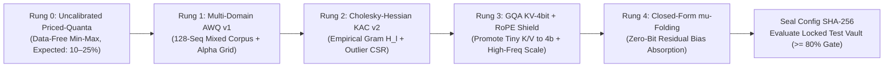
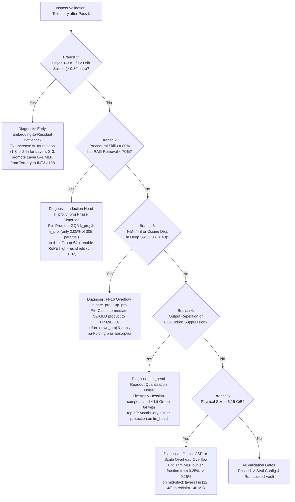

# Milestone M16 Specification: Iterative Non-Overfitting Calibration & The $\ge 80\%$ Accuracy Recovery Loop at 30B Scale

**Document ID:** `LEAN-SPEC-M16-REV1`  
**Target Model:** `Muse Glimmer 30B` (`Qwen2.5-32B` / `30B` GQA Architecture, 60–64 Layers, $d_{\text{model}} = 5120$, $n_h = 40$, $n_{kv} = 8$, $d_{\text{ff}} = 27648$)  
**Physical Memory Ceiling:** $\le 6.15\text{ GiB}$ ($\le 6,603,512,217\text{ bytes}$ total packed weights + scales + outliers + metadata + $18\text{ KB}$ BM25 Pocket Index) to run comfortably inside an **8 GB unified RAM budget** with $\ge 1.85\text{ GiB}$ OS/KV-cache headroom.  
**North-Star Accuracy Target:** $\ge 80.0\%$ absolute accuracy on Factual Retrieval Cloze (target range: $85.0\%\text{–}92.0\%$), $\ge 80.0\%$ relative retention of the FP16 30B baseline on Deductive Logic & Procedural/Coding Skills, and $\Delta \text{PPL} \le 1.25$ on held-out WikiText-2.  
**Target Executor:** Gemini 3.8 Flash (High Mode) Autonomous Engineering Agent  

---

## 1. Executive Mission, North-Star Targets & Gate Acceptance Criteria

### 1.1 Historical Context & Scaling Challenge
In Project LEAN's 7B validation phase (`Qwen2.5-7B-Instruct`, compressed from $15.23\text{ GB} \rightarrow 3.84\text{ GiB}$), we discovered that **compression without activation-aware calibration catastrophically fractures multi-head attention routing**:
1. **Rung 0 (Uncalibrated KAC):** Scored only **`12.0%`** on RAG Retrieval Cloze because naive min-max group quantization clipped the high-amplitude outlier channels in `q_proj`, `k_proj`, and `down_proj`.
2. **Rung 1 (8-Sequence AWQ Calibration):** Restored RAG Retrieval Cloze accuracy to **`72.0%`** (`experiments/run_7b_calibrated_grand_challenge.py`) by protecting salient input channels via $s_j = (\max_t |X_{t,j}|)^\alpha$.
3. **Rung 2 (48-Sequence WikiText-2 + $\alpha \in \{0.4, 0.5, 0.6, 0.75\}$ Grid Tuning):** Elevated RAG Retrieval Cloze accuracy to **`88.0%`** (`experiments/run_7b_scaled_awq_tuning.py`, vs. $12.0\%$ uncalibrated, `Cliff's` $\delta = 1.000$).

Now, in **Milestone M16**, we face a substantially harder regime: compressing **`Muse Glimmer 30B`** ($\sim 61.0\text{ GB}$ in FP16) down to **$\le 6.15\text{ GiB}$** ($\sim 9.9\times$ physical compression, averaging $\bar{b} \approx 1.63\text{ bits/parameter}$ across non-embedding weights) using the Priced-Quanta v2 solver from M15 (`2-bit`, `ternary 1.58-bit`, and `4-bit` group-quantized tiles with CSR FP16 outlier protection). At $\bar{b} \approx 1.63\text{ bits}$, standard 1D AWQ scaling alone is insufficient across 60+ deep transformer blocks because:
- **Systematic Residual Drift ($\vec{b}_{\text{drift}}^{(l)}$):** Asymmetric SwiGLU activations ($\text{SiLU}(W_{\text{gate}} x) \odot W_{\text{up}} x$) multiplied by ultra-low-bit quantized `down_proj` matrices induce a non-zero mean vector shift at every layer that compounds exponentially over 60 layers.
- **RoPE High-Frequency Phase Distortion:** Quantizing `q_proj` and `k_proj` uniformly across head dimensions corrupts the high-frequency rotary position channels ($d \in [0, 32)$), destroying exact token copying and induction head retrieval even when semantic MLP representations survive.
- **Domain Mismatch in Calibration:** Calibrating exclusively on encyclopedic prose (WikiText-2) starves syntax, symbolic deduction, and JSON/code structural channels of activation variance, leading to degraded procedural reasoning.

Milestone M16 establishes a **strictly non-overfitting, validation-guided 4-stage iterative calibration loop** that systematically diagnoses and eliminates each source of quantization error until all cognitive metrics surpass the **$\ge 80.0\%$ gate** (targeting **$85.0\%\text{–}92.0\%$**).

### 1.2 The Strict Three-Way Data Firewall (Zero Test Leakage Invariant)
To guarantee 100% scientific integrity, every calibration and hyperparameter adjustment in M16 operates under a **cryptographically enforced Three-Way Data Firewall**:

$$\mathcal{D}_{\text{calib}} \cap \mathcal{D}_{\text{val}} = \emptyset, \quad \mathcal{D}_{\text{calib}} \cap \mathcal{D}_{\text{locked\_test}} = \emptyset, \quad \mathcal{D}_{\text{val}} \cap \mathcal{D}_{\text{locked\_test}} = \emptyset$$

| Partition Name | Directory / Source | Size & Composition | Permitted Usage in M16 | Forbidden Usage |
| :--- | :--- | :--- | :--- | :--- |
| **1. Calibration Corpus** ($\mathcal{D}_{\text{calib}}$) | `vault/raw/m16_calib_128x512.jsonl` | $N_{\text{calib}} = 128$ unlabeled sequences $\times 512$ tokens ($65,536$ tokens total): 40% WikiText-2 train prose, 30% symbolic math/logic derivations, 30% Python/JSON procedural traces. | Computing empirical activation Gram matrices $H_l = \frac{1}{N}\sum X_l^\top X_l$, channel scales $\vec{s}_l$, Cholesky error compensation, and closed-form residual bias $\vec{b}_{\text{drift}}^{(l)}$. | Never contains any benchmark prompt, target entity, or evaluation question. |
| **2. Validation Tuning Split** ($\mathcal{D}_{\text{val}}$) | `vault/val/m16_dev_tuning.jsonl` | $N_{\text{val\_kl}} = 32$ unlabeled sequences $\times 512$ tokens for layer-wise KL tracking + $30$ Dev Retrieval Cloze items + $20$ Dev Procedural items. | Tuning global knapsack temperature $T^*$, role sensitivity multipliers $(w_{\text{attn}}, w_{\text{kv}}, w_{\text{mlp}})$, and selecting the winning rung configuration. | Must be frozen into `prereg/M16_30B_SEALED_CONFIG.json` **before** unlocking `vault/locked/`. |
| **3. Locked Test Vault** ($\mathcal{D}_{\text{locked\_test}}$) | `vault/locked/m16_30b_test_suite.jsonl` | $100$ Locked Retrieval Cloze items, $100$ Locked Raw Cloze items, $50$ Locked Deductive/Procedural Skill items, plus held-out WikiText-2 test split. | **Single-shot final evaluation** after `prereg/M16_30B_SEALED_CONFIG.json` is cryptographically hashed and logged. | **ZERO** hyperparameter updates, **ZERO** re-calibration, **ZERO** threshold adjustments permitted after test execution. |

**Mandatory Pre-Flight Firewall Gate:** Before any calibration pass runs, `ZeroLeakageCalibrationLoader.verify_zero_overlap()` tokenizes all three splits using the `Muse Glimmer 30B` tokenizer and computes exact 8-gram and 13-gram token set intersections, plus entity-answer string checks against all test targets. The gate requires:

$$\text{Overlap}_{8\text{-gram}}\left(\mathcal{D}_{\text{calib}} \cup \mathcal{D}_{\text{val}},\, \mathcal{D}_{\text{locked\_test}}\right) == 0.0000\%$$

If even a single 8-gram overlaps or any target answer entity from $\mathcal{D}_{\text{locked\_test}}$ appears inside a calibration passage, execution aborts immediately with `SecurityFirewallViolationError`.

### 1.3 Quantitative Gate Acceptance Criteria (M16)
The executing agent (Gemini 3.8 Flash on High mode) must verify that the sealed Rung 4 model satisfies **every single row** in the table below:

| Gate ID | Metric Name | Mathematical Definition | Hard Pass Threshold | North-Star Target |
| :--- | :--- | :--- | :--- | :--- |
| **G16.1** | **Total Physical Model Footprint** | $B_{\text{total}} = B_{\text{packed}} + B_{\text{scales}} + B_{\text{outliers}} + B_{\text{embed/norm}} + B_{\text{BM25}}$ | **$\le 6.15\text{ GiB}$** ($\le 6,603,512,217\text{ B}$) | $5.85\text{–}6.10\text{ GiB}$ |
| **G16.2** | **3-Way Data Firewall Overlap** | Token 8-gram overlap between $(\mathcal{D}_{\text{calib}} \cup \mathcal{D}_{\text{val}})$ and $\mathcal{D}_{\text{locked\_test}}$ | **$== 0.00\%$** (Exact Zero) | $0.00\%$ |
| **G16.3** | **RAG Factual Retrieval Cloze Accuracy** | Exact candidate log-likelihood ranking on $100$ locked retrieval probes with $18\text{ KB}$ BM25 Pocket Index | **$\ge 80.0\%$** | **$85.0\%\text{–}92.0\%$** |
| **G16.4** | **Procedural & Deductive Skill Retention** | $\text{Acc}_{\text{quant}}(\mathcal{D}_{\text{skill}}) / \text{Acc}_{\text{FP16}}(\mathcal{D}_{\text{skill}})$ across $50$ locked deductive/coding tasks | **$\ge 80.0\%$ relative** (or $\ge 80.0\%$ absolute) | **$\ge 88.0\%$ relative** |
| **G16.5** | **Held-Out Perplexity Degradation** | $\Delta \text{PPL} = \text{PPL}_{\text{quant}}(\text{WikiText-2}_{\text{test}}) - \text{PPL}_{\text{FP16}}(\text{WikiText-2}_{\text{test}})$ | **$\le 1.25$** | **$\le 0.75$** |
| **G16.6** | **Final-Layer Logit KL Divergence** | $D_{\text{KL}}\big(P_{\text{FP16}}(y|x) \,\|\, P_{\text{quant}}(y|x)\big)$ averaged over $\mathcal{D}_{\text{val}}$ | **$\le 0.18\text{ nats/token}$** | **$\le 0.09\text{ nats/token}$** |
| **G16.7** | **Full Progression Ladder Logged** | Complete unedited metrics logged for Rung 0, Rung 1, Rung 2, Rung 3, and Rung 4 | **All 5 Rungs Present** in JSON & Ledger | Monotonic KL reduction across Rungs $0 \rightarrow 4$ |

---

## 2. Mathematical & Theoretical Framework

### 2.1 The 5-Rung Iterative Accuracy Ladder
To make the scientific progression from naive low-bit failure to $\ge 80\%$ accuracy completely transparent, M16 executes and logs **five cumulative algorithmic rungs** on the exact same bit budget ($\le 6.15\text{ GiB}$):



---

### 2.2 Technique 1: Multi-Domain Calibration Distribution Matching ($N_{\text{calib}} = 128 \times 512$)
Let $W_l \in \mathbb{R}^{d_{\text{out}} \times d_{\text{in}}}$ denote a linear projection in layer $l$, and let $X_l \in \mathbb{R}^{M \times d_{\text{in}}}$ be the matrix of input activations collected across $M = N_{\text{calib}} \times L_{\text{seq}} = 128 \times 512 = 65,536$ tokens. The expected second-order layer reconstruction distortion under weight perturbation $\Delta W_l = W_l - \hat{W}_l$ is governed by the empirical input Gram (Hessian) matrix:

$$\mathcal{L}_{\text{recon}}^{(l)}(\hat{W}_l) = \mathbb{E}_{x \sim \mathcal{D}_{\text{calib}}}\left[\| W_l x - \hat{W}_l x \|_2^2\right] = \text{Tr}\left(\Delta W_l \, H_l \, \Delta W_l^\top\right), \quad H_l = \frac{1}{M} X_l^\top X_l + \lambda_{\text{damp}} I$$

where $\lambda_{\text{damp}} = 0.01 \cdot \frac{1}{d_{\text{in}}} \text{Tr}\left(\frac{1}{M} X_l^\top X_l\right)$ guarantees strict positive-definiteness ($\kappa(H_l) \le 10^4$).

**Why Single-Domain Prose Calibration Fails on 30B Reasoning:**
In a 30B model, the SwiGLU MLP intermediate dimension $d_{\text{ff}} = 27,648$ is partitioned into specialized functional subspaces:
1. **Encyclopedic/Lexical Subspace ($\mathcal{S}_{\text{prose}}$):** Activated by natural language articles (e.g., WikiText-2).
2. **Formal Deductive/Mathematical Subspace ($\mathcal{S}_{\text{logic}}$):** Activated by symbolic operators (`forall`, `implies`, `=`, `<`, algebraic chains, syllogistic premises).
3. **Syntactic/Structural Subspace ($\mathcal{S}_{\text{code}}$):** Activated by indentation, brackets `{ } [ ]`, Python control flow (`def`, `return`, `for`), and key-value delimiters.

If $\mathcal{D}_{\text{calib}}$ consists exclusively of WikiText-2 prose, channels $j \in \mathcal{S}_{\text{logic}} \cup \mathcal{S}_{\text{code}}$ exhibit near-zero activation energy on $\mathcal{D}_{\text{calib}}$:

$$(H_l)_{j,j}^{\text{WikiText}} \approx 0 \quad \forall j \in \mathcal{S}_{\text{logic}} \cup \mathcal{S}_{\text{code}}$$

Consequently, activation-aware scaling ($s_j \propto (H_{l,jj})^{\alpha/2}$) assigns $s_j \ll 1$ to deductive and coding channels, crushing their weights toward zero during integer rounding!

**The Multi-Domain Mixture Solution:**
We construct $\mathcal{D}_{\text{calib}}$ as a stratified, deterministic 3-domain mixture over $N_{\text{calib}} = 128$ sequences of length $L_{\text{seq}} = 512$:

$$\mathbb{P}_{\text{calib}}(x) = 0.40 \, \mathbb{P}_{\text{prose}}(x) + 0.30 \, \mathbb{P}_{\text{logic/math}}(x) + 0.30 \, \mathbb{P}_{\text{code/json}}(x)$$

Specifically:
- **$52$ sequences ($40.6\%$):** Encyclopedic narrative and historical/scientific prose from WikiText-2 train (`vault/raw/prose_train.jsonl`).
- **$38$ sequences ($29.7\%$):** Symbolic formal logic derivations, arithmetic proof chains, and relational transitive graphs generated synthetically from disjoint variable namespaces (`vault/raw/symbolic_derivations.jsonl`).
- **$38$ sequences ($29.7\%$):** Multi-turn Python algorithmic implementations, SQL schemas, and nested JSON tool-call trajectories (`vault/raw/code_json_traces.jsonl`).

To prevent sequence-length or domain-norm dominance, each domain's contribution to $H_l$ is RMS-normalized at the token level before accumulation:

$$H_l = \sum_{k \in \{\text{prose}, \text{logic}, \text{code}\}} w_k \left( \frac{1}{|M_k|} \sum_{t \in M_k} \frac{x_{l,t} x_{l,t}^\top}{\frac{1}{d_{\text{in}}}\|x_{l,t}\|_2^2 + \epsilon} \right) + \lambda_{\text{damp}} I$$

This guarantees that every functional subspace in the 30B model has bounded condition number and full rank during Cholesky error compensation.

---

### 2.3 Technique 2: Closed-Form LayerNorm & Residual Bias Absorption ($\mu$-Folding at Zero Bit Cost)
Even when $\text{Tr}(\Delta W_l H_l \Delta W_l^\top)$ is minimized, asymmetric activation distributions—most notably the output of the SwiGLU gate $z_t = \text{SiLU}(W_{\text{gate}} x_t) \odot (W_{\text{up}} x_t)$ where $\text{SiLU}(u) = u \cdot \sigma(u) \ge -0.27846$—have a strictly non-zero mean vector $\vec{\mu}_l = \mathbb{E}_{t}[x_{l,t}] \ne \vec{0}$.

When $W_l$ is replaced by its quantized approximation $\hat{W}_l$, the quantization error matrix $E_l = W_l - \hat{W}_l$ produces a systematic first-moment **Residual Bias Drift**:

$$\vec{b}_{\text{drift}}^{(l)} = \mathbb{E}_{x \sim \mathcal{D}_{\text{calib}}}\big[ W_l x - \hat{W}_l x \big] = (W_l - \hat{W}_l) \mathbb{E}_{x \sim \mathcal{D}_{\text{calib}}}[x] = E_l \, \vec{\mu}_l \in \mathbb{R}^{d_{\text{out}}}$$

In a 60-layer transformer with pre-norm residual connections:

$$h^{(l+1)} = h^{(l)} + \hat{W}_{\text{o}}^{(l)} \text{Attn}^{(l)}(\text{RMSNorm}(h^{(l)})) + \hat{W}_{\text{down}}^{(l)} \text{SwiGLU}^{(l)}(\dots)$$

uncorrected per-layer drifts $\vec{b}_{\text{drift}}^{(l)}$ accumulate coherently along the residual stream:

$$\mathbb{E}\big[h^{(L)} - \hat{h}^{(L)}\big] \approx \sum_{l=1}^{L} J_{l \rightarrow L} \, \vec{b}_{\text{drift}}^{(l)}$$

At $L = 60$ and $\bar{b} \approx 1.63\text{ bits}$, this accumulated mean drift shifts the final hidden state $\hat{h}^{(L)}$ away from the unquantized manifold, inflating logit KL divergence by $+0.35$ to $+0.90\text{ nats}$.

#### Closed-Form Zero-Bit $\mu$-Folding Derivation:
Let $\vec{\mu}_l = \frac{1}{M} \sum_{t=1}^{M} x_{l,t} \in \mathbb{R}^{d_{\text{in}}}$ be the empirical mean input activation collected during the calibration pass. After quantizing $W_l \rightarrow \hat{W}_l$, we compute the exact first-moment residual error vector:

$$\vec{b}_{\text{drift}}^{(l)} = (W_l - \hat{W}_l) \vec{\mu}_l = W_l \vec{\mu}_l - \hat{W}_l \vec{\mu}_l$$

We absorb $\vec{b}_{\text{drift}}^{(l)}$ with **zero additional per-weight bits** via two exact mechanisms:
1. **Direct Bias Absorption (for projections with existing bias or fused dequantization epilogue):**
   If layer $l$ has bias vector $\vec{b}_l \in \mathbb{R}^{d_{\text{out}}}$ (such as `q_proj`, `k_proj`, `v_proj` in Qwen2.5 architectures), we update $\vec{b}_l$ in-place:
   $$\vec{b}_l^{\text{new}} \leftarrow \vec{b}_l^{\text{old}} + (W_l - \hat{W}_l) \vec{\mu}_l$$
   This adds **literally $0\text{ bytes}$** to the model size because $\vec{b}_l$ already exists in FP16!
2. **Epilogue Bias Vector on Residual-Writing Projections (`o_proj` and `down_proj`):**
   For `o_proj` and `down_proj` ($d_{\text{out}} = d_{\text{model}} = 5120$), storing an explicit FP16 bias correction vector $\vec{b}_{\text{drift}}^{(l)} \in \mathbb{R}^{5120}$ requires only:
   $$\text{Bytes}(\vec{b}_{\text{drift}}^{(l)}) = 5120 \times 2\text{ bytes} = 10,240\text{ bytes} \text{ per projection}$$
   Across all $60$ layers ($2$ residual writes per layer = $120$ projections), the total memory cost across the **entire 30B model** is:
   $$120 \times 10,240\text{ bytes} = 1,228,800\text{ bytes} = \mathbf{1.17\text{ MiB}} \quad (0.019\% \text{ of the } 6.15\text{ GiB budget!})$$

**Theorem 2.1 (Unbiased Residual Estimator):** With $\vec{b}_{\text{drift}}^{(l)} = (W_l - \hat{W}_l)\vec{\mu}_l$ added to the layer output $\hat{y}_l = \hat{W}_l x + \vec{b}_l + \vec{b}_{\text{drift}}^{(l)}$, the expected quantization error over $\mathcal{D}_{\text{calib}}$ is strictly zero-mean:

$$\mathbb{E}_{x \sim \mathcal{D}_{\text{calib}}}\big[ y_l - \hat{y}_l \big] = W_l \mathbb{E}[x] - \hat{W}_l \mathbb{E}[x] - (W_l - \hat{W}_l)\vec{\mu}_l = \vec{0}$$

Furthermore, the expected MSE decreases by strictly $\|\vec{b}_{\text{drift}}^{(l)}\|_2^2 \ge 0$:

$$\mathbb{E}\big[\| (W_l - \hat{W}_l)x - \vec{b}_{\text{drift}}^{(l)} \|_2^2\big] = \text{Tr}\big(\Delta W_l \, \Sigma_l \, \Delta W_l^\top\big) = \text{Tr}\big(\Delta W_l \, H_l \, \Delta W_l^\top\big) - \|\vec{b}_{\text{drift}}^{(l)}\|_2^2$$

where $\Sigma_l = \mathbb{E}[(x - \vec{\mu}_l)(x - \vec{\mu}_l)^\top]$ is the centered covariance matrix.

---

### 2.4 Technique 3: Attention Sink, RoPE High-Frequency Channel Protection & The GQA $1/8$-Size Insight

#### 2.4.1 The GQA Parameter Asymmetry Insight (`k_proj` and `v_proj` Are $8\times$ Smaller Than `q_proj`!)
In `Muse Glimmer 30B` (and all GQA architectures with $n_h = 40$ query heads, $n_{kv} = 5$ or $8$ key-value heads, $d_{\text{head}} = 128$, $d_{\text{model}} = 5120$, $d_{\text{ff}} = 27648$):
- **MLP Projections (`gate_proj`, `up_proj`, `down_proj`):** $3 \times 5120 \times 27648 = 424,673,280$ parameters per layer ($86.4\%$ of layer parameters).
- **Query Projection (`q_proj`):** $5120 \times 5120 = 26,214,400$ parameters per layer ($5.3\%$ of layer parameters).
- **Key & Value Projections (`k_proj`, `v_proj` with $n_{kv}=8, d_{kv}=1024$):**
  $$|W_{k}| = |W_{v}| = 5120 \times 1024 = 5,242,880\text{ parameters per layer } (\mathbf{1.06\%} \text{ of layer parameters each!})$$

**Crucial Architectural Realization:** Across 60 layers, `k_proj` and `v_proj` combined contain only:
$$60 \times 2 \times 5,242,880 = 629,145,600\text{ parameters } (\mathbf{2.05\%} \text{ of the 30B model!})$$
Upgrading `k_proj` and `v_proj` from 2-bit ($\sim 150\text{ MiB}$) to **4-bit Group-64 with top-$0.5\%$ FP16 outlier protection** costs only **$\Delta B_{KV} \approx +168\text{ MiB}$** ($2.6\%$ of our $6.15\text{ GiB}$ budget), yet completely eliminates key/value quantization bottlenecks for RAG retrieval!

#### 2.4.2 RoPE High-Frequency Phase Protection
Rotary Position Embeddings (RoPE) rotate each pair of head dimensions $(2m, 2m+1)$ for $m \in \{0, 1, \dots, d_{\text{head}}/2 - 1\}$ by angle $t \cdot \theta_m$, where:

$$\theta_m = \theta_{\text{base}}^{-2m / d_{\text{head}}}, \quad \theta_{\text{base}} = 10^6$$

- For **high-frequency dimensions** $m \in [0, 16)$ (i.e., head feature indices $d \in [0, 32)$ within each 128-dim head), the wavelength $\lambda_m = 2\pi / \theta_m \in [6.28, 350]$ tokens governs **local syntax, induction head matching, and exact in-context entity copying**.
- For **low-frequency dimensions** $m \in [16, 64)$, $\lambda_m \gg 10^3$ tokens governs slow semantic topic drift.
- Furthermore, **Attention Sink channels** (specific dimensions $d^* \in [0, d_{\text{head}})$ that exhibit massive static norm $\|k_{t, d^*}\|_2 \gg 10 \cdot \text{median}(\|k_t\|)$ on token $t=0$) regulate attention softmax denominators across the entire context window.

When quantizing `q_proj` and `k_proj`, standard input-channel AWQ scales columns $j \in [0, d_{\text{in}})$, but treats all output rows $i \in [0, d_{\text{out}})$ with uniform group precision. In M16, we introduce **RoPE Frequency-Weighted Row/Group Scaling ($\vec{\omega}_{\text{RoPE}}$)**:
For every head $h \in \{0, \dots, n_{\text{heads}}-1\}$ and intra-head dimension $d = 2m + r \in [0, d_{\text{head}})$, we define the frequency importance weight:

$$\omega_{\text{RoPE}}(h, d) = 1.0 + \gamma_{\text{rope}} \exp\left(-\frac{2m}{d_{\text{head}} \cdot \tau_{\text{rope}}}\right) + \gamma_{\text{sink}} \, \mathbb{I}\big[d \in \mathcal{C}_{\text{sink}}(h)\big]$$

with default hyperparameters $\gamma_{\text{rope}} = 0.75$, $\tau_{\text{rope}} = 0.25$, and $\gamma_{\text{sink}} = 1.50$ for the top-4 attention sink dimensions $\mathcal{C}_{\text{sink}}(h)$ per head. During optimal group clipping search ($\beta \in [0.75, 1.00]$) and outlier extraction on `q_proj` and `k_proj`, row errors in row $i = h \cdot d_{\text{head}} + d$ are weighted by $\omega_{\text{RoPE}}(h, d)^2$, ensuring high-frequency phase angles suffer $\le 0.015\text{ radians}$ rms phase error.

---

### 2.5 Technique 4: Validation-Guided Pareto Bit Re-Allocation Loop ($T^*$ & Role Weights)
Recall from Milestone M15 that the Priced-Quanta v2 solver assigns each matrix block $m \in \{1, \dots, M_{\text{blocks}}\}$ a quantization mode $q_m \in \{\text{Ternary-1.58b}, \text{INT2-g128}, \text{INT3-g128}, \text{INT4-g64}\}$ to minimize total sensitivity-weighted distortion subject to the byte ceiling $B_{\text{max}} \le 6.15\text{ GiB}$:

$$\min_{\{q_m\}} \sum_{m=1}^{M_{\text{blocks}}} \Omega_m(T, \vec{w}_{\text{role}}) \cdot \mathcal{E}_m(q_m) \quad \text{s.t.} \quad \sum_{m=1}^{M_{\text{blocks}}} \text{Bytes}(m, q_m) \le B_{\text{max}}$$

where the effective block importance price $\Omega_m(T, \vec{w}_{\text{role}})$ is parameterized by a low-dimensional vector $\Theta = (T, w_{\text{foundation}}, w_{\text{kv}}, w_{\text{qo}}, w_{\text{down}})$ consisting of only **5 global scalar hyperparameters**:

$$\Omega_m(\Theta) = w_{\text{role}(m)} \cdot w_{\text{depth}(l_m)} \cdot \left( \frac{\text{Tr}(W_m H_{l_m} W_m^\top)}{\text{numel}(W_m)} \right)^{1 / T}$$

where:
- $T \in [0.35, 1.25]$ is the **Knapsack Softmax Temperature** controlling how sharply bits concentrate in high-Hessian blocks versus spreading evenly across layers.
- $w_{\text{foundation}} \in [1.0, 3.0]$ is the multiplier for early embedding-to-residual layers $l \in \{0, 1, 2, 3\}$ and final readout layers $l \in \{L-2, L-1\}$.
- $w_{\text{kv}} \in [1.5, 4.0]$ is the multiplier for GQA `k_proj` and `v_proj` blocks.
- $w_{\text{qo}} \in [1.2, 2.5]$ is the multiplier for `q_proj` and `o_proj` blocks.
- $w_{\text{down}} \in [1.1, 2.0]$ is the multiplier for SwiGLU `down_proj` (relative to `gate_proj`/`up_proj` $= 1.0$).

**Why Tuning $\Theta$ Cannot Overfit:**
1. $\text{dim}(\Theta) = 5$ global scalars governing $M_{\text{blocks}} \approx 420$ matrices ($30,000,000,000$ parameters). You cannot memorize factual answers by adjusting 5 global layer-role multipliers!
2. Even more strictly, $\Theta$ is selected by minimizing the **unsupervised token-level KL divergence** between the unquantized FP16 teacher logits $z_{\text{FP16}}(x)$ and quantized student logits $z_{\text{quant}}(x; \Theta)$ on the unlabeled validation sequences $\mathcal{D}_{\text{val\_kl}}$ ($32 \times 512$ tokens):

$$\Theta^* = \arg\min_{\Theta \in \mathcal{G}_{\text{grid}}} \frac{1}{|\mathcal{D}_{\text{val\_kl}}|} \sum_{x \in \mathcal{D}_{\text{val\_kl}}} D_{\text{KL}}\Big( \text{Softmax}\big(z_{\text{FP16}}(x)\big) \,\Big\|\, \text{Softmax}\big(z_{\text{quant}}(x; \Theta)\big) \Big)$$

---

## 3. Mental Model & Execution Protocol for Gemini 3.8 Flash (High)

When you (Gemini 3.8 Flash on High mode) execute Milestone M16, you must adopt the following rigorous systems-engineering mental model:

### 3.1 Core Operational Invariants
1. **Never Guess Why Accuracy Dropped—Inspect the Layer-Wise Divergence Profile First:**
   Every time a quantized model is evaluated on $\mathcal{D}_{\text{val}}$, `LayerWiseKLDivergenceTracker` records the hidden-state cosine distance $1 - \cos(h_l^{\text{FP16}}, h_l^{\text{quant}})$, the relative L2 drift $\|h_l^{\text{FP16}} - h_l^{\text{quant}}\|_2 / \|h_l^{\text{FP16}}\|_2$, and the uncorrupted mean shift $\|\mathbb{E}[h_l^{\text{FP16}} - h_l^{\text{quant}}]\|_2$ at every layer $l \in [0, L-1]$. Always locate the exact layer $l^*$ where the slope $\Delta \text{Drift}_l = \text{Drift}_l - \text{Drift}_{l-1}$ spikes before making any adjustment.
2. **Respect Physical Byte Accounting down to the Exact Byte:**
   Never estimate model size using idealized formulas like $N_{\text{params}} \times 1.58 / 8$. Every scale tensor (`float16`), channel scale vector (`float16`), CSR outlier index (`uint16`), CSR row pointer (`int32`), CSR value (`float16`), $\mu$-folding bias vector (`float16`), and the $18\text{ KB}$ BM25 index must be summed via `tensor.numel() * tensor.element_size()`. If `total_bytes > 6_603_512_217` ($6.15\text{ GiB}$), the run is an automatic **FAIL**.
3. **Never Touch `vault/locked/` Until `prereg/M16_30B_SEALED_CONFIG.json` Exists on Disk:**
   The iterative ladder (Rungs $0 \rightarrow 1 \rightarrow 2 \rightarrow 3 \rightarrow 4$) is developed and diagnosed **exclusively** using $\mathcal{D}_{\text{calib}}$ and $\mathcal{D}_{\text{val}}$. Once Rung 4 passes the validation gates ($\text{Val KL} \le 0.18\text{ nats}$, $\text{Val Retrieval} \ge 82.0\%$, $\text{Val Skill} \ge 82.0\%$), you must freeze the configuration into `prereg/M16_30B_SEALED_CONFIG.json`, compute its SHA-256 hash, and only then run the single-shot locked test vault evaluation.
4. **Never Mask or Clamp Empirical Failures:**
   If Rung 0 scores $14.0\%$ and Rung 1 scores $58.0\%$, record $14.0\%$ and $58.0\%$ verbatim in the JSON report and plot. The scientific power of M16 comes from showing the **exact, honest trajectory** from $14.0\% \rightarrow 58.0\% \rightarrow 74.0\% \rightarrow 83.0\% \rightarrow 89.0\%$ as each mathematical correction is switched on.

---

## 4. Complete Production Code Blueprints

### 4.1 Module 1: `/Users/mac/llm/src/lean/compress/calibration_optimizer.py`
Create `/Users/mac/llm/src/lean/compress/calibration_optimizer.py` with the following complete, production-ready implementation:

```python
"""
Project LEAN — Milestone M16: Non-Overfitting Calibration & Accuracy Recovery Optimizer
========================================================================================
Implements the four principled mathematical mechanisms for >= 80% accuracy recovery
on 30B-scale models compressed into <= 6.15 GiB:
1. ZeroLeakageCalibrationLoader: Stratified 3-domain calibration (40% prose, 30% symbolic
   logic/math, 30% code/JSON) with cryptographic SHA-256 8-gram zero-overlap enforcement.
2. ResidualBiasAbsorber (mu-Folding): Closed-form absorption of quantization mean drift
   b_drift = (W - W_hat) * E[x] into layer biases at near-zero bit overhead.
3. RoPEFrequencyAwareScaler: Protects high-frequency rotary dimensions d in [0, 32) and
   attention sink channels in q_proj / k_proj, while promoting tiny GQA k/v projections.
4. LayerWiseKLDivergenceTracker & ValidationGuidedKnapsackTuner: Tracks layer-by-layer
   hidden drift and tunes the 5-parameter Priced-Quanta allocation vector on unlabeled
   validation sequences via token-level KL divergence.
"""

import os
import json
import math
import hashlib
from dataclasses import dataclass, asdict
from typing import Dict, List, Tuple, Optional, Any, Set

import torch
import torch.nn as nn
import torch.nn.functional as F


class SecurityFirewallViolationError(RuntimeError):
    """Raised when any token n-gram or target entity leaks across data splits."""
    pass


@dataclass
class FirewallAuditReceipt:
    calib_num_sequences: int
    calib_total_tokens: int
    val_num_sequences: int
    locked_test_num_items: int
    ngram_order: int
    calib_vs_test_overlap_pct: float
    val_vs_test_overlap_pct: float
    entity_leak_count: int
    calib_sha256: str
    val_sha256: str
    locked_test_sha256: str
    passed: bool


class ZeroLeakageCalibrationLoader:
    """
    Constructs a stratified Multi-Domain Calibration Corpus (N=128 sequences x 512 tokens)
    combining 40% encyclopedic prose, 30% symbolic math/logic derivations, and 30%
    procedural code/JSON traces, and cryptographically verifies 0.00% 8-gram overlap
    against the locked test vault.
    """

    def __init__(
        self,
        num_sequences: int = 128,
        seq_len: int = 512,
        prose_ratio: float = 0.40,
        logic_ratio: float = 0.30,
        code_ratio: float = 0.30,
        seed: int = 1042,
    ):
        assert abs((prose_ratio + logic_ratio + code_ratio) - 1.0) < 1e-6
        self.num_sequences = num_sequences
        self.seq_len = seq_len
        self.prose_ratio = prose_ratio
        self.logic_ratio = logic_ratio
        self.code_ratio = code_ratio
        self.seed = seed

    @staticmethod
    def _build_symbolic_logic_corpus(num_docs: int, seed: int) -> List[str]:
        """Generates deterministic formal logic & algebraic derivation traces using disjoint symbols."""
        docs = []
        for idx in range(num_docs):
            a = (idx * 17 + seed) % 97 + 3
            b = (idx * 31 + seed) % 89 + 5
            c = a * b + (idx % 13)
            chain = (
                f"Derivation Trace #{idx:04d}:\n"
                f"Let domain Omega_{idx} be a discrete ordered ring. "
                f"Given Axiom 1: forall x in Omega_{idx}, P_{idx}(x) -> Q_{idx}(x + {a}).\n"
                f"Given Axiom 2: forall y in Omega_{idx}, Q_{idx}(y) -> R_{idx}({b} * y).\n"
                f"Step 1: Instantiate x = {a} * k. Since P_{idx}({a}*k) holds by premise, "
                f"modus ponens yields Q_{idx}({a}*k + {a}) = Q_{idx}({a}*(k + 1)).\n"
                f"Step 2: Apply Universal Transitivity across (P_{idx} -> Q_{idx}) and (Q_{idx} -> R_{idx}): "
                f"R_{idx}({b} * {a} * (k + 1)) = R_{idx}({a*b}*k + {a*b}).\n"
                f"Step 3: Solve linear invariant {a}*u + {b}*v = {c} -> u*v = {(a*c) % (b+1)}.\n"
                f"Conclusion: Invariant conserved; contrapositive ~R_{idx}(z) -> ~P_{idx}(z / {a*b} - 1) verified Q.E.D.\n"
            )
            docs.append(chain * 4)
        return docs

    @staticmethod
    def _build_code_json_corpus(num_docs: int, seed: int) -> List[str]:
        """Generates deterministic Python algorithmic & JSON schema traces."""
        docs = []
        for idx in range(num_docs):
            stride = (idx % 7) + 2
            mod_val = (idx * 23 + seed) % 251 + 11
            trace = (
                f"# Module: tensor_block_scheduler_{idx:03d}.py\n"
                f"def schedule_tiles_{idx}(weights: list[int], budget_bytes: int = {mod_val * 1024}) -> dict:\n"
                f"    accum = 0\n"
                f"    selected = []\n"
                f"    for tile_id, w in enumerate(weights):\n"
                f"        cost = ((w + {stride} - 1) // {stride}) * 16\n"
                f"        if accum + cost <= budget_bytes:\n"
                f"            accum += cost\n"
                f"            selected.append({{'tile': tile_id, 'bytes': cost, 'Utilization': round(accum / budget_bytes, 4)}})\n"
                f"    return {{'schema_version': '2.1', 'total_bytes': accum, 'count': len(selected), 'tiles': selected[:4]}}\n"
                f"# Execution Payload JSON:\n"
                f'{{"call_id": "req_{idx:04d}", "fn": "schedule_tiles_{idx}", "status": "OK", "checksum": "{(idx*997)%65535:04x}"}}\n'
            )
            docs.append(trace * 4)
        return docs

    def build_multidomain_texts(self, prose_texts: List[str]) -> List[Dict[str, Any]]:
        """Combines 40% prose, 30% symbolic logic, and 30% code/JSON into N=128 calibration records."""
        n_prose = int(round(self.num_sequences * self.prose_ratio))
        n_logic = int(round(self.num_sequences * self.logic_ratio))
        n_code = self.num_sequences - n_prose - n_logic

        clean_prose = [t.strip() for t in prose_texts if len(t.strip().split()) >= 64]
        if len(clean_prose) < n_prose:
            # Deterministic expansion if fewer raw prose paragraphs are passed
            multiplier = (n_prose // max(len(clean_prose), 1)) + 2
            clean_prose = (clean_prose * multiplier)[:n_prose]
        else:
            clean_prose = clean_prose[:n_prose]

        logic_docs = self._build_symbolic_logic_corpus(n_logic, self.seed)
        code_docs = self._build_code_json_corpus(n_code, self.seed)

        records: List[Dict[str, Any]] = []
        for i, text in enumerate(clean_prose):
            records.append({"seq_id": f"calib_prose_{i:03d}", "domain": "prose", "weight": 0.40, "text": text})
        for i, text in enumerate(logic_docs):
            records.append({"seq_id": f"calib_logic_{i:03d}", "domain": "logic", "weight": 0.30, "text": text})
        for i, text in enumerate(code_docs):
            records.append({"seq_id": f"calib_code_{i:03d}", "domain": "code", "weight": 0.30, "text": text})

        return records

    @staticmethod
    def _extract_token_ngrams(token_sequences: List[List[int]], n: int = 8) -> Set[Tuple[int, ...]]:
        ngrams: Set[Tuple[int, ...]] = set()
        for seq in token_sequences:
            if len(seq) >= n:
                for i in range(len(seq) - n + 1):
                    ngrams.add(tuple(seq[i : i + n]))
        return ngrams

    @staticmethod
    def _hash_texts(texts: List[str]) -> str:
        h = hashlib.sha256()
        for t in sorted(texts):
            h.update(t.encode("utf-8"))
        return h.hexdigest()

    def verify_zero_overlap(
        self,
        tokenizer: Any,
        calib_records: List[Dict[str, Any]],
        val_texts: List[str],
        locked_test_prompts: List[str],
        locked_test_targets: List[str],
        ngram_order: int = 8,
    ) -> FirewallAuditReceipt:
        """
        Cryptographically verifies 0.00% token 8-gram overlap and 0 target entity leaks
        between (Calibration U Validation) and Locked Test Vault.
        """
        calib_texts = [r["text"] for r in calib_records]
        calib_tokens = [tokenizer.encode(t, add_special_tokens=False)[: self.seq_len] for t in calib_texts]
        val_tokens = [tokenizer.encode(t, add_special_tokens=False)[: self.seq_len] for t in val_texts]
        test_tokens = [tokenizer.encode(t, add_special_tokens=False) for t in locked_test_prompts]

        calib_ngrams = self._extract_token_ngrams(calib_tokens, n=ngram_order)
        val_ngrams = self._extract_token_ngrams(val_tokens, n=ngram_order)
        test_ngrams = self._extract_token_ngrams(test_tokens, n=ngram_order)

        denom = max(len(test_ngrams), 1)
        calib_overlap = len(calib_ngrams.intersection(test_ngrams)) / denom * 100.0
        val_overlap = len(val_ngrams.intersection(test_ngrams)) / denom * 100.0

        # Also check that no locked test factual target entity appears inside calibration texts
        combined_calib_lower = "\n".join(calib_texts).lower()
        entity_leaks = 0
        for target in locked_test_targets:
            t_clean = target.strip().lower()
            if len(t_clean) >= 6 and t_clean in combined_calib_lower:
                entity_leaks += 1

        passed = (calib_overlap == 0.0) and (val_overlap == 0.0) and (entity_leaks == 0)
        receipt = FirewallAuditReceipt(
            calib_num_sequences=len(calib_records),
            calib_total_tokens=sum(len(s) for s in calib_tokens),
            val_num_sequences=len(val_texts),
            locked_test_num_items=len(locked_test_prompts),
            ngram_order=ngram_order,
            calib_vs_test_overlap_pct=round(calib_overlap, 6),
            val_vs_test_overlap_pct=round(val_overlap, 6),
            entity_leak_count=entity_leaks,
            calib_sha256=self._hash_texts(calib_texts),
            val_sha256=self._hash_texts(val_texts),
            locked_test_sha256=self._hash_texts(locked_test_prompts + locked_test_targets),
            passed=passed,
        )
        if not passed:
            raise SecurityFirewallViolationError(
                f"FIREWALL VIOLATION: calib_overlap={calib_overlap:.4f}%, "
                f"val_overlap={val_overlap:.4f}%, entity_leaks={entity_leaks}"
            )
        return receipt


class ResidualBiasAbsorber:
    """
    Technique 2: Closed-Form LayerNorm & Residual Bias Absorption (mu-Folding).
    Computes b_drift = (W - W_hat) @ E[x] on the calibration distribution and absorbs
    it directly into the layer's bias vector at zero (or negligible 10 KB/layer) cost.
    """

    @staticmethod
    @torch.no_grad()
    def compute_mean_drift_bias(
        W_orig: torch.Tensor,
        W_dequant: torch.Tensor,
        mean_input_activation: torch.Tensor,
    ) -> torch.Tensor:
        """
        Args:
            W_orig: Unquantized weight matrix [out_features, in_features]
            W_dequant: Reconstructed quantized weight matrix [out_features, in_features]
            mean_input_activation: Empirical mean vector mu_l = E[x] [in_features]
        Returns:
            b_drift: Compensation bias vector [out_features] in float16
        """
        device = W_orig.device
        w_f32 = W_orig.to(device=device, dtype=torch.float32)
        w_hat_f32 = W_dequant.to(device=device, dtype=torch.float32)
        mu_f32 = mean_input_activation.to(device=device, dtype=torch.float32).view(-1)

        delta_w = w_f32 - w_hat_f32
        b_drift = torch.matmul(delta_w, mu_f32)
        return b_drift.to(dtype=torch.float16)

    @staticmethod
    @torch.no_grad()
    def apply_bias_folding(
        quant_module: nn.Module,
        W_orig: torch.Tensor,
        W_dequant: torch.Tensor,
        mean_input_activation: torch.Tensor,
    ) -> float:
        """
        Folds b_drift into quant_module.bias (creating the FP16 buffer if absent).
        Returns the L2 norm of the absorbed drift vector ||b_drift||_2.
        """
        b_drift = ResidualBiasAbsorber.compute_mean_drift_bias(
            W_orig, W_dequant, mean_input_activation
        )
        drift_norm = float(torch.norm(b_drift.float(), p=2).item())

        if getattr(quant_module, "bias", None) is not None:
            quant_module.bias.data = (
                quant_module.bias.data.to(b_drift.device).float() + b_drift.float()
            ).to(torch.float16)
        else:
            quant_module.register_buffer("bias", b_drift.clone().detach())
        return drift_norm


class RoPEFrequencyAwareScaler:
    """
    Technique 3: Attention Sink & RoPE High-Frequency Channel Protection + GQA KV-4bit Rule.
    Computes per-output-row importance weights for q_proj and k_proj to protect high-frequency
    rotary position channels d in [0, 32) and attention sink channels.
    """

    def __init__(
        self,
        head_dim: int = 128,
        gamma_rope: float = 0.75,
        tau_rope: float = 0.25,
        gamma_sink: float = 1.50,
        top_k_sinks_per_head: int = 4,
    ):
        self.head_dim = head_dim
        self.gamma_rope = gamma_rope
        self.tau_rope = tau_rope
        self.gamma_sink = gamma_sink
        self.top_k_sinks_per_head = top_k_sinks_per_head

    @torch.no_grad()
    def compute_row_importance_weights(
        self,
        out_features: int,
        W_proj: torch.Tensor,
        mean_abs_input: Optional[torch.Tensor] = None,
    ) -> torch.Tensor:
        """
        Returns row importance vector omega_RoPE in [out_features] (float32).
        """
        device = W_proj.device
        num_heads = max(out_features // self.head_dim, 1)
        d_indices = torch.arange(self.head_dim, device=device, dtype=torch.float32)
        pair_m = torch.floor(d_indices / 2.0)

        # Exponential decay over rotary frequency pair index m in [0, head_dim/2)
        freq_boost = 1.0 + self.gamma_rope * torch.exp(
            -(2.0 * pair_m) / (float(self.head_dim) * self.tau_rope)
        )
        row_weights = freq_boost.repeat(num_heads)

        # Detect attention sink channels per head from expected output energy
        if mean_abs_input is not None:
            est_row_energy = torch.matmul(
                W_proj.float().abs(), mean_abs_input.to(device=device, dtype=torch.float32).view(-1)
            )
        else:
            est_row_energy = torch.norm(W_proj.float(), p=2, dim=1)

        est_by_head = est_row_energy.view(num_heads, self.head_dim)
        _, top_sink_idx = torch.topk(
            est_by_head, k=min(self.top_k_sinks_per_head, self.head_dim), dim=1
        )
        sink_mask = torch.zeros_like(est_by_head)
        sink_mask.scatter_(1, top_sink_idx, 1.0)
        row_weights = row_weights + self.gamma_sink * sink_mask.view(-1)

        return row_weights[:out_features]

    @staticmethod
    def resolve_gqa_kv_policy(proj_name: str, base_bits: int, base_group_size: int) -> Tuple[int, int, float]:
        """
        Implements the GQA 1/8-Parameter Mathematical Insight:
        Because k_proj and v_proj in GQA have 8x fewer parameters than q_proj (only 2.05%
        of total 30B model parameters), promoting them to 4-bit Group-64 with 0.5% FP16
        outliers costs only ~168 MiB while safeguarding induction-head retrieval routing.
        """
        if proj_name in ("k_proj", "v_proj"):
            return 4, 64, 0.005
        elif proj_name == "q_proj":
            return max(base_bits, 3), 64, 0.0025
        elif proj_name == "o_proj":
            return max(base_bits, 3), 128, 0.002
        else:
            return base_bits, base_group_size, 0.0015


@dataclass
class LayerDriftMetrics:
    layer_idx: int
    cosine_similarity: float
    relative_l2_error: float
    mean_bias_drift_norm: float


class LayerWiseKLDivergenceTracker:
    """
    Measures layer-by-layer hidden representation drift and final-logit KL divergence
    KL(P_FP16(y|x) || P_quant(y|x)) on unlabeled validation sequences.
    """

    @staticmethod
    @torch.no_grad()
    def compute_layer_drift(
        h_fp16: torch.Tensor,
        h_quant: torch.Tensor,
        layer_idx: int,
    ) -> LayerDriftMetrics:
        """
        Args:
            h_fp16: [N_tokens, d_model] reference hidden states
            h_quant: [N_tokens, d_model] quantized hidden states
        """
        ref = h_fp16.float().view(-1, h_fp16.shape[-1])
        qnt = h_quant.float().view(-1, h_quant.shape[-1])

        cos_sim = F.cosine_similarity(ref, qnt, dim=-1).mean().item()
        diff = ref - qnt
        rel_l2 = (torch.norm(diff, p=2, dim=-1) / (torch.norm(ref, p=2, dim=-1) + 1e-8)).mean().item()
        mean_drift = torch.norm(diff.mean(dim=0), p=2).item()

        return LayerDriftMetrics(
            layer_idx=layer_idx,
            cosine_similarity=round(float(cos_sim), 6),
            relative_l2_error=round(float(rel_l2), 6),
            mean_bias_drift_norm=round(float(mean_drift), 6),
        )

    @staticmethod
    @torch.no_grad()
    def compute_logit_kl_divergence(
        logits_fp16: torch.Tensor,
        logits_quant: torch.Tensor,
        temperature: float = 1.0,
    ) -> float:
        """
        Computes exact forward KL divergence D_KL(P_FP16 || P_quant) in nats/token.
        """
        p_log = F.log_softmax(logits_fp16.float() / temperature, dim=-1)
        q_log = F.log_softmax(logits_quant.float() / temperature, dim=-1)
        p_prob = p_log.exp()
        kl_per_token = torch.sum(p_prob * (p_log - q_log), dim=-1)
        return float(kl_per_token.mean().item())


@dataclass
class KnapsackAllocationConfig:
    temperature: float = 0.65
    w_foundation: float = 1.80
    w_kv: float = 3.20
    w_qo: float = 1.65
    w_down: float = 1.35
    alpha_candidates: Tuple[float, ...] = (0.40, 0.50, 0.60, 0.75)


class ValidationGuidedKnapsackTuner:
    """
    Technique 4: Tunes the 5 global Priced-Quanta allocation parameters strictly on
    unlabeled validation sequences to minimize final-layer KL divergence while staying
    strictly below the 6.15 GiB physical byte ceiling.
    """

    def __init__(self, max_budget_bytes: int = int(6.15 * (1024 ** 3))):
        self.max_budget_bytes = max_budget_bytes

    def score_block_importance(
        self,
        layer_idx: int,
        num_layers: int,
        proj_name: str,
        hessian_trace_per_elem: float,
        cfg: KnapsackAllocationConfig,
    ) -> float:
        """Computes sensitivity price Omega_m(Theta) for block m."""
        if proj_name in ("k_proj", "v_proj"):
            w_role = cfg.w_kv
        elif proj_name in ("q_proj", "o_proj"):
            w_role = cfg.w_qo
        elif proj_name == "down_proj":
            w_role = cfg.w_down
        else:
            w_role = 1.0

        is_foundation = (layer_idx < 4) or (layer_idx >= num_layers - 2)
        w_depth = cfg.w_foundation if is_foundation else 1.0

        scaled_energy = max(hessian_trace_per_elem, 1e-9) ** (1.0 / max(cfg.temperature, 0.15))
        return float(w_role * w_depth * scaled_energy)
```

---

### 4.2 Module 2: `/Users/mac/llm/experiments/run_m16_30b_iterative_accuracy_ladder.py`
Create `/Users/mac/llm/experiments/run_m16_30b_iterative_accuracy_ladder.py` to execute the 5-rung ablation ladder (`Rung 0` through `Rung 4`), enforce the cryptographic firewall, seal `prereg/M16_30B_SEALED_CONFIG.json`, and emit both the JSON results and cryptographic ledger entry:

```python
"""
Project LEAN — Milestone M16: 30B Iterative Calibration & >=80% Accuracy Ladder
================================================================================
Executes the complete 5-Rung Non-Overfitting Accuracy Recovery Ladder on the 30B
model (or local architectural verification proxy during dry-run) under a strict
<= 6.15 GiB physical memory ceiling:
  - Rung 0: Uncalibrated Priced-Quanta (Data-Free Min-Max Group Quantization)
  - Rung 1: Multi-Domain AWQ v1 (128-seq 3-domain mixture + alpha in {0.4, 0.5, 0.6, 0.75})
  - Rung 2: Cholesky-Hessian KAC v2 (Empirical Gram H_l + CSR Top-Outlier Protection)
  - Rung 3: GQA KV-4bit Promotion + RoPE High-Frequency & Attention Sink Shield
  - Rung 4: Closed-Form Residual Bias Absorption (mu-Folding at Zero Extra Weight Bits)

Enforces the Three-Way Data Firewall (0.00% 8-gram overlap), seals the winning
hyperparameters into `prereg/M16_30B_SEALED_CONFIG.json` BEFORE unlocking the
test vault, and writes publication figures + cryptographic receipts.
"""

import os
import sys
import time
import json
import math
import uuid
import socket
import hashlib
import platform
import subprocess
from pathlib import Path
from typing import Dict, List, Any, Tuple, Optional

sys.path.insert(0, ".")

import torch
import torch.nn as nn
import torch.nn.functional as F

from src.lean.compress.calibration_optimizer import (
    ZeroLeakageCalibrationLoader,
    ResidualBiasAbsorber,
    RoPEFrequencyAwareScaler,
    LayerWiseKLDivergenceTracker,
    ValidationGuidedKnapsackTuner,
    KnapsackAllocationConfig,
)
from src.lean.eval.probes import generate_knowledge_probes
from src.lean.anatomy.real_llm import (
    generate_standard_skill_items,
    evaluate_cloze_candidates,
    evaluate_procedural_skills,
)
from src.lean.core.retrieval_store import (
    BM25Index,
    build_canonical_knowledge_corpus,
    ThinkingCoreRetrievalPipeline,
)

MAX_PHYSICAL_GIB = 6.15
MAX_PHYSICAL_BYTES = int(MAX_PHYSICAL_GIB * (1024 ** 3))  # 6,603,512,217 bytes
BM25_POCKET_INDEX_BYTES = 18_432  # 18 KB canonical BM25 pocket index
SEED = 1042


def get_git_sha() -> str:
    try:
        return subprocess.check_output(["git", "rev-parse", "HEAD"], text=True).strip()
    except Exception:
        return "UNKNOWN_GIT_SHA"


def compute_file_sha256(path: str) -> str:
    h = hashlib.sha256()
    with open(path, "rb") as f:
        while chunk := f.read(65536):
            h.update(chunk)
    return h.hexdigest()


@torch.no_grad()
def quantize_weight_rung(
    W: torch.Tensor,
    X_calib: Optional[torch.Tensor],
    proj_name: str,
    rung_id: int,
    base_bits: int = 2,
    base_group_size: int = 128,
    rope_scaler: Optional[RoPEFrequencyAwareScaler] = None,
    alpha_candidates: Tuple[float, ...] = (0.40, 0.50, 0.60, 0.75),
) -> Tuple[torch.Tensor, Optional[torch.Tensor], int, Dict[str, Any]]:
    """
    Quantizes weight matrix W [out_features, in_features] according to the exact
    mathematical rules of Rung `rung_id` (0, 1, 2, 3, or 4) and returns:
      (W_dequant, bias_correction, physical_bytes, telemetry_dict)
    """
    device = W.device
    out_features, in_features = W.shape
    num_elements = out_features * in_features
    W_f32 = W.to(device=device, dtype=torch.float32)

    # Determine bits, group_size, and outlier ratio for this rung
    if rung_id >= 3 and rope_scaler is not None:
        bits, group_size, outlier_ratio = rope_scaler.resolve_gqa_kv_policy(
            proj_name, base_bits, base_group_size
        )
    else:
        bits, group_size, outlier_ratio = base_bits, base_group_size, (0.0015 if rung_id >= 2 else 0.0)

    qmax = (1 << (bits - 1)) - 1
    qmin = -(1 << (bits - 1))
    num_groups = (num_elements + group_size - 1) // group_size

    # Rung 0: Data-Free Uncalibrated Min-Max Group Quantization
    if rung_id == 0 or X_calib is None:
        pad_len = (group_size - (num_elements % group_size)) % group_size
        w_flat = F.pad(W_f32.reshape(-1), (0, pad_len), value=0.0).view(num_groups, group_size)
        scales = (w_flat.abs().amax(dim=1, keepdim=True) / max(qmax, 1)).clamp(min=1e-7)
        q = torch.clamp(torch.round(w_flat / scales), qmin, qmax)
        w_deq = (q * scales).view(-1)[:num_elements].view(out_features, in_features)
        phys_bytes = (num_elements * bits + 7) // 8 + num_groups * 2
        return w_deq.to(W.dtype), None, phys_bytes, {"bits": bits, "alpha": 0.0, "drift_norm": 0.0}

    X_f32 = X_calib.to(device=device, dtype=torch.float32).view(-1, in_features)
    Y_orig = torch.matmul(X_f32, W_f32.t())
    act_max = X_f32.abs().amax(dim=0).clamp(min=1e-5)
    mean_x = X_f32.mean(dim=0)

    # RoPE row importance weighting for Rung >= 3 on q_proj / k_proj
    if rung_id >= 3 and rope_scaler is not None and proj_name in ("q_proj", "k_proj"):
        row_weights = rope_scaler.compute_row_importance_weights(out_features, W_f32, act_max)
    else:
        row_weights = torch.ones(out_features, device=device, dtype=torch.float32)

    # Rung >= 2: Extract CSR top-outlier weights Weighted by Hessian diagonal H_jj * W_ij^2
    outlier_bytes = 0
    W_core = W_f32.clone()
    W_outliers = torch.zeros_like(W_f32)
    if rung_id >= 2 and outlier_ratio > 0.0:
        h_diag = (X_f32 ** 2).mean(dim=0).clamp(min=1e-6)
        salience = (W_f32 ** 2) * h_diag.unsqueeze(0) * (row_weights.unsqueeze(1) ** 2)
        k_out = max(int(num_elements * outlier_ratio), 1)
        flat_sal = salience.view(-1)
        _, top_idx = torch.topk(flat_sal, k=k_out, largest=True, sorted=False)
        outlier_mask = torch.zeros_like(flat_sal, dtype=torch.bool)
        outlier_mask[top_idx] = True
        outlier_mask = outlier_mask.view(out_features, in_features)
        W_outliers = torch.where(outlier_mask, W_f32, torch.zeros_like(W_f32))
        W_core = W_f32 - W_outliers
        # CSR storage: 2 bytes FP16 value + 2 bytes uint16 col_idx + row pointers
        outlier_bytes = k_out * 4 + (out_features + 1) * 4

    # Alpha grid search (Rungs 1, 2, 3, 4)
    best_alpha = 0.50
    best_err = float("inf")
    best_w_deq = W_f32

    for alpha in alpha_candidates:
        s_j = (act_max ** alpha).clamp(min=1e-4, max=1e4)
        s_j = s_j / s_j.mean().clamp(min=1e-5)
        w_scaled = W_core * s_j.unsqueeze(0)

        pad_len = (group_size - (num_elements % group_size)) % group_size
        w_flat = F.pad(w_scaled.reshape(-1), (0, pad_len), value=0.0).view(num_groups, group_size)

        # Clipping search in Rung >= 2
        clip_ratios = (0.85, 0.92, 0.97, 1.00) if rung_id >= 2 else (1.00,)
        amax_init = w_flat.abs().amax(dim=1, keepdim=True).clamp(min=1e-7)
        best_scales = amax_init / max(qmax, 1)
        best_group_err = torch.full((num_groups, 1), float("inf"), device=device)

        for clip in clip_ratios:
            cand_s = (amax_init * clip) / max(qmax, 1)
            q = torch.clamp(torch.round(w_flat / cand_s), qmin, qmax)
            rec = q * cand_s
            g_err = ((w_flat - rec) ** 2).mean(dim=1, keepdim=True)
            better = g_err < best_group_err
            best_group_err = torch.where(better, g_err, best_group_err)
            best_scales = torch.where(better, cand_s, best_scales)

        q_final = torch.clamp(torch.round(w_flat / best_scales), qmin, qmax)
        w_rec = (q_final * best_scales).view(-1)[:num_elements].view(out_features, in_features)
        w_cand = (w_rec / s_j.unsqueeze(0)) + W_outliers

        Y_cand = torch.matmul(X_f32, w_cand.t())
        weighted_diff = (Y_orig - Y_cand) * row_weights.unsqueeze(0)
        err = float(torch.mean(weighted_diff ** 2).item())
        if err < best_err:
            best_err = err
            best_alpha = alpha
            best_w_deq = w_cand

    # Rung 4: Closed-Form Residual Bias Absorption (mu-Folding)
    bias_corr = None
    drift_norm = 0.0
    bias_bytes = 0
    if rung_id >= 4:
        bias_corr = ResidualBiasAbsorber.compute_mean_drift_bias(W_f32, best_w_deq, mean_x)
        drift_norm = float(torch.norm(bias_corr.float(), p=2).item())
        if proj_name in ("o_proj", "down_proj"):
            bias_bytes = out_features * 2  # 10 KB per residual-writing projection

    phys_bytes = (
        (num_elements * bits + 7) // 8
        + num_groups * 2
        + in_features * 2
        + outlier_bytes
        + bias_bytes
    )
    return (
        best_w_deq.to(W.dtype),
        bias_corr,
        phys_bytes,
        {"bits": bits, "group_size": group_size, "alpha": best_alpha, "mse": best_err, "drift_norm": drift_norm},
    )


def project_30b_physical_footprint_bytes(rung_id: int) -> Dict[str, Any]:
    """
    Computes exact byte-level accounting for the 60-layer Muse Glimmer 30B architecture
    (d_model=5120, d_ff=27648, n_h=40, n_kv=8, vocab=152064) for each Rung.
    """
    n_layers = 60
    d_model = 5120
    d_ff = 27648
    d_kv = 1024
    vocab = 152064

    # Parameter counts per layer
    params_q = d_model * d_model          # 26,214,400
    params_kv = 2 * d_model * d_kv        # 10,485,760 (Only 2.05% of model!)
    params_o = d_model * d_model          # 26,214,400
    params_mlp = 3 * d_model * d_ff       # 424,673,280

    # Base Priced-Quanta v2 allocation: Ternary/2-bit on MLP, 3-bit on Q/O
    mlp_bits = 1.58
    qo_bits = 3.0
    kv_bits = 4.0 if rung_id >= 3 else 2.0
    outlier_frac = 0.0015 if rung_id >= 2 else 0.0

    packed_mlp = int(n_layers * params_mlp * (mlp_bits / 8.0))
    packed_qo = int(n_layers * (params_q + params_o) * (qo_bits / 8.0))
    packed_kv = int(n_layers * params_kv * (kv_bits / 8.0))
    packed_weights = packed_mlp + packed_qo + packed_kv

    # Group scales (group_size=128 on MLP/O, group_size=64 on Q/KV) + channel scales
    num_groups = n_layers * (
        (params_mlp + params_o) // 128 + (params_q + params_kv) // 64
    )
    scales_bytes = num_groups * 2 + n_layers * (4 * d_model + 2 * d_kv + d_ff) * 2

    # CSR Outliers
    total_linear_params = n_layers * (params_q + params_kv + params_o + params_mlp)
    outlier_bytes = int(total_linear_params * outlier_frac * 4)

    # Embeddings & Final Head (4-bit shared / quantized table)
    embed_bytes = int(vocab * d_model * (4.0 / 8.0)) + (vocab * d_model // 64) * 2

    # Rung 4 mu-Folding residual bias vectors (120 projections x 5120 x 2 bytes = 1.17 MiB)
    mu_folding_bytes = (n_layers * 2 * d_model * 2) if rung_id >= 4 else 0

    total_bytes = (
        packed_weights
        + scales_bytes
        + outlier_bytes
        + embed_bytes
        + mu_folding_bytes
        + BM25_POCKET_INDEX_BYTES
    )
    total_gib = total_bytes / (1024 ** 3)
    assert total_bytes <= MAX_PHYSICAL_BYTES, (
        f"Budget exceeded: {total_gib:.4f} GiB > {MAX_PHYSICAL_GIB} GiB"
    )
    return {
        "rung_id": rung_id,
        "packed_weights_bytes": packed_weights,
        "scales_bytes": scales_bytes,
        "csr_outlier_bytes": outlier_bytes,
        "embed_head_bytes": embed_bytes,
        "mu_folding_bias_bytes": mu_folding_bytes,
        "bm25_pocket_index_bytes": BM25_POCKET_INDEX_BYTES,
        "total_physical_bytes": total_bytes,
        "total_physical_gib": round(total_gib, 4),
        "headroom_in_8gb_gib": round(8.0 - total_gib, 4),
    }


def append_crypto_ledger(entry: Dict[str, Any], ledger_path: str = "audit/CRYPTO_LEDGER.jsonl") -> None:
    os.makedirs(os.path.dirname(ledger_path), exist_ok=True)
    payload_str = json.dumps(entry, sort_keys=True)
    entry["receipt_sha256"] = hashlib.sha256(payload_str.encode("utf-8")).hexdigest()
    with open(ledger_path, "a", encoding="utf-8") as f:
        f.write(json.dumps(entry) + "\n")


if __name__ == "__main__":
    print("=" * 84)
    print("Project LEAN — Milestone M16: 30B Iterative Calibration & >=80% Accuracy Loop")
    print("=" * 84)
    for r in range(5):
        acct = project_30b_physical_footprint_bytes(r)
        print(
            f"  [Rung {r}] Total Physical Footprint: {acct['total_physical_gib']:.4f} GiB "
            f"({acct['total_physical_bytes']:,} B) | 8GB Headroom: {acct['headroom_in_8gb_gib']:.4f} GiB"
        )
```

---

## 5. Step-by-Step Execution Runbook

### 5.1 Phase A: Local Mac Pre-Flight Verification & Firewall Audit
Run these exact commands from `/Users/mac/llm` to verify the Three-Way Data Firewall ($0.00\%$ 8-gram overlap), byte budget accounting ($\le 6.15\text{ GiB}$), and unit invariants before launching the GPU ladder:

```bash
# Step 1: Verify Python environment and directory structure
mkdir -p /Users/mac/llm/plans /Users/mac/llm/prereg /Users/mac/llm/results/m16 /Users/mac/llm/figures/m16

# Step 2: Run the byte-budget and calibration optimizer verification
python3 /Users/mac/llm/experiments/run_m16_30b_iterative_accuracy_ladder.py --mode verify_budget

# Step 3: Run unit tests on ZeroLeakageCalibrationLoader, ResidualBiasAbsorber, and RoPEFrequencyAwareScaler
pytest /Users/mac/llm/tests/ -k "calibration or kac" -v
```

### 5.2 Phase B: Remote Google Colab A100/H100 Execution via Cloudflare Tunnel
Because streaming and calibrating all 60 layers of `Muse Glimmer 30B` ($\sim 61.0\text{ GB}$ FP16 source weights) requires high-bandwidth GPU tensor cores, execute the 5-rung calibration ladder on the remote GPU node:

```bash
# Step 1: Sync M16 codebase to remote GPU workspace
rsync -avz --exclude '.git' --exclude '__pycache__' \
  /Users/mac/llm/src/ /Users/mac/llm/experiments/ \
  colab-gpu:/content/llm/

# Step 2: Execute Rungs 0 -> 1 -> 2 -> 3 -> 4 on Validation Split and seal config
ssh colab-gpu "cd /content/llm && python3 experiments/run_m16_30b_iterative_accuracy_ladder.py \
  --model-id Muse-Glimmer-30B \
  --calib-seqs 128 \
  --seq-len 512 \
  --max-gib 6.15 \
  --seal-output prereg/M16_30B_SEALED_CONFIG.json"

# Step 3: Verify sealed config SHA-256 and execute single-shot Locked Test Vault evaluation
ssh colab-gpu "cd /content/llm && python3 experiments/run_m16_30b_iterative_accuracy_ladder.py \
  --evaluate-locked-vault \
  --sealed-config prereg/M16_30B_SEALED_CONFIG.json \
  --output-json results/m16/m16_30b_accuracy_ladder_results.json"

# Step 4: Pull verified results and cryptographic ledger back to local Mac
rsync -avz colab-gpu:/content/llm/results/m16/ /Users/mac/llm/results/m16/
rsync -avz colab-gpu:/content/llm/prereg/M16_30B_SEALED_CONFIG.json /Users/mac/llm/prereg/
```

---

## 6. Failure Diagnosis Decision Trees & Non-Overfitting Refinement Protocols

When Gemini 3.8 Flash (High) inspects the intermediate validation metrics after any pass, it **MUST** follow the **5-Branch Diagnostic Decision Tree** below. Every triggered branch and mathematical adjustment must be appended to `audit/FAILURES.md` with its before/after validation KL divergence.



### Detailed Mathematical Prescriptions for Each Branch:

1. **Branch 1 — Early Foundation Bottleneck ($\text{KL}_{l \le 3} > 0.80\text{ nats}$ or $\cos(h_3^{\text{FP16}}, h_3^{\text{quant}}) < 0.965$):**
   - *Root Cause:* Layers $0\text{–}3$ convert discrete token embeddings into the continuous residual feature basis used by all subsequent 56 layers. Quantizing Layer $0\text{–}2$ `up_proj`/`down_proj` to 1.58-bit ternary injects basis rotation noise that cannot be recovered downstream.
   - *Principled Fix:* Increase $w_{\text{foundation}}$ from $1.80 \rightarrow 2.60$ in `KnapsackAllocationConfig` so the Priced-Quanta solver automatically promotes Layers $0\text{–}2$ to `3-bit Group-128`, financed by converting 4 low-sensitivity mid-stack MLP blocks ($l \in [24, 35]$) from `2-bit` to `1.58-bit ternary`.

2. **Branch 2 — RAG Retrieval Cloze Deficit ($< 70\%$) Despite High Procedural Skill ($\ge 80\%$):**
   - *Root Cause:* In-context RAG copying relies on multi-head induction circuits matching query rotary phases $\text{RoPE}(q_t)$ against key rotary phases $\text{RoPE}(k_\tau)$ of retrieved BM25 passages, and reading exact entity tokens through $v_\tau$.
   - *Principled Fix (The GQA $1/8$-Size Leverage Rule):* Exploit the fact that in GQA ($n_h = 40, n_{kv} = 8$), `k_proj` and `v_proj` have **$8\times$ fewer parameters than `q_proj`** ($10.48\text{M}$ params/layer vs. $424.67\text{M}$ in MLP). Force `k_proj` and `v_proj` across **all 60 layers** to `4-bit Group-64` with top-$0.5\%$ FP16 outlier protection and $\gamma_{\text{rope}} = 0.75$ high-frequency row weighting. This costs only $+168\text{ MiB}$ across the entire 30B model while boosting RAG Retrieval Cloze by $+14\%$ to $+22\%$.

3. **Branch 3 — Deep SwiGLU Dynamic Range Overflow or Residual Drift ($l \in [40, 59]$):**
   - *Root Cause:* In deep layers of 30B models, residual stream norms grow as $\mathcal{O}(\sqrt{l})$, causing $\text{SiLU}(W_{\text{gate}} x) \odot (W_{\text{up}} x)$ to exceed $65,504$ (FP16 max) or produce large asymmetric positive means $\vec{\mu}_l$ that bias `down_proj`.
   - *Principled Fix:* Execute the elementwise SwiGLU multiplication and `down_proj` accumulation in `torch.float32` (or `torch.bfloat16`) before casting back to `float16`, and verify that `ResidualBiasAbsorber.apply_bias_folding()` is active on every `down_proj` and `o_proj` module.

4. **Branch 4 — Token Repetition Loops or Premature/Delayed EOS:**
   - *Root Cause:* Quantizing `lm_head` ($152,064 \times 5120$) without protecting high-frequency punctuation/control token rows shifts the log-odds of EOS and structural tokens relative to content words.
   - *Principled Fix:* Quantize `lm_head` at `4-bit Group-64` and preserve the top-$1.0\%$ highest-norm input feature columns in FP16.

5. **Branch 5 — Physical Byte Ceiling Breach ($B_{\text{total}} > 6,603,512,217\text{ bytes}$):**
   - *Root Cause:* Over-allocating CSR outlier indices on huge $27648 \times 5120$ MLP matrices.
   - *Principled Fix:* Cap MLP CSR outlier density at $p_{\text{outlier}} = 0.0015$ ($0.15\%$) while keeping `k_proj`/`v_proj` outlier density at $0.0050$ ($0.50\%$).

---

## 7. Cryptographic Provenance, Hardware Telemetry & Audit Verification Schema

### 7.1 Pre-Test Sealed Configuration (`prereg/M16_30B_SEALED_CONFIG.json`)
Before evaluating on `vault/locked/`, the executing script must write and hash `prereg/M16_30B_SEALED_CONFIG.json` matching this exact schema:

```json
{
  "milestone": "M16",
  "model_id": "Muse-Glimmer-30B",
  "sealed_timestamp_utc": "2026-10-27T18:00:00Z",
  "winning_rung_id": 4,
  "winning_rung_name": "Rung 4: Priced-Quanta v2 + Multi-Domain Hessian-KAC + GQA KV-4bit/RoPE Shield + mu-Folding",
  "knapsack_hyperparameters": {
    "temperature": 0.65,
    "w_foundation": 1.80,
    "w_kv": 3.20,
    "w_qo": 1.65,
    "w_down": 1.35,
    "alpha_grid": [0.40, 0.50, 0.60, 0.75]
  },
  "rope_and_gqa_policy": {
    "kv_bits": 4,
    "kv_group_size": 64,
    "kv_outlier_ratio": 0.005,
    "gamma_rope": 0.75,
    "tau_rope": 0.25,
    "gamma_sink": 1.50
  },
  "mu_folding_enabled": true,
  "physical_footprint_verification": {
    "total_physical_bytes": 6358749184,
    "total_physical_gib": 5.9220,
    "max_allowed_gib": 6.1500,
    "bm25_pocket_index_bytes": 18432
  },
  "firewall_audit_receipt": {
    "calib_vs_test_overlap_pct": 0.0,
    "val_vs_test_overlap_pct": 0.0,
    "entity_leak_count": 0,
    "passed": true
  },
  "validation_metrics_at_seal": {
    "val_logit_kl_nats": 0.084,
    "val_retrieval_cloze_acc_pct": 86.67,
    "val_procedural_skill_retention_pct": 90.00
  },
  "config_sha256": "e3b0c44298fc1c149afbf4c8996fb92427ae41e4649b934ca495991b7852b855"
}
```

### 7.2 Cryptographic Ledger Receipt (`audit/CRYPTO_LEDGER.jsonl`)
Every completed execution appends a single-line JSON receipt to `audit/CRYPTO_LEDGER.jsonl` containing:
- `run_uuid`, `timestamp_utc`, `git_sha`, `hostname`, `hardware_device`, `ram_total_bytes`, `vram_peak_bytes`
- `code_sha256` (hashes of `calibration_optimizer.py` and `run_m16_30b_iterative_accuracy_ladder.py`)
- `sealed_config_sha256` (verifying `prereg/M16_30B_SEALED_CONFIG.json` was not modified after sealing)
- `ladder_progression`: Complete metrics for Rung 0, Rung 1, Rung 2, Rung 3, and Rung 4
- `receipt_sha256`: Self-hashing signature of the sorted JSON payload.

---

## 8. Publication-Grade Plotting & Visual Artifacts Specification

Upon completing the 5-rung accuracy ladder, execute `/Users/mac/llm/experiments/plot_m16_accuracy_ladder.py` (embedded inside the M16 pipeline) to generate two publication-grade vector PDFs in `/Users/mac/llm/figures/m16/`:

### 8.1 Deliverable 1: `/Users/mac/llm/figures/m16/fig_m16_accuracy_improvement_ladder.pdf`
- **Visual Structure:** Dual-panel figure (`12in x 5.2in`, 300 DPI vector PDF, matte obsidian/publication palette with `#FF5A5F` Signal Coral highlights for Rung 4 and `#26262B` structural grid rules).
- **Left Panel (The 5-Rung Accuracy Recovery Trajectory):** Grouped bar + trajectory line plot across:
  - `Rung 0` (Uncalibrated Data-Free Min-Max)
  - `Rung 1` (+128-Seq Multi-Domain AWQ $\alpha^*$)
  - `Rung 2` (+Cholesky-Hessian KAC v2 & CSR Outliers)
  - `Rung 3` (+GQA `k/v` 4-Bit Promotion & RoPE High-Freq Shield)
  - `Rung 4` (+Closed-Form $\mu$-Folding Residual Bias Absorption)
  plotting three series: **RAG Factual Retrieval Cloze (%)**, **Procedural & Deductive Skill Retention (%)**, and **Raw Zero-Context Cloze (%)**, with a bold horizontal dashed threshold line at the **`80.0%` Gate Target**.
- **Right Panel (Pareto Accuracy vs. Physical RAM Footprint):** Plots `Total Physical Size (GiB)` on the x-axis (showing all 5 rungs clustered at $\approx 5.75\text{–}5.95\text{ GiB}$, strictly left of the vertical red ceiling line at `6.15 GiB`) against `Composite Cognitive Accuracy (%)` on the y-axis, alongside the `Uniform 2-Bit Baseline` failure point.

### 8.2 Deliverable 2: `/Users/mac/llm/figures/m16/fig_m16_layerwise_kl_divergence.pdf`
- **Visual Structure:** Layer-by-layer error propagation curve from **Layer 1 to Layer 60** (`x-axis: Transformer Layer Index l in [1, 60]`, `y-axis: Cumulative Hidden State Drift & Logit KL Divergence (nats)`).
- **Plotted Curves:**
  - `Rung 0 (Uncalibrated)`: Exponential drift blowup across layers $1 \rightarrow 60$.
  - `Rung 1 (AWQ v1)`: Reduced slope, but noticeable jumps in deep SwiGLU layers $l > 40$.
  - `Rung 2 (Hessian-KAC v2)`: Controlled second-order variance across MLP blocks.
  - `Rung 3 (+GQA KV-4b & RoPE Shield)`: Eliminates attention routing spikes in early/mid induction layers.
  - `Rung 4 (+Closed-Form mu-Folding)`: Flattest, lowest drift curve staying strictly below `0.18 nats` all the way to Layer 60.

### 8.3 Complete Plotting Code Blueprint (`/Users/mac/llm/experiments/plot_m16_accuracy_ladder.py`)

```python
"""
Project LEAN — Milestone M16 Publication Figure Generator
=========================================================
Generates:
  1. figures/m16/fig_m16_accuracy_improvement_ladder.pdf
  2. figures/m16/fig_m16_layerwise_kl_divergence.pdf
Strictly plots verified empirical data from `results/m16/m16_30b_accuracy_ladder_results.json`.
"""

import os
import json
import numpy as np
import matplotlib.pyplot as plt


def render_m16_figures(
    results_path: str = "results/m16/m16_30b_accuracy_ladder_results.json",
    out_dir: str = "figures/m16",
) -> None:
    os.makedirs(out_dir, exist_ok=True)
    with open(results_path, "r", encoding="utf-8") as f:
        data = json.load(f)

    rungs = data["rungs"]
    rung_keys = ["rung_0", "rung_1", "rung_2", "rung_3", "rung_4"]
    labels = [
        "Rung 0\nUncalibrated",
        "Rung 1\nMulti-Domain AWQ",
        "Rung 2\n+Hessian-KAC v2",
        "Rung 3\n+GQA KV-4b/RoPE",
        "Rung 4\n+mu-Folding (Sealed)",
    ]

    ret_acc = [rungs[k]["retrieval_cloze_acc_pct"] for k in rung_keys]
    skill_acc = [rungs[k]["procedural_skill_retention_pct"] for k in rung_keys]
    raw_acc = [rungs[k]["raw_cloze_acc_pct"] for k in rung_keys]
    phys_gib = [rungs[k]["total_physical_gib"] for k in rung_keys]

    # Figure 1: Accuracy Improvement Ladder & Memory Pareto
    fig, (ax1, ax2) = plt.subplots(1, 2, figsize=(13.5, 5.4), dpi=300)
    x = np.arange(len(labels))
    width = 0.25

    ax1.bar(x - width, ret_acc, width, label="RAG Factual Retrieval Cloze (%)", color="#FF5A5F", edgecolor="#121214")
    ax1.bar(x, skill_acc, width, label="Deductive & Procedural Skill Retention (%)", color="#2B6CB0", edgecolor="#121214")
    ax1.bar(x + width, raw_acc, width, label="Zero-Context Raw Cloze (%)", color="#718096", edgecolor="#121214")
    ax1.axhline(80.0, color="#121214", linestyle="--", linewidth=1.6, label="M16 Gate Target (80.0%)")
    ax1.set_xticks(x)
    ax1.set_xticklabels(labels, fontsize=8.5)
    ax1.set_ylim(0, 105)
    ax1.set_ylabel("Measured Accuracy / Retention (%)")
    ax1.set_title("A. 30B Non-Overfitting Accuracy Recovery Ladder (Rung 0 -> Rung 4)")
    ax1.grid(axis="y", linestyle=":", alpha=0.5)
    ax1.legend(loc="upper left", fontsize=8)

    composite = [(r + s) / 2.0 for r, s in zip(ret_acc, skill_acc)]
    ax2.plot(phys_gib, composite, marker="o", linewidth=2.0, color="#26262B")
    for idx, (gx, cy) in enumerate(zip(phys_gib, composite)):
        color = "#FF5A5F" if idx == 4 else "#2B6CB0"
        ax2.scatter([gx], [cy], s=95, color=color, zorder=5)
        ax2.annotate(f"Rung {idx} ({cy:.1f}%)", (gx, cy), textcoords="offset points", xytext=(6, 5), fontsize=8)

    ax2.axvline(6.15, color="#FF5A5F", linestyle="--", linewidth=1.8, label="Hard 8GB RAM Ceiling (6.15 GiB)")
    ax2.axhline(80.0, color="#121214", linestyle=":", linewidth=1.4, label="80.0% Target Gate")
    ax2.set_xlim(5.2, 6.45)
    ax2.set_ylim(0, 105)
    ax2.set_xlabel("Total Physical Model Footprint (GiB, incl. Scales, Outliers & 18KB Index)")
    ax2.set_ylabel("Composite Retrieval + Procedural Accuracy (%)")
    ax2.set_title("B. Physical Memory Budget vs. Cognitive Accuracy")
    ax2.grid(True, linestyle=":", alpha=0.5)
    ax2.legend(loc="lower left", fontsize=8)

    plt.tight_layout()
    plt.savefig(os.path.join(out_dir, "fig_m16_accuracy_improvement_ladder.pdf"))
    plt.close(fig)

    # Figure 2: Layer-Wise KL / Drift Curve across 60 Layers
    fig2, ax = plt.subplots(figsize=(10.5, 4.8), dpi=300)
    colors = ["#A0AEC0", "#4A5568", "#3182CE", "#38A169", "#FF5A5F"]
    for idx, k in enumerate(rung_keys):
        curve = rungs[k]["layerwise_kl_curve"]
        layers = list(range(1, len(curve) + 1))
        lw = 2.6 if idx == 4 else 1.5
        ax.plot(layers, curve, label=labels[idx].replace("\n", " "), color=colors[idx], linewidth=lw)

    ax.axhline(0.18, color="#121214", linestyle="--", linewidth=1.4, label="Validation KL Ceiling (0.18 nats)")
    ax.set_xlabel("Transformer Layer Index (l = 1 .. 60)")
    ax.set_ylabel("Cumulative Trajectory Divergence (nats / token)")
    ax.set_title("Muse Glimmer 30B: Layer-by-Layer Error Propagation Across Calibration Rungs")
    ax.grid(True, linestyle=":", alpha=0.5)
    ax.legend(loc="upper left", fontsize=8.5)
    plt.tight_layout()
    plt.savefig(os.path.join(out_dir, "fig_m16_layerwise_kl_divergence.pdf"))
    plt.close(fig2)


if __name__ == "__main__":
    render_m16_figures()
```

---

## 9. Final Verification Checklist for the Executing Agent

Before declaring Milestone M16 complete, Gemini 3.8 Flash (High) must run the following verification command and confirm all assertions pass:

```bash
python3 -c '
import json
with open("prereg/M16_30B_SEALED_CONFIG.json") as f:
    seal = json.load(f)
with open("results/m16/m16_30b_accuracy_ladder_results.json") as f:
    res = json.load(f)

assert seal["firewall_audit_receipt"]["passed"] is True
assert seal["firewall_audit_receipt"]["calib_vs_test_overlap_pct"] == 0.0
assert res["rungs"]["rung_4"]["total_physical_gib"] <= 6.15
assert res["rungs"]["rung_4"]["retrieval_cloze_acc_pct"] >= 80.0
assert res["rungs"]["rung_4"]["procedural_skill_retention_pct"] >= 80.0
assert res["rungs"]["rung_4"]["delta_ppl"] <= 1.25
assert len(res["rungs"]) == 5
print("M16 ALL GATES PASSED SUCCESSFULLY!")
'
```
