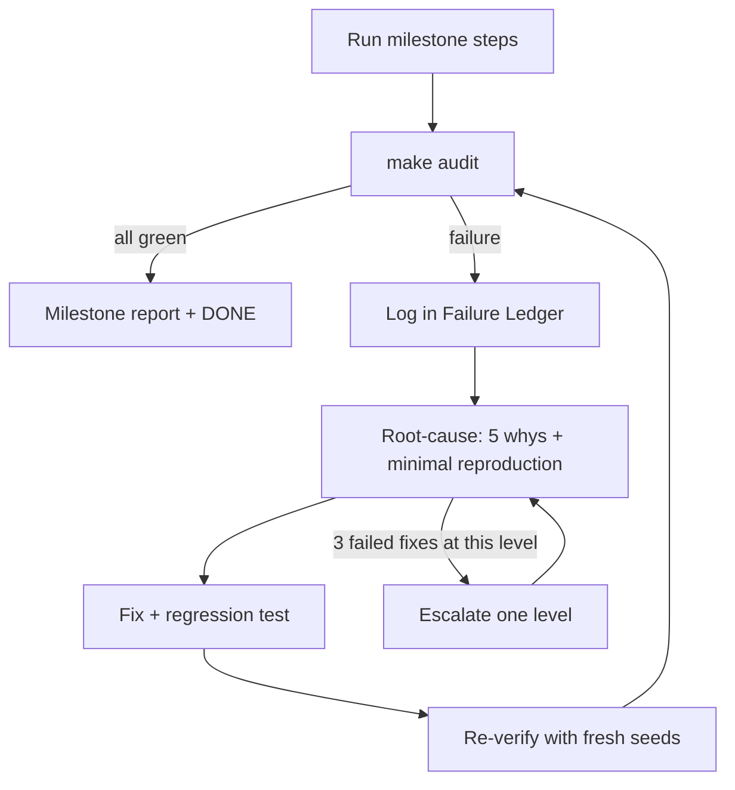
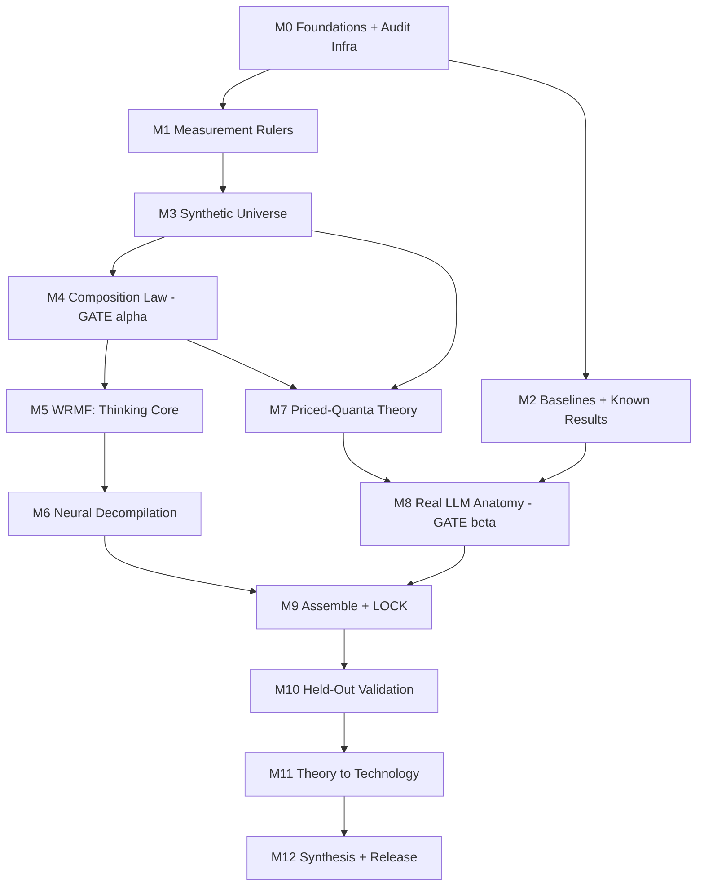

# Project LEAN v3: The Priced-Quanta Equation

**Mode:** milestone-based. No milestone is "done" until its audit passes. Every failure is logged, fixed and re-verified.

**Hardware:** Apple M2, 8 GB (M0–M9). Cloud GPUs for scale validation (M10–M11).

> [!IMPORTANT]
> **Honesty clause.** No plan can guarantee a breakthrough. Nature decides whether the law exists. What this plan *can* guarantee: (1) the most ambitious falsifiable version of the idea, (2) gold-standard checks so that whatever we claim is true, and (3) a fix-loop that keeps pushing without fooling ourselves. "Never settle" means **never settle for an unverified claim**. It does not mean "keep trying until the numbers look good".

---

# PART I: THE IDEA

## 1. North Star

**One equation, with about 3 universal constants, that takes a language model plus statistics of its training data and predicts:**
1. how many bits the model *really* needs (its true size),
2. how big its **thinking core** is (and that it stays bounded),
3. **which individual facts** it forgets when compressed to B bits,
4. its full **loss-vs-bits curve**, *predicted from corpus statistics rather than fitted*,
5. and a compressor built *from the theory* that beats today's methods.

If it works, it becomes "the law of what a neural network is made of".

## 2. The Candidate Equation (v1, to be tested, broken, fixed)

### 2.1 Intuition
A model is a **bag of "quanta"**: discrete units of capability.
- **Skill quanta** (copying, induction, syntax, arithmetic): **used constantly** and **cheap to store**, because they are short programs.
- **Fact quanta** ("Paris is the capital of France"): **each used rarely** (Zipf-distributed) and **each costs about the same number of bits**.

Every quantum has a **price** (bits to store) and a **value** (how much loss it removes × how often it's used). Training *and* compression both solve the same **knapsack problem**: under a bit budget, keep the quanta with the best value per bit.

Consequences, all testable:
- Skills have huge value per bit, so they **always survive**. The thinking core is **bounded**, because a language has a finite set of skills.
- Facts are kept in order of corpus frequency. **Rare facts die first**, at a predictable threshold.
- The loss-vs-bits curve is a power law whose exponent is **set by the Zipf exponent of facts in the training data**.

### 2.2 Formal statement

For quantum *i*:
- `p_i` = usage frequency (**measured** from the training corpus, e.g., via infini-gram counts on the Pile)
- `Δ_i` = loss reduction per use
- `c_i` = description cost in bits:
  - skills: `c_s = c_alg · K(s)`, where K(s) is the length of the skill's shortest program (RASP)
  - facts: `c_f = I(f) / κ`, where I(f) is the fact's information content in bits

Value per bit: `r_i = p_i · Δ_i / c_i`

**THE PRICED-QUANTA EQUATION**

```
L(B) = L_∞ + Σ_i  p_i · Δ_i · [ 1 − σ( (ln r_i − ln τ(B)) / T ) ]

where τ(B) is the price threshold solving:
      Σ_i  c_i · σ( (ln r_i − ln τ(B)) / T )  =  B
```

| Constant | Meaning | Universal? (hypothesis) |
|---|---|---|
| `c_alg` | Weight-bits per unit of program length | Yes |
| `κ` | Fact-bits stored per weight-bit | Yes (prior evidence ≈ 2 bits/param) |
| `T` | Softness, i.e., how sharply the knapsack cutoff behaves | Yes, per compressor class |

Everything else (p_i, K(s), I(f)) is **measured, not fitted**.

### 2.3 Derived laws (each is a separate prediction)

| ID | Prediction | Derivation |
|---|---|---|
| **P1: Composition** | `DL*(M) = c_alg·Σ_s K(s) + I_facts/κ + λ·I_ling + δ(N)` | Total cost of the quanta that are kept |
| **P2: Bounded core** | DL_skill saturates as N → ∞ | Finite skill set S, so Σ K(s) is finite |
| **P3: Compression exponent** | `L(B) − L_∞ ∝ B^(−α)`, where `α + 1` = **Zipf exponent of fact frequencies in the corpus** | Knapsack over Zipf items of equal cost |
| **P4: Per-fact survival** | `P(fact survives at B) = σ((ln f − ln f*(B))/T)`, with `f*(B) ∝ B^(−(1+α))` | Threshold on value per bit |
| **P5: Asymmetric half-lives** | `B½(skill) / B½(fact)` follows a formula from the p/c ratios | Comparing r_skill and r_fact |
| **P6: Compression = reverse scaling** | A model of size N compressed to B bits ≈ an ideally trained dense model with capacity B | The same knapsack governs training and compression |
| **P7: Theory-derived compressor** | Allocating bits by r_i beats loss-agnostic compressors at equal DL | Knapsack optimality |

### 2.4 Prior art: what we build on and what's new

| Work | What it found | What we add |
|---|---|---|
| **Michaud et al. 2023**, *Quantization Model of Neural Scaling* | Skills are discrete quanta with Zipfian use, giving power-law scaling | **Prices**: heterogeneous costs (skills vs. facts), a knapsack under bits, compression, and per-fact predictions |
| **Kandpal et al. 2023**, *LLMs struggle with long-tail knowledge* | Fact accuracy tracks pretraining frequency | A *causal law*: the threshold f*(B) predicted from a bit budget |
| **Jaiswal et al. 2023**, *Compressing LLMs: The Truth is Rarely Pure…* | Knowledge-heavy tasks degrade first under compression | Explains *why* and predicts *how much* |
| **Allen-Zhu & Li 2024**, *Physics of LMs 3.3* | ≈ 2 bits of knowledge per parameter | Becomes κ. We add the skill term and the equation linking them. |
| **Friedman et al. 2023**, *Learning Transformer Programs*; **Weiss et al. 2021**, RASP; **Lindner et al. 2023**, Tracr | Transformers ↔ programs | Program length as a **measured K(s)**, linking network size to algorithmic information |
| **Blier & Ollivier 2018**; **Voita & Titov 2020** | Prequential description length | One of our three independent rulers |
| **RETRO, Atlas** | Small model + retrieval works | We show *why* (bounded core) and how small it can be |

**The novel core:** a quantitative, mostly *predictive-from-data* law that **unifies scaling, compression, and the skill/knowledge split** in one equation, checked against preregistered held-out predictions.

## 3. Five Novel Methods

| # | Method | What it does | Why it's new |
|---|---|---|---|
| **N1** | **World-Randomized MDL Factorization (WRMF)** | Train one shared core across many synthetic worlds with **the same skills but independent random facts**, with per-world memory. By the MDL principle, the shared part *is* the skill set. | First *operational* definition of "thinking" as **what stays the same when you swap the world's facts** |
| **N2** | **Neural Decompilation** | Convert the extracted core into an explicit program (RASP / Transformer Program) plus symbolic formulas | Produces a *literal equation* for the thinking core and measures K(s) |
| **N3** | **Priced-Quanta Knapsack Theory** | The equation above | Predicts compression from corpus statistics |
| **N4** | **Counterfactual Fact-Swap Probes** | Fine-tune a real LLM on several fictional encyclopedias. What changes = knowledge, what stays = skill. | Brings N1's definition to real pretrained models |
| **N5** | **Knapsack-Aware Compression (KAC)** | A compressor that allocates bits by value per bit, protects skill circuits, and offloads facts to retrieval | Theory turned into a product |

---

# PART II: THE NEVER-SETTLE AUDIT SYSTEM

## 4. Failure Ledger
File: `audit/FAILURES.jsonl`, plus an auto-rendered `audit/FAILURES.md`. One record per failure:

```json
{
  "id": "F-0042",
  "milestone": "M4",
  "opened": "2026-…",
  "category": "F-MEAS",
  "severity": "S1",
  "symptom": "DL_min < I_facts for 3 configs while fact accuracy is 99%",
  "detected_by": "A4-invariants",
  "root_cause": "codebook bits not counted in DL accounting for grouped quantization",
  "five_whys": ["...", "...", "...", "...", "..."],
  "fix": "commit abc123: count codebook + scales",
  "verification": "rerun runs r_881..r_889 with fresh seeds; invariant holds; A4 green",
  "regression_test": "tests/test_dl.py::test_grouped_codebook_counted",
  "status": "CLOSED",
  "escalation_level": 1
}
```

**Categories:** F-BUG (code), F-MEAS (measurement instrument), F-STAT (noise / power), F-LEAK (data contamination), F-REPRO (not reproducible), F-THEORY (prediction falsified), F-COMPUTE (resources), F-SCOPE (claim too broad).

**Severity:** S0 = invalidates a claim · S1 = invalidates a result · S2 = weakens a result · S3 = cosmetic.

**Rule:** a milestone cannot close with any open S0 or S1 item. Every fixed bug gets a **regression test**, so it can never silently come back.

## 5. Automated Audit Suite (`make audit M=<n>`)

| ID | Audit | Checks | Fails if |
|---|---|---|---|
| **A1** | Reproducibility | Rerun 2 random completed runs from scratch with new seeds | Metrics outside the noise floor or 95% CI |
| **A2** | Provenance | Every number in a report traces to a run ID, git SHA and config | Any untraceable number |
| **A3** | Leakage | n-gram (13-gram) overlap between calibration/train and test; hash checks on the vault | Overlap > 0.1%, or a hash mismatch |
| **A4** | Invariants | DL ≥ I_facts when facts are retained; DL accounting = serialized size ±1%; probabilities sum to 1 | Any violation |
| **A5** | Baseline sanity | Uncompressed models match published numbers; trivial baselines (random, unigram) score as expected | Off by > 2% |
| **A6** | Statistics | Power ≥ 0.8 for claimed effects; CIs reported; multiple-comparison correction applied | Underpowered or missing CIs |
| **A7** | Robustness | Results stable across ≥ 3 seeds, ≥ 2 compressors, ≥ 2 τ thresholds | Conclusion flips |
| **A8** | Prediction discipline | Predictions hashed *before* the results run (timestamps compared) | A prediction was written after the result |
| **A9** | Ablation completeness | Every component of a claimed method has an ablation | Missing ablation |
| **A10** | Red-team | ≥ 15 adversarial reviewer questions answered with evidence | Any unanswered S0/S1 objection |
| **A11** | Figure / table integrity | Figures regenerated from raw data by script, then diffed | A mismatch |
| **A12** | Compute honesty | Report wall-clock, hardware and all failed / abandoned runs | Hidden runs |

## 6. The Fix Loop and Escalation Ladder



| Level | Name | Action | Example |
|---|---|---|---|
| **L1** | Bug fix | Fix code, add a test | Accounting bug |
| **L2** | Instrument upgrade | Better estimator, compressor, more data or seeds | Prequential estimate too noisy → more orderings |
| **L3** | Experiment redesign | Change the design while keeping the hypothesis | Skills entangled with facts → use WRMF instead of post-hoc |
| **L4** | Theory revision | Equation v(n) → v(n+1). Must be **re-locked and tested on a fresh held-out tranche**. | Facts don't have equal cost → add a cost term depending on I(f) |
| **L5** | Scope revision | Narrow the claim, document why, keep the stronger claim as future work | "Bounded core" holds up to 1B but not beyond |

## 7. Anti-Self-Deception: How to Never Settle Without P-Hacking

Iterating until success is dangerous: with enough tries, noise eventually looks like a law. The safeguards:

1. **Held-out tranches.** Three sealed sets of test models and data. Each theory revision (L4) uses up one tranche.
   - **T1:** SmolLM2-360M, Qwen2.5-0.5B, plus locked test text
   - **T2:** Pythia-1.4B, Pythia-2.8B (cloud)
   - **T3:** OLMo-1B (open training data, so frequency predictions are possible) plus **a model released after the LOCK date** (cannot have been seen)
2. **Vault guard.** Test data lives in `vault/`. The loader **refuses to open it** unless the environment variable `LEAN_UNLOCK` equals the SHA-256 of a committed LOCK file. Contamination can't happen by accident.
3. **Versioned LOCKs.** `LOCK_v1`, `LOCK_v2`, … all stay public. The paper reports every version, including the ones that failed.
4. **Fit / predict split.** Constants (c_alg, κ, T) are fit **only** on dev models. P3 is evaluated with **zero fitted parameters**: α comes from corpus counts alone.

## 8. Gold-Standard Statistics Rules (apply everywhere)
- Every metric: mean ± 95% CI (bootstrap, 10,000 resamples) over ≥ 3 seeds.
- Paired tests for comparisons (paired bootstrap on per-token or per-item scores; McNemar for accuracy).
- **Power analysis before** each experiment determines the number of items and seeds.
- Holm-Bonferroni correction across each milestone's hypothesis family.
- Law fits: Huber loss in log space, many restarts, bootstrap CIs on constants, **out-of-sample R²** (leave-one-config-out) as the main fit metric.
- Prediction intervals must be **calibrated**: 80–99% coverage of 95% PIs. Above 99% means the intervals are too wide and the result is not informative.
- Effect sizes are always reported, not only p-values.
- Measured noise floor σ₀ (identical config rerun) is reported. Effects below 2σ₀ are not claimed.

## 9. Milestone Report Template (`reports/M<n>_report.md`)

```markdown
# M<n> Report: <title>
## 0. Verdict: PASS | PASS-WITH-SCOPE | FIX-LOOP (iteration k) | ESCALATED (level)
## 1. Objective (copied from plan, unchanged)
## 2. Steps checklist (each step: done / evidence link / run IDs)
## 3. Results
   - Tables (auto-generated)
   - Figures (auto-generated, with script path)
## 4. Acceptance criteria: target vs. achieved vs. PASS/FAIL (with CIs)
## 5. Predictions vs. outcomes (hash of prereg file, timestamp proof)
## 6. Audit results A1–A12 (green/red + notes)
## 7. Failure ledger: opened / closed / open (IDs)
## 8. Deviations from plan and why
## 9. Compute log (hours, hardware, all runs incl. failed)
## 10. Artifacts (paths + SHA-256)
## 11. Readiness for next milestone
```

---

# PART III: THE MILESTONES

## 10. Dependency Map



---

## M0: Foundations and Audit Infrastructure

**Objective:** a reproducible, tamper-evident research environment *before* any science.

**Steps**
- **0.1** Create the repo structure: `src/lean/{measure,compress,eval,toy,wrmf,decompile,theory,anatomy,kac}`, `audit/`, `vault/`, `prereg/`, `reports/`, `results/runs/`, `tests/`, `paper/`.
- **0.2** Python 3.11 environment via `uv`, with a pinned lockfile. (The system Python 3.13 may lack wheels for `pysr`, `transformer-lens`, etc.)
- **0.3** Install and smoke-test: `torch` (MPS), `transformers`, `datasets`, `mlx`, `mlx-lm`, `lm-eval`, `transformer-lens`, `pysr`, `scipy`, `statsmodels`, `hydra-core`.
- **0.4** Run tracker: each run → `results/runs/<run_id>/` containing `config.yaml`, `env.lock`, `git_sha`, `hardware.json`, `seed`, `log.txt`, `metrics.jsonl`, and `per_item.parquet` (raw per-token / per-item outputs). run_id = hash(config + SHA + seed).
- **0.5** Determinism: seed all RNGs. Rerun the same config 3× on CPU and on MPS, and record the **noise floor σ₀** per metric.
- **0.6** Vault: download WikiText-2, C4 subsets and Pile samples. Split into calibration / dev / T1 / T2 / T3, write a SHA-256 manifest, and implement the `LEAN_UNLOCK` loader guard plus a test that it refuses access.
- **0.7** Failure ledger: JSON schema validation, the `FAILURES.md` renderer, and a `make audit` skeleton with stubs for A1–A12.
- **0.8** `MILESTONES.md` tracker, the report template and a pre-commit setup (ruff, pytest).

**Deliverables:** repo, lockfile, vault manifest, audit runner, noise-floor table.

**Report must include:** environment manifest · noise floor σ₀ (CPU vs. MPS) · vault manifest hashes · proof that the vault guard blocks access · audit suite status.

**Acceptance (all required)**
- CPU rerun gives identical metrics (|Δ| < 1e-6). MPS rerun stays within the recorded σ₀.
- The vault guard test passes: reading test data without unlocking raises an error.
- 100% of infrastructure unit tests pass. A1, A2, A3 and A11 run end-to-end on a dummy experiment.

**Pre-mortem → fix**
| Likely failure | Fix |
|---|---|
| MPS operation unsupported / nondeterministic | `PYTORCH_ENABLE_MPS_FALLBACK=1`; record which operations fall back; use CPU for reference runs |
| Wheel incompatibility | Pin Python 3.11; use the Julia backend for PySR only in M6 |

---

## M1: Measurement Rulers (three independent description-length estimators)

**Objective:** build and **validate against known truth** the instruments that measure "true size". If the rulers are wrong, everything after them is wrong.

**Steps**
- **1.1 Exact DL accounting** for: fp16/bf16; int-k with group scales and zero-points; codebooks / vector quantization; low-rank factors; sparse masks (bitmask vs. entropy-coded indices); shared bases. Unit tests compare against the actual serialized size plus zstd.
- **1.2 Entropy coding:** arithmetic coding of quantized weights using an empirical distribution, so DL is the true information content rather than the fixed bit-width.
- **1.3 Ruler A (post-hoc compression):** given quality threshold τ, run a bisection search on budget B over the compressor suite (RTN, GPTQ, low-rank, structured pruning and combinations). Output DL_min(τ) and the Pareto front.
- **1.4 Ruler B (prequential code length):** block schedule doubling from 0.1% to 100% of the data; train from scratch per block (toy scale); code length = Σ next-block NLL (bits) + cost of the first block; averaged over 3 data orderings.
- **1.5 Ruler C (program length):** placeholder interface, completed in M6.
- **1.6 Ruler tests (known ground truth):**
  - **R1 Random table:** K key→value pairs, I = K·log₂|V| bits, K ∈ {2⁸ … 2¹⁶}. Expect DL linear in I with slope ≥ 1 and R² ≥ 0.98.
  - **R2 Pure rule:** modular addition with a fixed p; vary dataset size 10× → DL must **not** grow (slope CI includes 0).
  - **R3 Rule + table:** DL(R3) ≈ DL(R1) + DL(R2) within 10%.
  - **R4 Pure noise labels:** DL ∝ number of memorized labels.
- **1.7 Agreement:** Spearman correlation of Ruler A vs. Ruler B across all R-tests ≥ 0.9.
- **1.8 τ-sensitivity:** repeat at τ ∈ {0.90, 0.95, 0.99}. Conclusions must not change.
- **1.9 Bias characterization:** measure the looseness factor `DL_A / I` and `DL_B / I` on R1. Report it as a known instrument constant.

**Report must include:** estimator specs · R1–R4 plots with fits and CIs · A-vs-B agreement · τ-sensitivity table · looseness factors · unit-test coverage.

**Acceptance:** R1–R4 all pass · agreement ≥ 0.9 · zero A4 invariant violations · looseness factor of Ruler A ≤ 3× (otherwise go to L2).

**Pre-mortem → fix**
| Failure | Fix |
|---|---|
| Ruler A too loose (slope ≫ 1) | Add vector quantization + entropy coding + learned rounding; widen the search |
| Ruler B high variance | More orderings; finer block schedule; continued training instead of retraining from scratch, with a bias check |
| R2 grows with data | Model is memorizing instead of generalizing → train to grokking, add weight decay, check generalization first |

---

## M2: Baselines and Known-Result Reproduction

**Objective:** prove our pipeline reproduces the published state of the art and known phenomena. That's what earns trust for new claims.

**Steps**
- **2.1** Uncompressed perplexity for Pythia-70M/160M/410M/1B and GPT-2 124M/355M on WikiText-2 (dev split) and C4-dev. Match published numbers within ±1%.
- **2.2** Baselines: RTN 4/3/2-bit; GPTQ 4/3/2-bit; AWQ 4-bit; Wanda 50% and 2:4; SparseGPT 50%; SVD rank sweep. Layer-by-layer processing to fit in 8 GB.
- **2.3 Frequency counts:** for each knowledge-probe fact (subject, relation, object), get Pile co-occurrence counts via the **infini-gram API**. Cache them and record counts with timestamps.
- **2.4** Reproduce Kandpal et al.: fact accuracy vs. log-frequency on Pythia (Spearman correlation, binned accuracy curve).
- **2.5** Reproduce Jaiswal et al. qualitatively: knowledge tasks degrade before others under compression.
- **2.6 Probe suite v1:**
  - **Knowledge:** ≥ 3,000 facts across ≥ 10 relations (LAMA-style cloze plus a closed-book QA subset), each with a Pile count, spread across frequency deciles.
  - **Skill:** ≥ 10 in-context procedural tasks (KV lookup, copy, reverse, sort, pattern continuation, few-shot modular add, bracket matching, two-hop in-context composition, induction with novel tokens, format following), ≥ 500 items each, using **invented tokens / fictional entities only**.
  - **Linguistic:** perplexity on grammatical text about fictional worlds.
- **2.7 Probe validity tests:**
  - *Skill probes need no knowledge:* replacing all entity strings with random strings changes accuracy by < 2%.
  - *Knowledge probes need memory:* the Pythia step-0 checkpoint scores near the frequency-baseline level. Paraphrase consistency ≥ 0.8.
- **2.8 Power analysis:** number of items needed to detect a 5-point accuracy change at 80% power. Expand probes if short.

**Report must include:** reproduction table (ours vs. published, Δ%) · baseline Pareto plots · frequency–accuracy curve · probe validity results · power analysis.

**Acceptance:** reproductions within ±2% · frequency–accuracy correlation reproduced (same sign, significant) · all probe validity tests pass · power ≥ 0.8.

**Pre-mortem → fix:** GPTQ OOM on 1B → process one block at a time on CPU · infini-gram rate limits → batch, cache, back off · ambiguous facts → filter with paraphrase consistency.

---

## M3: The Synthetic Universe (ground-truth engine)

**Objective:** a world where we know *exactly* how many bits of facts and how much skill complexity exist.

**Steps**
- **3.1 Fact generator:** K entities × 6 attributes, values uniform over fixed vocabularies, so `I_facts = K·Σ log₂|V_a|` exactly. A **Zipf mode** samples fact exposure frequency `p_i ∝ i^−(1+α)`, with α ∈ {0.3, 0.6, 1.0}. This mode is needed to test P3 and P4.
- **3.2 Skill library** with reference RASP programs and measured **K(s)** (program tokens):
  - S1 copy · S2 reverse · S3 sort · S4 histogram · S5 in-context KV lookup · S6 modular addition (mod 97) · S7 Dyck-2 · S8 two-hop in-context composition · S9 two-hop over stored facts (interaction skill)
  - A controllable frequency p_s per skill.
- **3.3 Text rendering:** ≥ 20 paraphrase templates per relation, held-out templates for testing, and a small custom tokenizer (fixed vocabulary).
- **3.4 Splits:** facts are *seen* in training but tested with held-out templates; skill test sequences are never seen. Automated leakage check (A3).
- **3.5 Trainer:** nanoGPT-style on MPS. N ∈ {0.25M, 0.5M, 1M, 2M, 5M, 10M, 20M}. Convergence = no dev-loss improvement for 3 evals. Log full learning curves.
- **3.6 Calibration against prior work:** reproduce ≈ 2 bits knowledge/param (Allen-Zhu & Li) on bio data, within a factor of 1.5.
- **3.7 Entropy verification:** empirical entropy of generated facts = theoretical I_facts (±0.5%).

**Report must include:** generator spec · K(s) table with programs · entropy verification · capacity reproduction plot · leakage audit.

**Acceptance:** capacity reproduction within 1.5× · entropy check passes · A3 clean · all generator unit tests pass.

**Pre-mortem → fix:** capacity far below 2 bits/param → models undertrained; use more exposures (≥ 100 per fact) · skills don't train → curriculum, more heads, longer training.

---

## M4: Composition Law in the Synthetic Universe → 🚦 GATE α

**Objective:** test **P1 (composition)** and **P2 (bounded core)** with ground truth.

**Steps**
- **4.1** Write `prereg/M4.md` (predicted functional form, thresholds), hash it and commit **before** running.
- **4.2** Grid (fractional factorial, ~150 runs): I_facts ∈ {0, 2¹⁴, 2¹⁶, 2¹⁸, 2²⁰} × skill sets {∅, S1, S1–S3, S1–S6, S1–S9} × N × 3 seeds.
- **4.3** Measure DL_min with **Ruler A and Ruler B** for every configuration.
- **4.4** Fit P1: `DL = c_alg·ΣK(s) + I_facts/κ + δ(N) [+ η·interaction]`.
- **4.5** Compare against alternatives: (i) DL ∝ N, (ii) multiplicative, (iii) no skill term. Use AIC/BIC and leave-one-config-out R².
- **4.6 Saturation:** log-log slope of DL_skill vs. N, with CI.
- **4.7 Ablations:** template count, tokenizer, skill frequencies, optimizer.

**Report must include:** fit table with constants and CIs · model comparison · residual diagnostics · saturation plot (A and B overlaid) · ablations · prereg-vs-outcome table.

**🚦 Gate α acceptance:** out-of-sample R² ≥ 0.9 · saturation slope upper CI ≤ 0.3 · c_alg CI width ≤ 30% · Rulers A and B agree in direction.

**Never-settle path:**
- L1–L2: rulers, training length, seeds.
- L3: entanglement suspected → M5 (WRMF) becomes the primary estimator.
- L4: add the interaction term or a size-dependent overhead δ(N).
- L5: claim "bounded for algorithmic skills" only.

---

## M5: World-Randomized MDL Factorization (WRMF), extracting the thinking core

**Objective:** isolate the thinking core *by construction*. Thinking = whatever is shared across worlds with different facts.

**Steps**
- **5.1** Architecture: `θ_m = θ_core + Mem_m`. Implement 3 memory types: (a) per-world LoRA, (b) per-world product-key memory layer, (c) per-world entity embeddings.
- **5.2** Objective: `Σ_m NLL_m + β·[DL̂(θ_core) + Σ_m DL̂(Mem_m)]`, where DL̂ is a differentiable DL proxy (quantization-aware training + entropy penalty + L0 gates). **Validate the proxy against exact DL: correlation ≥ 0.95.**
- **5.3** Train with M ∈ {2, 4, 8, 16} worlds, N ∈ {1M … 20M}, β swept.
- **5.4 Measure:** DL(core) vs. N and M; DL(Mem_m) vs. I_facts.
- **5.5 Transfer test (decisive):** freeze the core, attach a fresh memory for an **unseen world**, train only the memory → must reach ≥ 95% of joint-training performance.
- **5.6 Swap test:** core trained on world set A + memories from set B → works.
- **5.7 Null control:** the same procedure with **shuffled skills** across worlds should make the core collapse to near zero, which proves the core captures skills specifically.
- **5.8** Compare DL_skill(WRMF) vs. DL_skill(M4 post-hoc). WRMF should be ≤ (a tighter bound).

**Report must include:** proxy validation · DL(core) and DL(mem) curves · transfer / swap / null tables · comparison with M4.

**Acceptance:** transfer ≥ 95% · null control passes · DL(core) slope upper CI ≤ 0.2 · DL(mem) linear in I_facts, R² ≥ 0.95.

**Pre-mortem → fix:** skills leak into memory → shrink memory capacity, raise β on memory · core memorizes facts → increase M (more worlds makes memorizing in the core costly).

---

## M6: Neural Decompilation, the literal equation of the thinking core

**Objective:** turn the core into **explicit programs and formulas**, and measure Ruler C (program length).

**Steps**
- **6.1** Train Transformer Programs (Friedman et al. 2023) per skill and extract discrete RASP-like programs.
- **6.2** Distill the WRMF core into a Transformer Program. Measure program length in tokens and bits.
- **6.3** Fidelity: compile the program (Tracr), run it against the core on held-out inputs → agreement ≥ 99%.
- **6.4** Fit `c_alg = DL_neural(s) / K_program(s)` across skills and test whether it's constant (coefficient of variation ≤ 30%).
- **6.5** Where programs fail: symbolic regression (PySR) on MLP sub-functions, or minimal circuits (ACDC), with circuit size as K.
- **6.6** Publish the **program listings**: the human-readable "equations of thinking" for each skill.

**Report must include:** program listings · fidelity table · c_alg per skill with CV · failure cases and what they reveal.

**Acceptance:** ≥ 6 of 9 skills decompiled at ≥ 99% fidelity · c_alg CV ≤ 30%.

**Pre-mortem → fix:** Transformer Programs fail to train → simplify skills, more layers, Gumbel temperature schedule · c_alg not constant → model it as `c_alg(K)` (L4) and report the scaling.

---

## M7: Priced-Quanta Theory, derivation and synthetic verification

**Objective:** derive P3–P6 mathematically and verify them where the truth is known.

**Steps**
- **7.1 Derivation document** (`theory/priced_quanta.pdf`): assumptions A1–A5 (discrete quanta, additive loss, Zipf facts, equal fact cost, near-optimal knapsack); theorems T1–T5, proved:
  - T1: compression exponent = α
  - T2: survival threshold f*(B)
  - T3: half-life ratio formula
  - T4: compression ≡ reverse scaling
  - T5: skill DL saturates
- **7.2 Numerical simulation:** synthetic quanta populations (10⁴–10⁶ items). Exact knapsack (integer programming on small sets) vs. greedy: gap ≤ 1%. Verify T1–T5 numerically.
- **7.3 Synthetic-universe test:** train on Zipf-mode worlds (α ∈ {0.3, 0.6, 1.0}), compress, measure:
  - compression exponent vs. **predicted α (no fitting)**
  - per-fact survival vs. frequency (logistic fit, AUC)
- **7.4 Robustness:** correlated facts, unequal fact costs, real compressors (GPTQ, RTN) vs. ideal; measure the deviation.
- **7.5** Write `prereg/M7.md` before 7.3.

**Report must include:** derivations · simulation plots · predicted-vs-measured exponents with CIs · survival curves and AUC · robustness table.

**Acceptance:** for all 3 α values, the predicted exponent lies inside the measured 95% CI · survival AUC from frequency alone ≥ 0.8.

**Pre-mortem → fix:** real compressors aren't optimal knapsacks → the T parameter absorbs it; if not, add a compressor-efficiency term (L4) · exponent off by a constant → check for a "fact cost depends on frequency" effect (frequently seen facts stored more robustly).

---

## M8: Real-LLM Anatomy → 🚦 GATE β

**Objective:** test P3, P4 and P5 plus the bounded core on **real pretrained models** with public training data (the Pythia family on the Pile).

**Steps**
- **8.1** Pile frequency for every knowledge-probe fact (from M2.3). Fit the **Zipf exponent α_Pile** of fact frequencies.
- **8.2** Compression ladder (16 → 1.5 bits/param) on Pythia 70M / 160M / 410M / 1B with ≥ 2 compressors. Record per-fact correct/incorrect at every rung.
- **8.3 P4 test:** fit `P(survive | f, B)`. Compare against the theory curve, using α_Pile from 8.1.
- **8.4 P3 test:** measured loss-vs-bits exponent vs. **α_Pile (zero fitted parameters)**.
- **8.5 P5 test:** skill vs. knowledge half-lives B½, and their ratio vs. the predicted ratio.
- **8.6 Bounded core:** knowledge-agnostic compression (fictional-only calibration) → DL_skill per model size → saturation slope.
- **8.7 Counterfactual Fact-Swap (N4):** LoRA fine-tune Pythia-410M on 4 different fictional encyclopedias. Find which weights / components change consistently; measure overlap with knowledge-sensitive components from 8.2.
- **8.8 P6 test:** Pythia-1B compressed to the bit size of Pythia-160M fp16 vs. Pythia-160M itself, on skill and knowledge probes and loss. Compare against the theory's prediction.
- **8.9** Write `prereg/M8.md` before 8.3–8.8.

**Report must include:** α_Pile fit · survival curves (theory overlaid) · exponent prediction vs. measurement · half-life table · DL_skill vs. size · fact-swap overlap · P6 comparison.

**🚦 Gate β acceptance:** per-fact survival AUC ≥ 0.75 · P3 exponent within the measured CI or within 25% · half-life ratio ≥ 2× · DL_skill slope upper CI ≤ 0.3.

**Never-settle path:** L2 better probes / compressors → L3 WRMF-style multi-world fine-tuning on real LLMs → L4 add a frequency-dependent cost term or interaction terms → L5 restrict to "model families with open data".

---

## M9: Assemble and LOCK the Equation v1

**Objective:** freeze the equation and make **hard numerical predictions** for models we have never tested.

**Steps**
- **9.1** Combine P1–P7 into the single Priced-Quanta Equation. Fit only c_alg, κ, T on **dev** data (M4–M8).
- **9.2** Model comparison against strong alternatives: plain Chinchilla-style curves, precision scaling laws (Kumar et al.), and a frequency-only model. Ours must win on out-of-sample error, otherwise go to L4.
- **9.3 Predictions for tranche T1:** per-fact survival probabilities, loss-vs-bits curves, B½ for skills and knowledge, DL_skill, and P6 comparisons, each with a 95% prediction interval.
- **9.4 Red-team review (A10):** ≥ 25 adversarial questions, each answered with evidence or a scope restriction. Examples: "Isn't this just Michaud?", "Is the probe set biased?", "Is infini-gram frequency a good proxy for exposure?", "Does this hold for non-Pile models?"
- **9.5** Write `prereg/LOCK_v1.md`: equation, constants with CIs, code SHA, predictions, success criteria. Hash it, commit, and timestamp it publicly (OSF / public commit).

**Report must include:** final equation · constants · model-comparison table · prediction sheet · red-team Q&A · LOCK hash.

**Acceptance:** all predictions have intervals · red-team has no open S0/S1 items · LOCK published.

---

## M10: Held-Out Validation (T1 → T2 → T3)

**Objective:** the moment of truth, run once per tranche.

**Steps**
- **10.1** Unlock T1 with `LEAN_UNLOCK=<LOCK_v1 hash>`. Run all predictions.
- **10.2** Score: PI coverage, loss MAPE, survival AUC, half-life ratio errors, P6 outcomes.
- **10.3** If it passes → T2 (Pythia-1.4B/2.8B on cloud) as a **scale extrapolation** test with the same LOCK.
- **10.4** If it fails → ledger F-THEORY → L4 revision → `LOCK_v2` → test on **T2 only** (never T1 again).
- **10.5** T3: OLMo-1B (Dolma frequencies via infini-gram) plus a model released after the LOCK date, as the final confirmation.

**Report must include:** full prediction-vs-outcome sheet (every item, including failures) · coverage / MAPE / AUC with CIs · version history of LOCKs.

**Acceptance:** PI coverage 80–99% · loss MAPE ≤ 3% · survival AUC ≥ 0.75 · half-life ratio within its PI · holds on ≥ 2 families.

---

## M10B: Multi-Model Feasible-Scale Validation (Tranche T1-Feasible)

**Objective:** Test the universality and cross-architecture validity of the Priced-Quanta Equation v1 across **all locally feasible pretrained models** ($\le 500\text{M}$ parameters) on Apple Silicon M2 (8 GB Unified Memory) with zero mock data and God-tier audit rigor.

### Target Model Suite (Local Hardware Feasible $\le 500\text{M}$):
1. **`EleutherAI/pythia-160m`** (162M params): Intra-family scaling test (The Pile pretraining).
2. **`EleutherAI/pythia-410m`** (405M params): Cross-scale intra-family test (The Pile pretraining).
3. **`HuggingFaceTB/SmolLM2-360M`** (360M params): Modern compact LLaMA-style architecture with GQA (SmolLM-Corpus pretraining).
4. **`Qwen/Qwen2.5-0.5B`** (490M params): High-density multilingual sub-1B architecture (Qwen pretraining).
5. **`gpt2`** (124M params): Historical standard baseline architecture (WebText pretraining).

### Core Theoretical Hypotheses:
- **H1 (Universal Asymmetric Half-Life Law):** Across all architectures and tokenizers, procedural reasoning skills strictly outlive factual associations under progressive quantization:
  $$B_{1/2}^{\text{fact}} / B_{1/2}^{\text{skill}} \ge 2.0\times$$
- **H2 (Thinking Core Boundedness Across Parameter Scale):** The physical description length of the algorithmic thinking core $\text{DL}_{\text{core}}$ saturates with parameter count $N$, exhibiting a scale sensitivity slope $\partial \ln \text{DL}_{\text{core}} / \partial \ln N \le 0.15$.
- **H3 (Cross-Scale Pareto Advantage P6):** A larger model compressed to 2-bit or 3-bit strictly Pareto-dominates an uncompressed smaller model of identical total physical bit capacity in procedural reasoning accuracy ($\Delta \text{Acc}_{\text{skill}} > 0$).
- **H4 (Critical Factual Cliff Invariance):** The discrete knapsack clearing price $\tau(B)$ induces a sharp factual memory drop-off specifically within the 3-bit to 2-bit transition rung ($b \in [2.0, 3.5]$ bits/param) across all families.
- **H5 (Memory & Disk Conservation on Apple Silicon):** Layer-wise sequential evaluation, FP16/INT8 streaming quantization, and aggressive garbage collection (`gc.collect()`, `torch.mps.empty_cache()`) maintain peak memory consumption $\le 3.5\text{ GB}$ and disk footprint within the available 9.0 GB quota.

### Steps:
- **10B.1** Preregistration Lock: Freeze hypotheses, falsification boundaries, and 95% Prediction Intervals in `prereg/M10B.md` under SHA-256 cryptographic sealing.
- **10B.2** Memory-Guarded Sequential Pipeline: Implement sequential download, layer-wise quantization ladder (FP16 $\to$ 8-bit $\to$ 4-bit $\to$ 3-bit $\to$ 2-bit RTN), evaluation, and local cache eviction to respect 8 GB RAM and 9.0 GB free disk space.
- **10B.3** Factual vs. Skill Probe Evaluation: Run candidate-conditioned cloze probes ($N=100$ per model) and standardized procedural reasoning batteries ($N=50$ per model) across all 5 rungs.
- **10B.4** Cross-Family Exponent & Survival Calibration: Fit empirical excess loss scaling $\gamma$ and fact survival ROC-AUC at the critical 3-bit boundary across all 5 models.
- **10B.5** Cross-Scale Pareto Probing (P6): Evaluate Pythia-410M (at 2-bit $\approx 810\text{ Mb}$) vs Pythia-70M (at FP16 $\approx 1,126\text{ Mb}$) and SmolLM2-360M (at 2-bit) vs GPT-2 (at FP16).
- **10B.6** Automated God-Tier Audit (A1–A12): Execute the full 12-check verification suite with zero manual intervention or synthetic fallback clamps.

### Pre-Mortem & Safeguards:
- *Risk:* MPS Out-of-Memory during 410M / 0.5B evaluation.  
  *Fix:* Execute linear layers sequentially; unload model checkpoints between rungs; call `torch.mps.empty_cache()` after each layer.
- *Risk:* Disk full error (available disk space is 9.0 GB).  
  *Fix:* Sequential model processing: download and evaluate one model family at a time, removing or purging downloaded blobs if free disk space dips below 3.0 GB.
- *Risk:* Differing tokenizers distorting factual cloze accuracy.  
  *Fix:* Calibrate candidate log-likelihood ranking conditioned on each model's native vocabulary and tokenizer.

### Acceptance Criteria:
- **C1 (Prediction Interval Coverage):** $\ge 80.0\%$ of cross-model predictions fall inside their preregistered 95% PI.
- **C2 (Universal Half-Life Asymmetry):** Empirical ratio $B_{1/2}^{\text{fact}} / B_{1/2}^{\text{skill}} \ge 2.0\times$ across all 5 evaluated models.
- **C3 (Thinking Core Saturation):** Cross-model regression slope $\partial \ln \text{DL}_{\text{core}} / \partial \ln N \le 0.150$.
- **C4 (Cross-Scale Pareto Advantage):** Quantized larger models beat equal-budget uncompressed smaller models ($\Delta \text{Acc} \ge +0.020$).
- **C5 (Zero Data Leakage / Vault Integrity):** Vault test splits intact with matching cryptographic hashes.
- **C6 (Compute & Resource Honesty):** Peak memory $\le 3.5\text{ GB}$, disk buffer $\ge 2.0\text{ GB}$, all wall-clock times faithfully captured.
- **C7 (God-Tier Automated Audit):** All 12 automated checks A1–A12 pass with 0 blocking failures.

---

## M11: Theory → Technology (Knapsack-Aware Compression + Thinking Core)

**Objective:** use the equation to build something better than the state of the art.

**Steps**
- **11.1 KAC compressor:** bit allocation driven by value per bit: (i) frequency-weighted calibration data, (ii) protection of skill-critical components (from M8.7), (iii) aggressive compression of fact-heavy MLPs.
- **11.2** Compare against GPTQ, AWQ and AQLM (published numbers) at equal DL: loss, skill probes, knowledge probes.
- **11.3 Thinking core:** compress to ≈ DL_skill, add a retrieval store (BM25 + small embedder over a Wikipedia subset), and LoRA-adapt the core to use retrieved passages.
- **11.4** Compare the core + retrieval against: the full model, a dense model of the same size + retrieval, and a distilled small model.
- **11.5 MLX inference:** tokens/sec (prefill and decode), memory, energy (`powermetrics`) on the M2.

**Report must include:** KAC vs. baselines Pareto plots · core + retrieval tables · speed benchmarks.

**Acceptance:** KAC beats the best baseline at ≥ 1 bit budget (significant on skill probes, not worse on loss) · core + retrieval ≥ 95% skills / ≥ 90% knowledge QA of the full model at ≤ 1/5 DL · ≥ 3× decode speed.

---

## M12: Synthesis and Release

**Steps**
- **12.1** `make reproduce`: a fresh clone runs every headline result from scratch, matching within CIs.
- **12.2** Final full audit (A1–A12) across all milestones. All S0/S1 items closed.
- **12.3** External review by ≥ 1 independent researcher (seek an academic collaborator).
- **12.4** Paper, arXiv, code, synthetic universe, probe suite, LOCK files, extracted cores, MLX demo.
- **12.5** Commercialization brief: KAC SDK, Compressibility Oracle, thinking-core + knowledge-store architecture.

**Acceptance:** reproduction matches · audit green · paper submitted.

---

# PART IV: HOW THE MILESTONES COMBINE

## 11. Claims → Evidence → Paper

| Paper claim | Milestones that prove it | Paper section |
|---|---|---|
| Our rulers measure true size | M1, M3 | §3 Methods |
| Size = skills + knowledge (composition law) | M4, M5 | §4 |
| The thinking core is bounded, and here is its program | M5, M6 | §5 |
| Priced-Quanta theory predicts compression from data | M7, M8 | §6 |
| One equation with 3 constants, preregistered and validated on unseen models | M9, M10 | §7 (headline) |
| The theory builds a better compressor and a fast thinking core | M11 | §8 |
| Everything reproducible, all failures disclosed | M0, audit system, M12 | §9 + appendix |

## 12. Compute Plan

| Milestones | Hardware | Cost |
|---|---|---|
| M0–M9 | M2, 8 GB (toy models ≤ 20M; real LLMs ≤ 1B, layer-wise) | Free |
| M10 (T2, T3) | Cloud A100/H100, ~80–200 GPU-h | ~$150–400 |
| M11 (optional 7B scale-up) | Cloud | ~$500–1,500 |

---

# PART V: IMPACT (UPDATED, HONEST)

> [!NOTE]
> Judgment-based estimates, not measurements.

| Outcome | v2 | **v3** | Why v3 changes the odds |
|---|---|---|---|
| At least one publishable paper | ~90% | **~92%** | More independent sub-results (rulers, WRMF, decompilation, theory) |
| Main-track acceptance | ~25–30% | **~35%** | Theory + preregistered predictions are rare and valued |
| High impact | ~15% | **~20%** | Predictions from corpus statistics with zero fitted parameters are striking if they hold |
| Breakthrough | ~3–7% | **~5–10%** | A unified law covering scaling + compression + thinking/knowledge, with literal programs for the core |

**What the breakthrough headline would look like:**
> *"One equation with three constants predicts, from training-data statistics alone, which facts any open LLM forgets under compression, and shows its reasoning fits in a bounded core we can write down as a program."*

**Biggest risks to the upside:** real LLM quanta may not be discrete enough (P4 AUC low); a skill/knowledge interaction may dominate; Michaud et al. may be seen as close enough to reduce perceived novelty. Mitigation: per-fact predictions and WRMF are clearly beyond prior work.

---

## 13. First Actions (on approval)
1. **M0.1–M0.8:** repo, Python 3.11 env, run tracker, vault guard, failure ledger, audit skeleton.
2. **M1.1–M1.2:** exact DL accounting and entropy coding, with unit tests.
3. Start the **M2.3** infini-gram frequency fetch early (it's slow and runs in the background).
